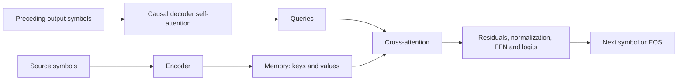

# Architecture assessment: what the evidence means

[Learned global relay](../topics/attention/global-retrieval-results.md), executed and closed: nine matched6000-update full/local/global runs. Every arm passes eligible training/validation/test17 gates. Global test21 distant accuracy is100%/100%/83.33% across seeds; the all-seed reliability and combined dependence criteria fail. Removing global edges reduces distant accuracy to1/6 in every test cell. All48 native/ablated evaluations and80,640 predictions pass independent audit with zero argmax changes. Useful relay and a remaining transfer gap coexist; cause unisolated. No tuning or automatic extension selected.

[Global-token audit](../topics/attention/global-attention-results.md), executed and closed:96 Q/K/V numerical cases,96 reach cases and64 counts pass. Bidirectional global connections give two-layer all-pairs paths. Causal global routes require source<=global<=query; a first global token cannot summarize later inputs. An intentionally unmasked global query leaks future information to an earlier ordinary query after two layers; the correct mask prevents it. Shared Q/K/V only, no training or speed claim. No automatic extension selected.

[Learned local retrieval](../topics/attention/window-retrieval-results.md), executed and closed: three matched full/local pairs,4544 parameters,6000 updates and360,000 examples each. Every seed scores100% at distances1/3/4 across training, validation and length9/13 tests. Full attention also scores100% at5/8; local scores exactly1/6 with invariant six-answer-family logits. All24 pools and40,320 predictions pass independent audit with zero argmax changes. Local relay is learned for this task; the longer test preserves relay distances. Dense masking gives no sparse-speed claim. No tuning or automatic extension selected.

Latest component finding: [sliding-window attention](../topics/attention/sliding-window-results.md) passes48 output/gradient comparisons,18 structural reach checks and40 pair counts. Restricting visible keys changes the function; explicit local computation matches dense masking of the same pattern. Depth expands possible reach, while actual learned use and execution savings remain unmeasured. [Educational guide](../topics/attention/sliding-window-guide.md). Study closed.

Latest task-level conclusion: [six-task consolidation](capability-summary.md) includes four architecture comparisons, GPU fitting and an encoder-decoder copy baseline. State tracking favors its GRU package; retrieval and word prediction favor their Transformer packages. Graph lookup remains incompletely fitted. [Copying](../topics/benchmarks/encoder-decoder-copy-results.md) reaches100% training exactness but fails held-out reliability and long copying. The [stopping diagnostic](../topics/benchmarks/copy-stopping-results.md) shows that blocking early EOS does not restore correct long content. These different tasks and recipes establish no overall architecture ranking, causal mechanism or novel solution. All declared studies are closed.

## Encoder-decoder: what is now established

The encoder builds source representations, called memory. The decoder combines its preceding output symbols with that memory to predict the next symbol. In cross-attention, decoder states supply Q and encoder memory supplies K/V. This gives each output position access to source information; learning the correct selection remains a separate question. This structure follows [Vaswani et al., sections3.1-3.2.3](https://arxiv.org/html/1706.03762v7).

For one head, `A = softmax(QK^T / sqrt(d_k) + mask)` and `head = AV`. Its score matrix has output-prefix positions as rows and source positions as columns. The source can be fully visible while future decoder symbols remain hidden by a different mask.

| Evidence | Finding | Boundary |
|---|---|---|
| [Cross-attention audit](../topics/attention/cross-attention-results.md),36 cases | Equations, gradients and masking controls pass | Supplied memory and a causal assembly; no learned generation |
| [Complete model audit](../topics/foundations/encoder-decoder-results.md),18 cases | Layer/loss equations and gradients pass;135 identical-prefix comparisons agree | One initialized encoder/decoder layer, CPU float64 |
| [Copy learning](../topics/benchmarks/encoder-decoder-copy-results.md),three seeds | Training full exact100%; test3/4 means96.88%/90.63%; test6/8 both0% | Validation reliability fails despite perfect training fit |
| [EOS intervention](../topics/benchmarks/copy-stopping-results.md),same checkpoints | Six-symbol content/full exact1.56%/0.52%; eight-symbol both0% | Correct length is supplied; opened pools are reused diagnostic evidence |

**Why the diagnostic matters:** EOS marks the end of an output. Blocking it forces continued generation, but does not supply the next correct symbol. Even with correct preceding symbols, six-symbol next-token accuracy falls from84.64% at position4 to1.04% at position5. Eight-symbol inputs also fail earlier. A stopping-only repair is therefore insufficient in these models.

**What remains unknown:** why the content fails, which representations or training factors account for it, and whether another recipe transfers reliably. The position5 drop aligns with training on at most four content symbols, but does not prove a learned length rule. Attention access alone does not establish a learned copying algorithm.

This branch is closed. The synthesis adds no training replications. Preserve the implementation checks, perfect training fit and failed reliability criteria together. Future work needs a distinct decision and frozen scope; these failures do not initiate another copying-tuning cycle.

Latest constraint comparison: [input/output weight tying](../topics/embeddings/weight-tying-results.md). Sharing removes 532,448 parameters (49.82%) but worsens mean validation PPL 6.41%, failing the allowed 5% loss; every pair loses quality. Reused test worsens 7.12%. Six runs and 2,779,278 independent loss checks pass, with one argmax difference. Both controls have matching initial functions but change the earlier embedding initialization. The gradient sum is verified; this specific parameter/quality tradeoff fails. Original recipe retained, study closed without tuning. [Short learning guide](../topics/embeddings/weight-tying-guide.md).

Latest transfer comparison: [gain-only LayerNorm versus RMSNorm on WikiText-2](../topics/normalization/wikitext2-norm-results.md), with attention/RoPE/ReLU/FFN32 fixed. RMS improves every validation pair; mean PPL395.48 to389.17 (1.60%). The predefined2% adoption margin fails, despite a positive gain. Reused test improves1.34%. All six runs and2,779,278 independent token-loss checks pass. Both controls omit the original80 normalization bias parameters; no automatic recipe change, convergence or speed claim follows. Study closed. [Short educational guide](../topics/normalization/wikitext2-norm-guide.md); [FFN consolidation](ffn-assessment.md).

Latest FFN comparison: [SwiGLU versus ReLU](../topics/ffn/swiglu-results.md) is closed under [Decision0004](../decisions/0004-swiglu-matched-ffn.md). Bias-free widths22/33 match FFN projection weights/MACs. All six runs and 2,779,278 independently recomputed validation/test token losses pass, with zero argmax differences. SwiGLU worsens geometric mean validation PPL 392.25 to 400.10 (2.00%); every pair loses and adoption fails. Reused test PPL worsens1.83%. [The guide](../topics/ffn/swiglu-guide.md) explains negative/amplifying gates and both gradient paths. This does not establish universal inferiority or explain the losses. Retain the original recipe; no sweep selected.

Previous external attention comparison: [WikiText-2 with matched MHA/MQA](../topics/benchmarks/wikitext2-results.md) is closed under [frozen decision0003](../decisions/0003-wikitext2-matched-baseline.md). Six runs and independent checks of 1,473,408 test-token losses pass. MQA meets the quality/resource rule while losing quality in every seed: geometric mean perplexity 357.92 to 364.95, 1.96% worse. Potential compact K/V payload halves; total parameters fall only 0.051%. Convergence, speed and general superiority remain unproven.

Previous task-transfer check: [majority aggregation](../topics/benchmarks/majority-transfer-results.md). The fixed recipe scores100% across five seeds at9/11/15 bits, but seed1627 reaches86.25% at21 bits and62.84% on one-bit majorities. All20 independent evaluations pass; the reliability rule fails. Aggregation works within a bounded range, while reliable extrapolation remains unsupported. The external comparison above does not erase this failure.

Previous decision: [LN/RMS training](../topics/normalization/rmsnorm-training-results.md) improves RMS mean six-pair unique accuracy by2.34pp but fails its reliability/adoption rule. All30 independent evaluations pass. Retain centered normalization as the baseline while preserving weak seeds and gains. [Normalization is closed](normalization-assessment.md); [recipe choices and task boundary](recipe-assessment.md) are consolidated.

Latest mathematical finding: [LayerNorm versus RMSNorm](../topics/normalization/rmsnorm-math-results.md). Removing centering changes the function and Jacobian. Equal outputs on centered inputs can have different gradients; a residual skip can still carry offsets that LayerNorm removes from its branch. All68 cases and the Decimal audit pass. This does not select a normalization for training. Mathematical study closed.

Latest numerical finding: [cache precision](../topics/attention/cache-precision-results.md). Cache rounding alone changes some answers with weights/architecture fixed: FP16 changes1 and INT8 K/V9 final decisions on the reused subset; FP32 changes none. All180 cells pass the independent audit. This establishes a storage approximation tradeoff, not an architectural improvement or GPU result. Study closed.

Latest execution comparison: [MQA GPU cached decoding](../topics/attention/mqa-decoding-results.md). All36 numerical checks and the independent audit pass. Compact cache halves; none of six shapes passes the repeatable 10% speedup rule across three processes. Smaller storage alone does not establish faster execution. This leaves the separate trained quality/resource acceptance intact. Study closed.

Latest trained comparison: [MHA versus MQA](../mqa-training-results.md). Five paired seeds pass the fixed resource/quality rule: compact K/V payload halves and parameters fall 10.69%. Six-pair mean unique accuracy falls 94.73% to 94.05%; worst seed loss is 4.111pp. Every MQA query-type score stays above90%. All30 independent evaluations pass. Accept MQA for this recipe/tolerance, with measured losses retained. Comparison closed.

Latest mathematical probe: [shared KV heads](../shared-kv-results.md). Four-head payload is 80/40/20 KiB for MHA/GQA/MQA at fixed dimensions. Already-shared controls match; mean pooling different heads changes outputs. Shared keys constrain joint log odds within each group. All four probes and the 1,969-scalar independent audit pass. This establishes scoped arithmetic properties, not trained quality or latency. Study closed.

Previous implementation check: [KV-cache equivalence](../topics/attention/kv-cache-results.md). All 120 cases and the independent audit pass; maximum cached/full logit error is 4.75e-14. Reset-position and omitted-entry controls are detected in every case. This verifies inference correctness and K/V payload under the fixed conditions; speed and model quality were not compared. Study closed; no automatic follow-up selected.

Previous comparison: [broader training queries](../topics/training/query-exposure-results.md). With architecture and context streams fixed, unique-key mean accuracy rises 74.32% to 99.89% at four pairs and 59.53% to 94.83% at six. Every paired seed improves. One six-pair seed scores 87.77%, failing the fixed all-seed reliability rule. All 30 independent evaluations pass. This supports a training-coverage benefit, not an architecture change. Comparison closed.

Previous diagnostic: [fixed-context query switching](../topics/training/query-switch-results.md). Five saved models achieve81.59% mean on previously untrained unique-key queries; only two seeds reach90%. The models are not completely query-blind on these inputs, but reliable transfer fails. All predictions checked against independent attention; no retraining. Diagnostic closed.

**Our strongest practical finding is fragile retrieval on longer inputs. We have not established that insufficient head width, softmax dilution alone, or missing value information is its cause.** The recent mathematical probes explain possible limits; they do not diagnose every trained-model error.

## The computation in one line

`Q,K -> scores -> softmax weights A -> weighted values AV -> output projection + residual -> FFN/readout`

Q/K determine where information is gathered. V determines what is gathered. Later operations determine the prediction. Changing one stage can help without identifying the original cause of failure.

## Findings and boundaries

| Evidence | What we learned | What does not follow |
|---|---|---|
| [Native GPU forward/backward](../topics/attention/native-backward-results.md) | Faster implementations preserve tested outputs and gradients within tolerance. | A better architecture or better learning. |
| [Score-gap mathematics](../topics/attention/attention-competition-results.md) | With equal distractor scores, `p_target=1/(1+m*exp(-gap))`. More competitors dilute mass at a fixed gap. | Every long-context error is dilution; low target mass always corrupts output. |
| [Trained weight interventions](../topics/attention/trained-competition-results.md) | Mean accuracy: original 64.24%, fixed sharpening 63.01%, oracle target-directed weights 99.75%, with V fixed. | Sharpening is a repair, the oracle is deployable, or values are universally correct. |
| [Head-width constraint](../topics/attention/head-width-results.md) | Q/K width bounds log-odds rank, not probability-matrix rank. Some patterns need wider heads. | Our task requires those patterns or wider heads would improve it. |
| [Output capacity](../topics/attention/output-capacity-results.md) | Different A can give identical AV. If `[V,1]` has full row rank, output uniquely identifies A. | Matching every attention weight is always necessary for the task. |
| [Causal extension](../topics/attention/causal-width-results.md) | Width constraints survive on jointly visible keys. | A complete characterization of causal attention or an across-input learned solution. |
| [Broader training exposure](../topics/training/length-exposure-results.md) | Six-pair mean improves 58.11% to 81.65%; four of five seeds still miss 90%. | Reliable length transfer or an architectural improvement. |

These studies use different cohorts. Their percentages are not competing scores on one shared benchmark. Mathematical witnesses, trained interventions and GPU measurements answer different questions.

## Which limitation matters to our task?

**Observed:** long-sequence reliability is inadequate. Training exposure helps but does not close the gap. In an older diagnostic cohort, replacing attention weights while retaining V rescues many errors.

**Supported interpretation:** how information is selected is a useful intervention point. In that cohort, 1,744 of 1,831 errors lack a top-ranked target in at least one head. Stronger existing preferences can reinforce the wrong selection. Both heads need not select the target for a correct answer, so this count is descriptive rather than a mechanism proof.

**Before the positional comparison, unresolved:** whether poor selection comes mainly from positional representation, learned Q/K features, optimization, or their interaction. We have not shown that representational capacity is exhausted. Exact pattern impossibility is not itself evidence of a practical bottleneck.

## Positional comparison: rationale and outcome

**Can changing the positional representation improve long-sequence retrieval without knowing the target location?** Earlier [layout interventions](../topics/positions/layout-results.md) make this a justified question. They do not predict which design will win.

The next step is one predeclared comparison of the existing positional design with one established alternative, after checking its original paper and compatibility. Keep the task, model dimensions, optimizer and training exposure fixed; report any parameter/compute differences. Use fresh reserved mappings, paired seeds and preservation of short-sequence accuracy. Freeze a keep/reject rule before evaluation. Do not select among alternatives using the held-out results.

This rationale preceded execution. The completed comparison below supports the representation replacement for this task, without identifying which changed path caused the gain.

## Research discipline

Prefer relevant assumptions, sound derivations and independently checked evidence over publication date. Older work anchors the width and identifiability arguments; recent work provides context, not automatic authority. [Source register and reading depth](../reference/sources.md).

The benchmark, sharpening and rank probes are closed. No novel architecture, full transformer explanation or general superiority has been established.

Planning follow-up: [positional guide](../positional-comparison-guide.md) selects standard RoPE and explains the alternatives; [comparison protocol](../positional-comparison-protocol.md) is fixed before execution. [Completed comparison](../positional-comparison-results.md): RoPE passes all fixed criteria; mean six-pair accuracy rises from 81.91% to 99.86%. Both arms retain 100% short-length test accuracy. Keep this candidate for the tested task/budget; the cause of its advantage and broader transfer remain unresolved. The question above records the rationale before execution.

Previous comparison: [repeated-key latest-value recall](../topics/training/repeated-key-results.md). After retraining, RoPE improves six-pair mean 57.18% to 93.51% and every paired seed gains. Two seeds miss the fixed 90% threshold (89.875% / 89.9028%), so the reliability rule fails. All 30 independent checkpoint evaluations pass audit. Comparison closed; no tuning or automatic follow-up. The earlier unique-key success remains valid.

Previous comparison: [ReLU versus GELU with RoPE fixed](../topics/ffn/gelu-comparison-results.md). Mean six-pair accuracy 95.85% to 96.08% (+0.225pp); four seeds improve and one worsens. Both arms clear90% in all five seeds, but GELU fails the fixed >=2pp/no-worse-seed rule. Retain ReLU for this recipe. All30 independent checkpoint evaluations pass; comparison closed. The pretraining data-capacity correction is archived, and the three-pair test has only40 families.

[Positional investigation closed](position-representation-assessment.md). No further automatic experiment is selected.

Previous comparison: [FFN hidden width32 versus64](../topics/ffn/ffn-width-results.md), with RoPE/ReLU fixed. Mean six-pair accuracy rises 85.86% to 91.44% (+5.59pp), with41.51% more parameters. Four seeds improve; one loses7.50pp and scores85.90%, failing the all-seed reliability/no-worsening rules. Median gain is0.68pp. Retain width32 under the stopping rule, not as a claim of superior accuracy. All30 independent evaluations pass. Four/six-pair data is fresh; three-pair data is reused diagnostic evidence. Comparison closed.

Latest educational follow-up: [trained Q/K/V walkthrough](../topics/retrieval/trained-recall-walkthrough.md) is complete and verified against archived predictions and independent attention. It traces two already-evaluated examples; no new training comparison or causal intervention was performed.
