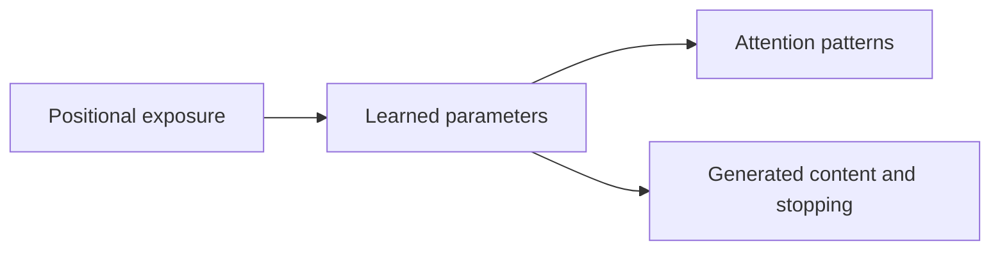

# Copying: what the combined evidence establishes

Updated 2026-10-08. **Broader positional exposure can learn a complete-copy repair from initialization and improve an existing weak solution.** The precise learned mechanism remains unresolved. These are small-model, bounded results, not a novel architecture or universal length-generalization claim.

## Current result

[Shared-checkpoint continuation](../topics/benchmarks/copy-exposure-continuation-results.md) starts both branches from the same weak update-6,000 weights, Adam state and generators. After 2,000 matched updates, adding self-site exposure achieves **99/128** complete length-10 copies versus **55/128** for continued cross-only exposure: 44 rescues and no harms. Every short group remains perfect at measured checkpoints. Length-8 copying is 128/128 versus 92/128.

This supports a conditional exposure effect after the weak solution has formed. The 95% complete-repair gate still fails: 29 premature stops remain. Extra training also improves the control; that improvement cannot be attributed to exposure. No further training is queued.

## Evidence chain

| Question | Result | What it does not establish |
|---|---|---|
| Can the input representation hide length? | [Unmarked RoPE](../topics/benchmarks/copy-rope-results.md) has uniform-source collisions; [marker training](../topics/benchmarks/copy-marker-training-results.md) learns short copying | A Transformer-wide impossibility, or sufficient learned length transfer |
| Is usable content available? | [Supplied alignment](../topics/benchmarks/copy-marker-alignment-results.md) recovers complete long copies in earlier marked models | A learned route or deployable repair |
| Can short-string training learn long copying? | [Spaced positions](../topics/benchmarks/copy-position-exposure-results.md) reach 100% in all nine long confirmation groups | Arbitrary lengths or positions beyond the exposed range |
| Which exposure sites suffice? | [Site comparison](../topics/benchmarks/copy-position-sites-results.md): combined passes every primary group; cross-only succeeds in two seeds and fails in one | Universal necessity of both sites; encoder/decoder self sites are grouped |
| Is the later weak failure mainly stopping? | [EOS blocking](../topics/benchmarks/copy-site-failure-results.md) recovers 127/128 complete long copies | A learned stopping repair; one content error remains |
| Can a read pattern fix a decision? | [Within-model pattern transfer](../topics/benchmarks/copy-head-pattern-transfer-results.md) restores 128/128 fifth-token answers; wrong-position control gives zero | Complete generated copying, stopping or training-history causality |
| Is a successful cross output portable? | [Whole-output transplant](../topics/benchmarks/copy-cross-output-transfer-results.md) gives only 2/128 weak long copies and damages short copying in both directions | Clean localization: learned-coordinate and downstream compatibility remain unresolved |
| Can exposure improve the existing weak solution? | Matched continuation gives 99/128 versus 55/128, preserving short behavior | Complete recovery, seed reliability or an internal mediator |

The [content-length exposure study](../topics/benchmarks/copy-length-exposure-results.md) changes token lengths, unlike position spacing on unchanged short strings. Historical scores across these studies are not paired treatment estimates. Earlier [EOS suppression](../topics/benchmarks/copy-stopping-results.md) left content failures in different models; it does not contradict the later 127/128 recovery.

## What the training intervention changes

Under RoPE, the attention score is

`score(i,j) = (R(p_i) q_i)^T (R(p_j) k_j) / sqrt(d_k)`.

At matching source/decoder positions the relative offset is zero. Ordered position sampling broadens other offsets without adding content tokens or changing labels. [Ruoss et al. (2023), section 3](https://arxiv.org/html/2305.16843v1#S3) supplies the sampling method; site choices and measured effects are local work.

The diagram does not assume attention patterns alone cause success. An outranking head can coexist with a correct answer. Changing exposure at one site can also change parameters elsewhere through gradients.

## Review after the terminal-feedback interventions

[Removing terminal loss](../topics/benchmarks/copy-eos-development-results.md) and [restricting terminal gradients to the classifier](../topics/benchmarks/copy-terminal-gradient-route-results.md) improve selected content decisions but break stopping or short fitting. They establish effects of supervision under those continuations, not a usable repair or universal harm from EOS feedback.

The chain `terminal feedback -> head-pattern mismatch -> premature EOS` remains unproven. A local pattern intervention and a separate training intervention do not establish causal mediation. Stop terminal-feedback variants and arbitrary cross-model transplants; their failures remain in the [failure register](failure-register.md).

## Diagnostics already completed

The [matched exposure stage trace](../topics/benchmarks/copy-exposure-stage-trace-results.md) follows the 44 recovered examples across saved checkpoints. Downstream growth survives both fixed endpoint classifiers; the final -7.067 margin difference splits into -6.953 representation and -0.114 classifier terms under the symmetric convention. This addresses the readout comparison confound, while changed upstream inputs, FFN and normalization remain coupled. True-terminal decisions are correct under supplied prefixes. No FFN cause or justification for another cross-model transplant follows.

These narrow explanations but do not individually identify the learning mechanism. Details and original controls remain in the reports.

| Diagnostic | Useful constraint |
|---|---|
| [Source visibility](../topics/benchmarks/copy-source-visibility-results.md) and [ranking review](copy-learning-hypothesis.md) | Excluding competing decoder reads rescues earlier first-token errors; rankings alone do not determine answers |
| [Direct marker contribution](../topics/benchmarks/copy-end-route-results.md) | Removal rescues none of the later weak errors; direct marker value alone is not the supported explanation |
| [Matched-prefix extension](../topics/benchmarks/copy-prefix-extension-results.md) | The source change flips all tested fifth-token decisions, but changes several source properties together |
| [Added-read masking](../topics/benchmarks/copy-added-read-mask-results.md) | Only 17/128 fifth-token rescues; excluding added reads is insufficient |
| [Exact trajectory replay](../topics/benchmarks/copy-learning-trajectory-results.md) | Failure appears by sampled update 1,000, before first full short fitting at 2,000; its onset is not localized between samples |
| [Q/K parameter swaps](../topics/benchmarks/copy-routing-development-results.md) | Q/K projection updates do not carry most of the observed margin increase; hybrids also damage short copying |
| [Intact developmental trace](../topics/benchmarks/copy-intact-development-results.md) | Marker reading and downstream differences change together; observation does not allocate causal responsibility |

## Remaining questions and boundaries

- Which learned changes remove premature stopping under added exposure?
- Do encoder and decoder self-attention exposure contribute differently?
- Does the improvement hold across fresh starts, tasks, scales and position ranges?

Original exposure confirmations share data across seeds; later diagnostics reuse opened pools and selected checkpoints. Test position IDs remain inside the training sampling range. Short fitting and long transfer are separate claims. A failed criterion does not erase a measured improvement, but an improvement does not satisfy a failed criterion.

A follow-up needs competing predictions, valid compatibility controls where relevant, and full content/stopping and short-task checks. Another stage, head or budget sweep alone is insufficient. The [checkpoint](research-checkpoint.md) owns current status; [history](research-history.md) owns chronology. The [pre-cleanup snapshot](../../results/docs_tidy_20261008/before.json) preserves the expanded assessment and proposal text.
