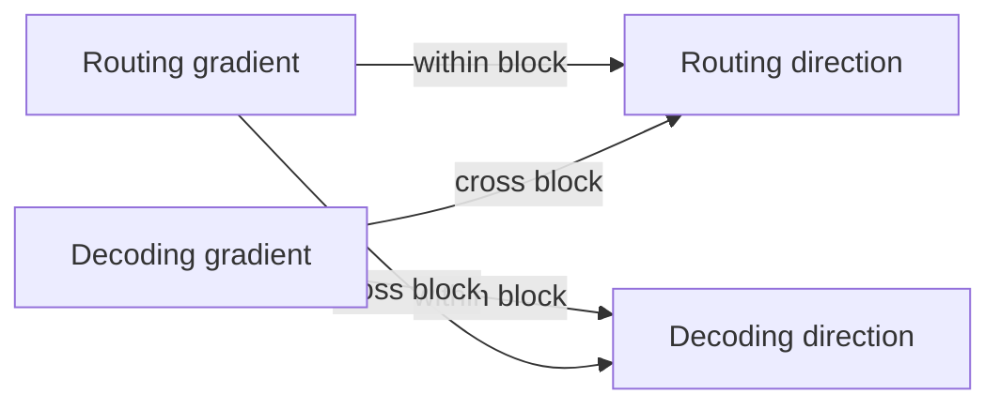

# Routing and decoding in saved optimizer directions

The archive is sufficient for a controlled transport test. We reconstructed every saved direction without training. **Cross-block transport is present, but usually opposes local gradient descent on its own.** Its contribution combines with stronger within-block descent. Presence does not establish benefit or the historical cause of successful fitting.

## The idea, briefly

A gradient g describes how loss changes with the parameters. Negative-gradient descent uses d=-g. L-BFGS uses d=-Hg, where H is a learned inverse-curvature approximation built from recent parameter changes s and gradient changes y. It is not the exact neural Hessian.

Split parameters into routing R (keys, tied queries and write strength, 513 parameters) and decoding D (values and classifier, 102). Then

$$\begin{bmatrix}d_R\\d_D\end{bmatrix}=-\begin{bmatrix}H_{RR}&H_{RD}\\H_{DR}&H_{DD}\end{bmatrix}\begin{bmatrix}g_R\\g_D\end{bmatrix}.$$

For example, $-H_{RD}g_D$ means decoding gradients contribute to the routing direction. That is optimizer transport between blocks; it is different from attention's Q/K routing.

Define $d=d_{within}+d_{cross}$. The sign of $g^T d_{cross}$ describes a first-order loss effect: positive opposes descent, negative favors it. It does not predict the loss after a finite step or a different training trajectory.

## What the archive contains

All six traces were inspected, with no favorable-step selection. The saved gradients and trials had already passed the [direction study's audit](../../results/fitting_direction/audit.json).

| Seed | Direction | Saved gradients | Optimizer calls |
|---|---|---:|---:|
| 3473 | L-BFGS | 127 | 63 |
| 3473 | Negative gradient | 128 | 39 |
| 3479 | L-BFGS | 128 | 63 |
| 3479 | Negative gradient | 128 | 39 |
| 3481 | L-BFGS | 127 | 63 |
| 3481 | Negative gradient | 128 | 39 |

Every call stores parameters before/after, direction, accepted length and curvature state. Each gradient call stores parameters, loss and gradients. All parameters belong to the two declared blocks. These archives cover the bounded direction experiment after Adam warm-up, not the full learning history.

## Measured transport

The first L-BFGS call has H=I and zero transport, as required. All 62 subsequent calls per seed have nonzero transport. The table excludes that first null call.

| Seed | Median cross/total direction norm | Cross favors descent | Cross opposes descent | Median native/within cosine |
|---|---:|---:|---:|---:|
| 3473 | 2.4519 | 7 / 62 | 55 / 62 | 0.9237 |
| 3479 | 2.3388 | 8 / 62 | 54 / 62 | 0.8517 |
| 3481 | 2.2150 | 8 / 62 | 54 / 62 | 0.7681 |

Norm ratios above one reflect cancellation between contributions. They are not percentages of learning success. Both the full and within-only directions have negative gradient projections at all 189 L-BFGS calls. All 117 negative-gradient calls use exactly -g, with zero cross-block transport despite retaining unused curvature bookkeeping.

This rules out describing transport as uniformly adding local descent. It does **not** establish that removing it would improve fitting: step length, subsequent curvature and visited parameters would change. Raw-coordinate transport also does not isolate the effective decoder's non-scalar change from its scale.

## Verification and scope

The [frozen review](../protocols/fitting-transport-review.md) reused the existing two-loop helper. A separate dense inverse-BFGS recurrence audited all 189 curvature directions and their masked contributions. Scalar sums checked geometry and projections; all 306 saved displacements/directions passed. Maximum direction discrepancy was 1.11e-15. Two preflight methods exercised a saved synthetic fixture and intentional direction/partition/missing-step/metric defects. These arithmetic tests are not trained-model findings.

The formal review took 2.31 seconds excluding imports and audit; zero new optimizer calls, gradients or model forwards. CPU float64, one thread. The [audit](../../results/fitting_transport_review/audit.json) passed with 47 protected files unchanged. [Raw measurements](../../results/fitting_transport_review/report.json) and [306-row CSV](../../results/fitting_transport_review/directions.csv) retain every call. Calls are correlated trajectory measurements, not independent seeds. No new accuracy, held-out loss or calibration measurement was made.

## One next intervention

Compare the full direction with $-\operatorname{blockdiag}(H_{RR},H_{DD})g$, retaining each branch's global secant history and the original line-search policy. This removes cross-block action while retaining its principal within-block operators. It differs from two separate optimizers. Positive curvature and positive initial scaling make those principal blocks positive definite, so the proposed direction remains a descent direction for nonzero g.

Use identical saved starts, all three seeds and the original 128-gradient cap. Require an exact native control. Freeze final training errors/CE/maps and all-group validation/test reporting before execution. If transport is required for the observed fitting quality, removing it should increase training errors; equal errors would limit that explanation, even if CE differs. This is a proposed causal contrast, not an executed repair or a source-backed score prediction. Close after that single contrast without more partitions, optimizers or budget extensions. RL stays parked.

Sources inspected: [PyTorch 2.11 implementation](https://github.com/pytorch/pytorch/blob/v2.11.0/torch/optim/lbfgs.py), `step` secant updates and two-loop recursion; [Liu/Nocedal (1989), author abstract](https://users.iems.northwestern.edu/~nocedal/Abstracts/limited-memory.html), limited-memory method and convex-theory scope. The block decomposition, first-order interpretation and intervention are local reasoning. These sources do not explain our scores or prove neural convergence.
