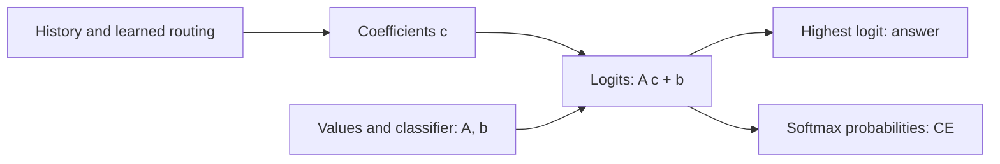

# What we have explained about retention learning

Synthesis, 2026-10-05. **The tested learning procedure affects fitting. Compatible routing and decoding matter at the endpoint. Logit scale explains a measured loss penalty. How training produces transferable representations remains unresolved.** This page connects existing evidence; it adds no experiments.

## Scope

The active model is a 615-parameter delta reader with scalar write strength, tied normalized keys/queries and an affine classifier. Histories contain key/value associations. Each key keeps its value within a history; this is not changing-value overwrite learning. Loads are 2/8/16/32 associations.

Fresh fitting confirmation used three initialization seeds and one new dataset. Subsequent direction, swap, scale and transport studies reuse those starts and pools. They are controlled follow-ups, not independent confirmations. Six related value shifts and repeated query answers are correlated.

## Evidence and its limits

| Question | Measured evidence | What it establishes | What remains open |
|---|---|---|---|
| Can the model fit these finite pools? | [Fresh confirmation](../topics/attention/full-pool-fitting-confirmation-results.md): all three seeds pass the 99% training-group gate; two L-BFGS endpoints have zero errors | Normal-write fitting is feasible for the tested pools; previous poor fitting was not an unavoidable model-wide limit | Perfect fitting in every seed, convergence and unseen-map reliability |
| Does the learning direction matter? | [Fixed objective/search contrast](../topics/attention/fitting-direction-results.md): fewer errors and lower training CE in every seed | The tested direction rule contributes under the declared gradient cap | Direction orientation versus scale; the full earlier Adam failure |
| Which endpoint component supplies the improvement? | [Routing/decoder swaps](../topics/attention/fitting-representation-results.md): neither donor alone matches native fitting in any seed | Component effects depend on the other component; neither tested donor alone is sufficient | How training builds that compatibility |
| Why can better fitting have worse held-out CE? | [Scale/shape decomposition](../topics/attention/decoder-scale-shape-results.md): scale dominates all 12 primary contrasts; removing it preserves every prediction | A substantial loss penalty comes from scale in this fixed decomposition | Wrong-answer causes and the historical cause of scale growth |
| Is direct cross-block optimizer action required? | [Controlled removal](../topics/attention/fitting-transport-results.md): two perfect fits remain; the weakest seed goes from 6 to 24 errors | Full action helps one seed under this cap; the all-seed benefit rule fails | Other budgets and mechanisms of within-block preconditioning |

Earlier [exact affine-conflict certificates](../topics/attention/shared-readout-recovery-results.md) apply to fixed original reads in seeds 3461/3463. They rule out a perfect affine head across those training pools. They do not rule out learning different reads. The newer fitting witnesses use different seeds/data; these results answer different questions.

## One controlled comparison

All-load training errors after the same Adam warm-up, full objective, line-search policy and 128-gradient cap:

| Seed | Negative-gradient direction | Full L-BFGS direction | Block-diagonal action |
|---|---:|---:|---:|
| 3473 | 122 | 0 | 0 |
| 3479 | 176 | 0 | 0 |
| 3481 | 204 | 6 | 24 |

The full controls reproduce exactly across studies; counting them again does not add seeds. Direction changes also change trials and accepted update counts. Block removal retains global secant history and the shared objective, so the blocks still learn jointly. Its training CE is lower in every pair, despite the extra errors in seed 3481.

## How to read the mechanism

Our exact local factorization is

\[
S_T=C_TV,\qquad c=C_T^\top q,\qquad z=Ac+b,\quad A=WV^\top.
\]

The writes and query determine coefficients \(c\). Values and the classifier determine the class map \(A\). Their combination determines logits \(z\); \(c\) need not be a probability distribution.

This is the computation, not a proven learning history. Endpoint swaps establish compatibility effects; they do not show when or why compatibility emerged.

For positive \(s\), \(\arg\max(sz)=\arg\max(z)\), while \(\mathrm{CE}(sz,y)=\log\sum_j e^{sz_j}-sz_y\) changes. Large scale can sharpen correct predictions and amplify confident mistakes. Removing the measured scale penalty therefore lowers CE without fixing retrieval. It also raises training CE. The newer block-removal endpoints have not received this decomposition; their loss increase has no established scale attribution.

## What to pursue next

**Prioritize how fitting gains produce representations that remain unreliable on unseen maps.** Native full-direction test-32 accuracy is 87.40%/88.66%/87.59%, but only 0/12/6 of 384 histories are entirely correct. This is a generalization gap, not evidence of memorization or an architectural impossibility.

Before another run, require two competing learning explanations and a trajectory measurement or intervention with different predicted outcomes. Use the saved successful/failing trajectories first. A diagnostic that only reconfirms endpoint incompatibility or sharp logits adds little. No new optimizer grid, fitting extension or architecture proposal is selected. Copy/state remain deferred; RL stays parked.

## Sources and verification

Reopened primary sources: [Yang et al. (2024), section 2.2](https://arxiv.org/html/2406.06484v2#S2.SS2), delta writes/reads; [PyTorch 2.11 implementation](https://github.com/pytorch/pytorch/blob/v2.11.0/torch/optim/lbfgs.py), secant directions and strong-Wolfe search; [Guo et al. (2017), section 4.2](https://proceedings.mlr.press/v70/guo17a/guo17a.pdf), positive temperature scaling and unchanged class decisions. Our reader differs from full DeltaNet; our weight-derived scaling is not their fitted calibration procedure. Sources support equations/methods, not local score predictions. The factorization and synthesis are local reasoning.

The [verification record](../../results/retention_learning_synthesis/verification.json) checks report/audit hash bindings, cited numbers, protected evidence and local links. It does not rerun the research audits or establish new mechanisms. Zero new training, gradients or model forwards.
