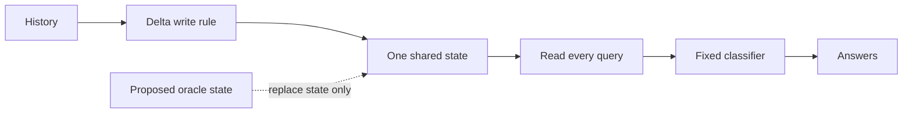

# What still needs explaining in compact retention

Reviewed 2026-10-04. **We have identified interference and a local optimizer effect. We have not explained why learning leaves an unreliable shared memory.** RL remains parked. This is an evidence review, with no new training, gradients or predictions.

Follow-up: the separately executed [shared-state diagnostic](../topics/attention/shared-state-feasibility-results.md) now finds a correct state in every tested training history. The table and proposal below preserve what was known before that test. Reachability, preservation under writes and the learning cause remain open.

## Which explanations survive?

| Explanation | Existing evidence | Assessment |
|---|---|---|
| The reader cannot decode individual associations | [Target-only histories](../topics/attention/target-only-history-results.md): all 48 cells reach 100%; 13,973 errors recover | Ruled out for these clean reads. Mixed reads remain a different question. |
| Remaining training pairs never received feedback | [Exhaustive continuation](../topics/attention/query-feedback-continuation-results.md): every training history/key pair is supervised; final train-32 accuracy is 98.9990% / 98.5636% | Missing query feedback cannot be the sole explanation of these remaining errors. Finite optimization remains open. |
| Competing writes can damage an answer | Clean-history recovery above; [orthogonal keys](../topics/attention/key-geometry-retention-results.md) recover every shared map in the older readers | Supported intervention evidence. Filtering changes inputs; orthogonal slots double state width. Neither explains why training learned the native geometry. |
| Minimizing average key overlap is sufficient | [Overlap penalty](../topics/attention/overlap-regularization-results.md): test mean 62.19% to 65.79%, zero complete maps; overlap approaches its minimum | Insufficient under that recipe. A good average does not establish safe interactions for every history. |
| Excess confidence explains wrong answers | [Fixed-memory scaling](../topics/attention/readout-scale-control-results.md) improves high-load CE with every answer unchanged | Explains a removable loss component, without repairing the wrong rankings. |
| Opposed gradients or Adam memory alone explain failure | [Gradient competition](../topics/attention/memory-gradient-competition-results.md): total memory descent locally lowers error CE at all four endpoints. [Moment removal](../topics/attention/memory-first-moment-reset-results.md): both joint benefit rules fail | One optimizer effect is causal locally; no reliable repair or full training-history explanation follows. |
| No correct shared state exists with the learned keys and classifier | Clean filtering gives a different state per query. Orthogonal recovery uses wider keys. No fixed-width shared-state feasibility study was found in the inspected code/reports | Still unresolved. This is the next distinguishing question. |

Different studies use different seeds, supervision and checkpoints. Their scores are not paired comparisons across this table. Small gains and failed criteria remain valid evidence.

## Learn the distinction

**Decoding:** can the classifier recognize a clean value? We tested this successfully.

**Shared-state feasibility:** could one memory answer all keys correctly with these learned query vectors and classifier? Not yet tested.

**Writing and learning:** does the recurrence construct that state, and why did training choose these parameters? Still unresolved, even if a feasible state exists.

The proposed replacement uses all correct labels. It is a diagnostic upper bound, not a usable reader or learned repair.

## Next question and mathematics

**At the saved 12000-step weights, can any single 16-by-8 state give a strictly correct winner for every query in each training history?**

The inspected implementation uses normalized, tied query/key vectors, learned values, scalar beta and a six-class linear classifier:

$$S_t=S_{t-1}+\beta k_t(v_t-S_{t-1}^{T}k_t)^T,
\qquad z_i=WS^Tq_i+b.$$

For target class $y_i$, require a common positive margin $\gamma$ against every competing class $c$:

$$z_{i,y_i}-z_{i,c}
=(W_{y_i}-W_c)S^Tq_i+b_{y_i}-b_c\geq\gamma,
\qquad c\ne y_i.$$

With $q,W,b$ fixed, these inequalities are linear in the 128 entries of $S$. A proposed linear program maximizes $\gamma$, with $\gamma\leq1$ to cap the objective. Positive optimum means a strictly correct shared state exists. The cap preserves that existence question; it does not impose a norm bound on the state. Exact ties need separate treatment.

| Diagnostic outcome | What it would distinguish |
|---|---|
| Independently verified positive-margin state | These fixed keys/head permit correct shared decoding for that history; the native write process misses a possible state. Reachability and learning cause remain open. |
| Certified nonpositive optimum | No state gives strictly correct winners for that history with these keys/head fixed. Changing the write process alone cannot produce positive-margin correctness there. Different learned keys/head may still succeed. |
| Solver failure or uncertain numerical boundary | Unresolved. Failure to find a state is not an impossibility proof. |

Start with all 768 train-32 histories per seed, 3461/3463, at the existing endpoint. Include native successes as controls and report complete maps, margins, state norms and every unresolved case. Each history has 32 queries and five competing classes, giving 160 inequalities. Freeze solver, numerical certificates, tie rules and controls before execution. Use independently checked feasible/conflicting fixtures and actual model reload/read paths. No held-out selection, new training or geometry/reset grid.

This asks about classification, not exact reconstruction of arbitrary value vectors. **32 keys in 16 dimensions alone is not proof that these six-class answers are impossible.** A large unconstrained oracle state may also be unreachable or numerically fragile.

## Sources and inspected scope

[Yang et al. (2024), section 2.2](https://arxiv.org/html/2406.06484v2#S2.SS2): inspected delta write/read equations. Our state is transposed relative to their notation; scalar beta and the separate classifier are local simplifications. The proposed margin reduction is our derivation, not a published result about these checkpoints.

[Boyd and Vandenberghe, slides 5.33-5.35](https://stanford.edu/~boyd/cvxbook/bv_cvxslides.pdf): inspected alternatives and Farkas' lemma for the certificate principle. A solver status alone is insufficient; numerical certificates need independent residual checks and unresolved boundaries must stay visible.

Local scope: linked reports, their audit-to-report hashes, relevant metrics, the `LoadReader`/`Reader` write/read implementations and a search for an existing shared-state feasibility study. Historical gains use older recipes; no repository-wide correctness claim follows. Review verification is [recorded separately](../../results/retention_representation_review/verification.json). Next execution needs its own frozen protocol. This review does not reopen completed training budgets.
