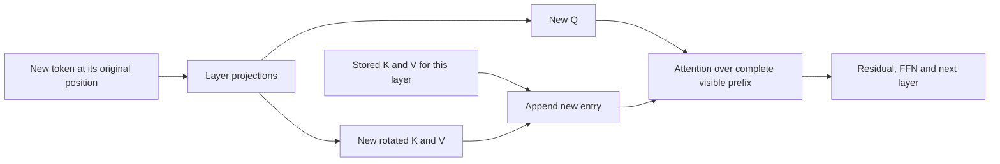

# ADR 0002: verify KV caching before studying cache alternatives

Date: 2026-10-01. Status: selected next question; experiments not run.

## Why this question?

The retrieval comparisons are closed. RoPE helped in the tested tasks. Broader query exposure improved transfer in every paired seed, but one seed missed the reliability threshold. GELU and wider FFNs failed their respective adoption rules. These findings do not identify a universal architecture defect. See the [assessment](../assessments/architecture-assessment.md).

Next question: **does cached decoding reproduce the full causal forward pass, including the same RoPE positions?** No dedicated decoding-cache experiment was found in the workspace. This covers another transformer component without requiring more training.

## What is a KV cache?

Each attention layer saves past projected keys and values. For the next token, it computes only the new query, key and value, then attends over the stored prefix and new entry. The cache is temporary inference state. It differs from the key/value pairs in our synthetic task.

For one layer and head, with position p_t:

`q_t = R(p_t) W_Q z_t`, `k_t = R(p_t) W_K z_t`, `v_t = W_V z_t`.

`K_1:t = concat(K_1:t-1, k_t)`, `V_1:t = concat(V_1:t-1, v_t)`.

`a_t = softmax(q_t K_1:t^T / sqrt(d_k))`, `o_t = a_t V_1:t`.

Biases are omitted here for readability; the experiment must retain the model's learned biases. R is the RoPE rotation. Cache rotated keys once, at their original positions.

Causal attention makes an earlier token independent of future tokens. Our normalization and FFN operate separately on each token. By induction over layers, an unchanged prefix therefore retains the same states, keys and values. This establishes equivalence in exact arithmetic when weights, positions and visibility match and dropout is disabled. Floating-point agreement still requires a numerical check.

## Fixed scope and stopping rule

| Item | Selected boundary |
|---|---|
| Models | All ten final query-exposure checkpoints; no training or checkpoint selection |
| Fixtures | Test context rows 0, 1, 36 and 37 at each of 3/4/6 pairs; reused diagnostic inputs |
| Positions | Offsets 4 and 17, identical between full and cached computation |
| Execution | CPU float64, evaluation mode; token-by-token and half-prefix prefill followed by individual tokens |
| Reference | Existing full causal forward pass, independently checked with explicit RoPE rotation matrices and attention |
| Comparison | Every token's vocabulary logits, cache length and K/V payload size; 120 model/length/offset/schedule cases |
| Numerical criterion | Maximum absolute logit error <=1e-10 in every case; disclose argmax differences and near ties |
| Negative controls | Reset newly appended RoPE positions; separately omit one past cache entry. Each must create a >1e-6 logit discrepancy in at least one declared fixture |
| Output | One result document, raw measurements and provenance, one independent audit; close after these checks |

Before execution, freeze the implementation and protocol hashes. Include biases, both layers and the final normalization/readout. A failed control means the validation is incomplete. A failed equivalence check requires an implementation diagnosis, not architecture tuning.

For batch B, layers L, heads h, cached length T and element size s, K/V tensor payload is `B L h T (d_k+d_v) s` bytes. This excludes allocator overhead and model weights. Each new attention query still reads a growing prefix. No latency or GPU speed claim is selected for this study.

Matching logits can preserve incorrect answers too. Passing proves implementation agreement on these fixtures; it does not improve recall accuracy, establish language generation quality or justify compressed/quantized caches. Changed prefixes, changed weights, cache eviction and padding require separate contracts.

## Sources and reading depth

- [Hugging Face: how caching works](https://huggingface.co/docs/transformers/main/cache_explanation), documentation sections reviewed on 2026-10-01: causal prefix reuse, per-layer caches and mask bookkeeping. This informs the implementation contract; no Hugging Face dependency is required.
- [Shazeer, Fast Transformer Decoding (2019)](https://arxiv.org/abs/1911.02150), abstract screened: motivates the memory-bandwidth question and shared-KV alternatives. Its speed and quality claims are not reproduced here.
- [Su et al., RoFormer (2021)](https://arxiv.org/abs/2104.09864), existing source P06, landing page rechecked. Our rotation implementation is already audited in the [positional study](../positional-comparison-results.md); this next check concerns preserving its positions during decoding.

Older foundational sources remain appropriate for the mathematics. Current documentation provides implementation context. No new model design or paper benchmark replication is selected.
