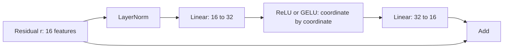

# FFN activation: ReLU versus GELU

**Question:** with RoPE fixed, does replacing ReLU with GELU improve the same recall task under a fixed training budget? Earlier [FFN interventions](topics/ffn/ffn-branch-results.md) tested branch contributions in trained models. This comparison trains new models with a different nonlinearity.

## Where it acts

Each FFN transforms one token's features. Attention has already supplied context from other tokens.

`z = LN(r)`; `u = W1*z + b1`; `FFN(z) = W2*a(u) + b2`; `output = r + FFN(z)`.

Only `a` changes, in both blocks. We keep dimensions, parameters and RoPE fixed. Without this activation, the two FFN projections compose into one affine map of z. Attention and normalization would still make the whole model nonlinear.

## What the functions do

| Function | Formula | Local derivative |
|---|---|---|
| ReLU | `max(0,u)` | 0 for u<0; 1 for u>0. Not differentiable at0; our library uses0 there. |
| Exact GELU | `u*Phi(u) = u*(1+erf(u/sqrt(2)))/2` | `Phi(u) + u*phi(u)` |

`Phi` is the standard normal cumulative distribution function. `phi(u)=exp(-u^2/2)/sqrt(2*pi)` is its density. They define the function; they do not require the actual activations to be Gaussian.

| Input u | ReLU(u) | GELU(u), rounded |
|---:|---:|---:|
| -2 | 0 | -0.0455 |
| -1 | 0 | -0.1587 |
| 0 | 0 | 0 |
| 1 | 1 | 0.8413 |
| 2 | 2 | 1.9545 |

ReLU switches negative coordinates off. GELU smoothly scales them and permits small negative outputs. GELU here is deterministic, with the exact erf definition rather than the tanh approximation.

## Why gradients matter

Holding the FFN input z as the differentiation variable:

`J_FFN = W2 * diag(a'(u)) * W1`.

For the full pre-norm residual sublayer:

`J = I + J_FFN * J_LN`.

The activation affects both forward features and backward gradients. A negative ReLU input has zero local derivative on that example; this alone does not prove a permanently dead neuron. GELU's derivative can also be small or negative (about -0.0833 at u=-1). Smoothness does not guarantee stable gradients, faster learning or better generalization. Residual and normalization paths still matter.

## The controlled comparison

New repeated-key binding families and five paired seeds. Both arms use RoPE, 5,088 parameters, the same initial weights, batches, optimizer and 6,000 updates. Train on3/4 pairs; test6 pairs only after all runs finish. Compare final checkpoints, with validation curves as descriptive learning evidence. Equal tokens do not imply equal arithmetic cost.

Fresh-family availability limits the three-pair split to160 training,20 validation and40 test families. Both arms use this same corrected split; raw scores are not a controlled comparison with earlier studies. The setup correction was made before training and is recorded in the protocol.

The [frozen protocol](gelu-comparison-protocol.md) requires every GELU seed >=90% on six pairs, mean gain >=2 points, no six-pair seed worsening, and preserved short-length performance. Stop after ten runs and an independent audit. A failure is specific to this task and recipe.

## Primary source

[Hendrycks and Gimpel, Gaussian Error Linear Units, v5, section2](https://arxiv.org/html/1606.08415v5) defines GELU and its approximations. Section3 reports other tasks and tuned settings. Those results motivate this comparison; they do not predict its outcome. Formulation and experimental setup were inspected. We use this directly relevant original paper rather than selecting a newer source by date.

[Completed results](topics/ffn/gelu-comparison-results.md): GELU gains+.225 points on average, but fails the fixed adoption rule. Retain ReLU for this recipe.
