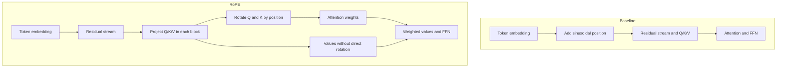

# Positional representations: one next comparison

**Select standard RoPE versus our additive sinusoidal baseline.** This is an established architectural choice, not a novel proposal. Selection is based on its clear mathematical difference, not an expectation that it will win. The [completed comparison](positional-comparison-results.md) passes its fixed keep rule; its result is limited to our task and budget.

## What position information does

Attention needs a way to distinguish locations. A causal mask restricts access to the past; position representations additionally describe where tokens are.

| Method | How it works | Important limit |
|---|---|---|
| Additive sinusoidal, our baseline | Add a position vector to each embedding before the blocks. Position enters residual, Q/K and V computations. | Defined at unseen positions, but learned behavior need not extrapolate. |
| RoPE, selected | Rotate Q and K by position in each block. Do not add a position vector to the embedding. | Relative-position structure does not guarantee retrieval at unseen distances. |
| ALiBi, not selected for this comparison | Add a distance penalty to attention scores. No additive position embedding. | Explicit preference for recent tokens may affect distant retrieval; not tested here. |

RoPE values can still contain contextual position effects from earlier blocks. "No direct rotation" does not mean position-free values throughout the model.

## Essential math

Baseline: `x_i = embedding(token_i) + PE(i)`, with paired coordinates `sin(i*w_r), cos(i*w_r)` and `w_r=10000^(-2r/D)` for model width D.

RoPE rotates each two-coordinate pair by angle `i*w_r`, now using head width d:

`R(theta)[a,b] = [a*cos(theta)-b*sin(theta), a*sin(theta)+b*cos(theta)]`.

For unrotated projected vectors q_i and k_j:

`(R(i)q_i)^T(R(j)k_j) = q_i^T R(j-i) k_j`.

The explicit positional factor depends on relative distance. Rotations preserve vector norms. Moving all position indices by the same offset preserves scores if q/k content is unchanged. Our RoPE-only model should preserve its full output under a common offset with the same tokens and mask. Adding new tokens is different: it changes context and distances, so length generalization remains an empirical question.

ALiBi uses `score_ij = q_i^T k_j/sqrt(d) - m_h*(i-j)` for visible keys j<=i and fixed positive head slope m_h. It changes scores by a recency bias, rather than rotating vectors.

## Why this candidate?

Earlier layout tests showed positional sensitivity. RoPE provides a testable relative-position identity and adds no learned parameters. Our head width is eight, so pairing coordinates requires no resizing. Removing additive PE and adding rotations is one representation replacement, but changes several information paths together. A gain would not isolate which path caused it.

## Sources and scope

[RoFormer, Su et al., v5](https://arxiv.org/html/2104.09864v5): positional-method definitions and section 3 rotation construction reviewed. [ALiBi, Press et al., v2](https://arxiv.org/abs/2108.12409): abstract screened for distance bias and reported extrapolation. Neither paper's benchmark is reproduced here. Older, directly relevant methods are preferred over novelty for this comparison. The [frozen comparison protocol](positional-comparison-protocol.md) specifies the test; this guide contains no measured improvement claim.
