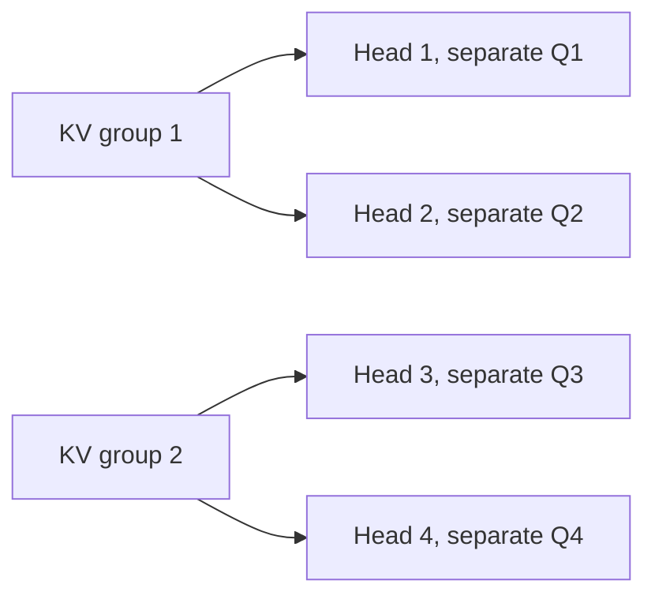

# Shared KV heads: savings and restrictions

**The four mathematical probes and independent audit pass.** Sharing reduces cache payload. It preserves our already-shared controls, but arbitrary mean pooling changes outputs. No trained model or GPU benchmark was changed.

## What MHA, GQA and MQA mean

H counts query heads; G counts stored K/V groups. Query heads stay separate. Heads in one group read the same K/V.

| Method, four query heads | KV groups | Sharing |
|---|---:|---|
| MHA: multi-head attention | 4 | Each query head has its own K/V |
| GQA: grouped-query attention | 2 | Two query heads per K/V group |
| MQA: multi-query attention | 1 | All query heads share one K/V group |

Example GQA grouping:



For head h assigned to group g:

`A_h = softmax(Q_h K_g^T / sqrt(d_k) + causal_mask)`, `Y_h = A_h V_g`.

Different Q can give different A even with shared K. Our unmasked MQA example has a **0.438398** maximum probability difference between heads 0 and 1. Sharing does not make the heads identical.

## Measured storage and parameter counts

CPU float64: batch B=2, layers L=2, tokens T=128, H=4, key/value widths 2/3, projection input/output width D=8, no biases. These are test tensors. Our saved two-head models allow only the MHA/MQA endpoints; four heads illustrate intermediate GQA.

| Method | Actual K/V payload | Saved versus MHA | Q/K/V/output projection elements per layer |
|---|---:|---:|---:|
| MHA | 80 KiB | 0% | 320 |
| GQA | 40 KiB | 50% | 240 |
| MQA | 20 KiB | 75% | 200 |

Payload: `B L T G(d_k+d_v) s` bytes. Projection count: `D H d_k + D G(d_k+d_v) + H d_v D`. Only K/V size shrinks. Counts exclude other weights, allocator overhead and temporaries. Latency is unmeasured.

## Findings and limits

| Probe | Result | Legitimate conclusion |
|---|---|---|
| Already-shared K/V, G=4/2/1, causal and unmasked | Six configurations; largest attention/output error 5.55e-17 | Compact sharing matches dense MHA whose within-group K/V are copies |
| Two desired head patterns | Joint log-odds rank 2; shared width-2 recovery error 0 | Shared width 1 cannot exactly realize this particular joint pattern |
| Pool different K/V heads | Outputs 0.635825, 4.000000 become 2.349045, 2.349045 | Arithmetic mean pooling is not generally an exact replacement |
| Pool identical heads, positive control | Output discrepancy 0 | Pooling is exact in this declared special case |

Pooling fixture: Q1=Q2=1, K1=(1,0,0), K2=(0,1,0), V1=(0,1,2), V2=(3,4,5). Both new heads use mean K/V. An identity output projection preserves the observed difference. This rejects exact pooling equivalence, not trained GQA.

## Why shared keys impose a joint restriction

Choose a common visible reference key r. Softmax normalization cancels in the log ratio:

`B_h,ij = log(A_h,ij/A_h,ir) = q_h,i dot (k_g,j-k_g,r)/sqrt(d_k)`.

Stack the query rows from every head in one group. They all factor through the same key differences, so **rank(B_group) <= d_k**. Independent MHA heads each satisfy their own width bound, but their stacked patterns need not share that bound. This is the new extension of our [head-width lemma](topics/attention/head-width-results.md).

Our two heads request scores (1,0,0) and (0,1,0). Their stacked log odds against key 3 are `[[1,0],[0,1]]`, with exact determinant 1. Shared width 1 can only give rank <=1. Width 2 reproduces both with K=((1,0),(0,1),(0,0)) and Q=sqrt(2)*I.

Assumptions: positive dot-product attention and common visible keys. Additional score biases can change the bound. Exact routing is stronger than correct prediction. This does not diagnose recall errors or bound the complete network.

## Comparison with primary research

| Source and reading depth | Relevance and boundary |
|---|---|---|
| [Shazeer 2019, v1](https://arxiv.org/html/1911.02150v1), sections 2-3 reviewed | MQA definitions support the payload formula. Speed/quality benchmarks are unreplicated. |
| [Ainslie et al. 2023, v3](https://arxiv.org/html/2305.13245v3), methods, setup and limitations reviewed | Pooling is followed by pretraining. Our exact-equivalence counterexample does not contradict their adapted-model results. |
| [Jin et al., Findings 2025](https://aclanthology.org/2025.findings-emnlp.467/), abstract screened | Alignment before merging; unaudited research lead. |
| [Tripathi et al., September 2026 v2](https://arxiv.org/abs/2609.13285v2), abstract screened | Key reconstruction from grouped values; unverified preprint lead. |

Search checked 2026-10-01. Original definitions take priority; recent leads remain unverified. No paper benchmark was replicated.

## Evidence and stopping decision

Independent audit: 50-digit Decimal attention and rational determinant; **1,969 scalar checks**, maximum disagreement `4.44e-16`. Frozen hashes and storage counts pass.

Evidence: [frozen protocol](shared-kv-protocol.md), [raw fixtures/results](../results/shared_kv.json), [audit](../results/shared_kv_audit.json). Code: [probes](../experiments/shared_kv.py), [auditor](../experiments/audit_shared_kv.py).

```powershell
.venv/Scripts/python.exe experiments/audit_shared_kv.py
```

**Study closed.** Storage savings and the scoped routing restriction are established. Retrained quality remains unknown. The failure register retains the pooling counterexample. Any training comparison needs a new matched protocol.
