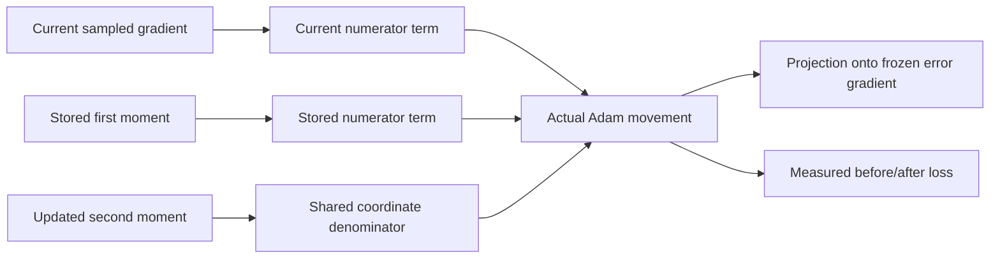

# Why an Adam step can oppose the current gradient

[Raw memory gradients](memory-gradient-competition-results.md) locally favored reducing the remaining errors when combined. Adam uses sampled gradients, stored moments and coordinate scaling. Its movement can differ.

This check reads 16 already reconstructed updates. At each before-model, we identify wrong answers in the full training load-32 pool. We keep that error membership fixed while testing the update.

## The calculation

For one parameter coordinate, Adam forms

$$m_t=\beta_1m_{t-1}+(1-\beta_1)g_t,\quad
v_t=\beta_2v_{t-1}+(1-\beta_2)g_t^2,$$
$$\Delta\theta=-\eta\frac{m_t/(1-\beta_1^t)}{\sqrt{v_t/(1-\beta_2^t)}+\epsilon}.$$

We inspected [Kingma and Ba, Algorithm 1](https://arxiv.org/pdf/1412.6980) and [PyTorch 2.11 Adam](https://docs.pytorch.org/docs/2.11/generated/torch.optim.Adam.html) for these equations. Here g_t is the recorded minibatch gradient, not the full-pool error gradient.

With the **same observed denominator**, the movement splits into stored and current numerator terms:

$$\Delta\theta=\Delta\theta_{stored}+\Delta\theta_{current}.$$

This is a local algebraic decomposition. It is not a momentum-reset experiment: resetting moments would also change the denominator and future updates.

Let h be the gradient of mean CE on the before-model's wrong answers. The local loss effect is

$$\Delta L_{error}\approx h^T\Delta\theta.$$

Positive means those errors become more costly locally. Negative means less costly. Contributions add across parameter blocks at first order. The actual finite-step loss need not equal this approximation.

## A measured reversal

Seed 3463, step 11004, joint memory:

| Contribution | Predicted error-CE change |
| --- | ---: |
| Stored first-moment numerator | +0.002106754 |
| Current-gradient numerator | -0.001489638 |
| Actual summed movement | +0.000617117 |
| Measured memory-only finite change | +0.000728060 |

The current term favors improvement. The larger stored term points toward deterioration, so their sum does too. Independent equations and numerical probes verify this selected update. This does not show that all momentum is harmful or that resetting it repairs learning.

## Loss and answers differ

We measure a private memory-only after-state with the original classifier, then the recorded full after-state. The full state includes classifier changes too. Finite effects of these mixed states are not an additive causal breakdown.

[Fourteen memory steps lower error CE; two raise it](adam-memory-error-transport-results.md). Yet across these evaluations, memory-only movements rescue 49 answers and harm 50. Lower mean loss on one fixed subset does not guarantee better overall accuracy. Error subsets differ between steps; these transition totals include repeated examples.

These measurements identify how selected updates move. They do not explain all training, held-out deterioration, convergence or architectural capacity.
