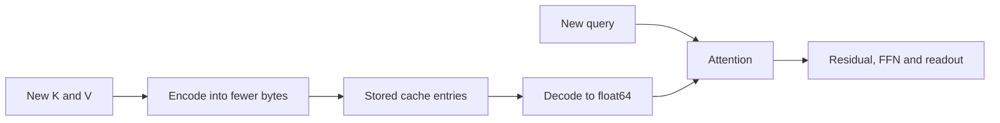

# Cache precision: storage savings and prediction changes

**FP32 preserves final predictions on this subset; FP16 and INT8 do not.** The independent audit passes all180 cells. These results concern cache rounding with float64 arithmetic, not low-precision whole-model execution.

## What we changed

A KV cache stores earlier attention keys and values. Lower precision stores fewer bytes but rounds those numbers. We keep all model weights unchanged.

Ten saved MHA/MQA models, five seeds each. For each of 3/4/6 pairs, select the first four stored test families, with36 context variants and all key queries. This gives1,440 input sequences, reused across ten models: **14,400 final decisions per mode**. They are not14,400 independent examples. Three-pair data also comes from an earlier reused diagnostic split.

CPU float64 computation, one thread, positions4+i. Decode every input token individually. Each layer immediately encodes its new rotated K and unchanged V, then reads the stored entries for attention. Rounding can propagate through residuals into later tokens and layers. We do not quantize a completed forward trace. [Frozen protocol](../../cache-precision-protocol.md).

## Measured findings

Counts aggregate the same inputs across models and lengths. Damaged means a formerly correct answer becomes wrong. Repaired means a formerly wrong answer becomes correct. Other wrong-to-wrong changes are possible in general.

| Stored cache | Final prediction changes | Damaged / repaired | Correct answers /14,400 | Maximum final logit error | Strict preservation rule |
|---|---:|---:|---:|---:|---|
| Float64 control |0|0 /0|14,091|7.19e-14|Pass|
| FP32 K/V |0|0 /0|14,091|8.79e-6|Pass|
| FP16 K/V |1|1 /0|14,090|0.09296|Fail|
| INT8 K/V |9|5 /4|14,090|0.90825|Fail|
| INT8 K only |4|1 /3|14,093|0.93486|Fail|
| INT8 V only |3|2 /1|14,090|0.48536|Fail|

All final changes occur at six pairs; none at three/four. FP16 changes one MHA answer and no MQA answers. INT8 K/V changes four MHA and five MQA answers. This does not establish a general robustness ranking.

FP32 preserves decisions while changing logits. FP16 and INT8 fail the declared **zero final changes** rule, even though net accuracy changes are small. This strict rule is a prediction-equivalence check; failing it does not make approximate caching unusable. Single-side INT8 controls leave the other side float64 and diagnose sensitivity; their occasional repairs do not establish an improvement.

Intermediate positions were not trained as answer outputs. Nevertheless, all-token argmax changes are retained: FP32 zero, FP16 32, INT8 K/V502, K-only349, V-only302.

## Storage: count the scales

For one eight-channel vector, FP32 uses32 bytes, FP16 uses16. Our symmetric INT8 codec uses eight code bytes **plus four scale bytes**. Thus it saves25% relative to FP16, rather than50%.

| Both K/V stored as | Bytes per vector | MHA / MQA bytes per sequence at14 tokens |
|---|---:|---:|
| Float64 |64|7,168 /3,584|
| FP32 |32|3,584 /1,792|
| FP16 |16|1,792 /896|
| INT8 + FP32 scale |12|1,344 /672|

Two layers; MHA has two KV heads and MQA one. Payload is `B L G T (bytes_K_vector + bytes_V_vector)`. These are encoded tensor bytes, excluding model weights, Python objects and temporary dequantized tensors. No GPU memory or speed measurement was performed.

## The mathematics: why errors matter

For each token/head vector x, `s=FP32(max|x|/127)`, `c=clip(round_even(x/s),-127,127)`, and `x_hat=c*s`. Zero vectors use s=1. Rounding removes information. Every INT8 write checks reconstruction error `|x-x_hat| <= s/2 +1e-12` for the tested finite values.

With the query fixed, a key error changes its score by `delta_score_j = q·delta_k_j/sqrt(8)`. Cauchy-Schwarz gives `|delta_score_j| <= ||q||_2 ||delta_k_j||_2/sqrt(8)`. Softmax then changes the routing weights.

With attention weights fixed, a value error changes content by `delta_y = sum_j a_j delta_v_j`; consequently `||delta_y||_infinity <= max_j ||delta_v_j||_infinity`. When both change, `y_hat-y=(a_hat-a)V+a_hat(V_hat-V)`. These are local identities/bounds, not bounds on the complete decoder: its queries and later activations can also change.

If a final reference winner has gap g over the runner-up and every logit changes by at most e, **g>2e guarantees the winner stays**. This follows because the winner can fall by e while a competitor rises by e. The saved outputs certify14,400 rows for FP32,14,399 for FP16, and14,385 for INT8 K/V. An uncertified row need not change; this is sufficient, not necessary, and computed after evaluation.

Concrete FP16 failure: MHA seed1423, six-pair row232 changes answer12 to16. Reference gap0.00780; maximum row logit error0.01997. The margin certificate does not apply. This example illustrates the measured rounding effect without identifying its exact layer-level cause.

## Audit, papers and closure

Float64 cached/full maximum error8.53e-14; no argmax changes. The independent auditor uses explicit normalization, rotation matrices, separate projections, a different INT8 rounding formula and SDPA. All180 cases agree within9.95e-14. Scalar Python/struct checks corroborate96 codec elements. A constructed INT8 attention example loses a small key distinction and turns a class1 winner into a tie, resolved to class0; universal preservation is therefore false for this codec.

[KIVI, ICML2024](https://proceedings.mlr.press/v235/liu24bz.html), [v2 sections3.1–3.3](https://arxiv.org/html/2402.02750v2), studies asymmetric quantization with grouped per-channel keys, per-token values and a full-precision residual buffer. Our symmetric per-token eight-channel codec has different axes, scales, precision, models and execution. Its measured errors do not replicate or refute KIVI's reported quality or speed.

Evidence: [results](../../../results/cache_precision.json), [saved final logits and fixtures](../../../results/cache_precision_tensors.pt), [independent audit](../../../results/cache_precision_audit.json), [runner](../../../experiments/cache_precision.py), [auditor](../../../experiments/audit_cache_precision.py).

**Study closed.** Preserve savings and changed predictions together. Whole-model FP16/GPU behavior, more families, longer contexts, other quantizers and speed remain unmeasured. No tuning sweep follows.
