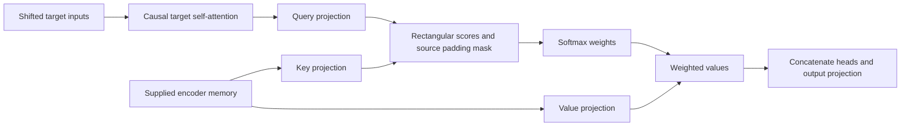

# Cross-attention: reading a separate sequence

[Results](cross-attention-results.md) · [Frozen protocol](../../protocols/cross-attention.md)

## What changes

Self-attention reads states from its own sequence. Cross-attention takes queries from decoder states and keys/values from encoder memory. Source and target lengths can differ. This is the encoder-decoder attention in [Vaswani et al., section3.2.3](https://arxiv.org/html/1706.03762v7).

The audit supplies encoder memory directly. It does not run an encoder or train a sequence-generation model.

## Shapes and mathematics

For one head, let decoder states be `D` and encoder memory be `E`:

`Q = D Wq + bq`, `K = E Wk + bk`, `V = E Wv + bv`

`S = Q Kᵀ / √k + M`, `A = softmax_rows(S)`, `H = A V`

| Object | Shape in one audited example |
|---|---|
| D / E |2×8 /5×6 |
| Q / K / V, per head |2×4 /5×4 /5×4 |
| Scores and weights |2×5 |
| Per-head output |2×4 |
| Two concatenated heads, then output projection |2×8 |

The output has one row per **query**, not per source row. Projection matrices reconcile the different input widths. Biases are tested both present and absent.

## Which mask goes where?

| Operation | Allowed information | Why |
|---|---|---|
| Decoder self-attention | Current and earlier shifted target positions | Future target inputs can contain answers |
| Cross-attention | Every valid source position | In this task the entire source is already available |
| Source padding | No access to invalid source rows | Padding must not contribute content or receive gradients through this operation |

Cross-attention normally has no triangular source/target mask. Target position1 may need source position5. A triangular mask would impose an extra restriction. Streaming source tasks can need different visibility rules; they are outside this audit.

For target answers `[A,B,C]`, decoder inputs are `[BOS,A,B]`. The first position predictsA. Feeding `[A,B,C]` directly leaks the current answer even with a causal mask. Our shift check tests this input contract separately.

At least one source key must remain visible. All-masked softmax has no defined normalized distribution; our wrapper rejects such examples. A source key-padding mask does not automatically remove padded **target** rows or their losses. [PyTorch2.11's mask convention](https://docs.pytorch.org/docs/2.11/generated/torch.nn.MultiheadAttention.html) uses `True` to exclude a key.

## How gradients return to both sequences

For an upstream per-head gradient `G = dL/dH`:

`dV = AᵀG`, `dA = GVᵀ`

`dS = A ⊙ (dA - row_sum(A ⊙ dA))`

`dQ = dS K / √k`, `dK = dSᵀ Q / √k`

Then `dD = dQ Wqᵀ` and `dE = dK Wkᵀ + dV Wvᵀ`, summed across heads. The encoder receives gradients through both routing and content. Correct masking makes contributions from invalid source rows zero. The audit compares every input/parameter gradient and checks a joint directional finite difference; it does not exhaustively finite-difference every scalar.

Matching equations establishes a numerical contract. It does not establish useful learned alignments, training quality or a human-readable interpretation of attention weights.
