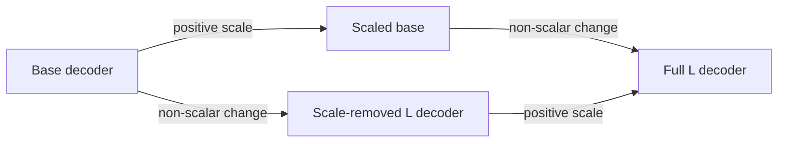

# Same answer, different loss

The [diagnostic](decoder-scale-shape-results.md) separates two decoder changes: positive scale and a non-scalar change to its class map. Routing and all saved weights remain fixed; we evaluate exact transformations of audited logits.

## Why cross-entropy can change without accuracy changing

For class logits z and the correct class y,

$$\ell(z,y)=\log\sum_j e^{z_j}-z_y.$$

Multiply every logit by a positive number s. Their ordering stays the same, but softmax probabilities change. For example, logits (2,1) predict class one. If class two is correct, loss is about 1.31. Scaling to (6,3) keeps that wrong answer and raises loss to about 3.05.

When the correct class uniquely has the highest logit, large positive scaling drives its loss toward zero. For a wrong answer, loss grows roughly with $s(\max_j z_j-z_y)$. Whether mean loss improves depends on the collection of margins. Scaling alone cannot fix a wrong class or an incomplete map.

## Our fixed decomposition

The effective decoder is $B=[WV^T\;b]$, with each column's class mean removed. Centering removes only a common logit offset. We project the L-BFGS decoder onto the negative-gradient decoder:

$$s=\frac{\langle B_L,B_N\rangle}{\|B_N\|^2},\qquad Q=B_L/s.$$

The scalar uses weights only. No labels or validation scores choose it. Q is the L decoder with that projected scale removed; it includes its non-scalar change. This is not an exact equal-norm decomposition or a unique definition of shape.

| Case | Decoder | Question |
|---|---|---|
| Base | $B_N$ | Original reference |
| Scale | $sB_N$ | What does scale do at the reference shape? |
| Shape | $Q$ | What does the L map do without that scale? |
| Full | $sQ$ | Original L-BFGS decoder |

Cross-entropy is nonlinear. The scale effect can differ along the two paths. We report both conditional effects and their interaction. A ratio above 100% means the remaining change offsets part of the loss penalty, not that we found a unique causal percentage.

## What remains unknown

The measured decoder effect does not explain why training grew its scale or learned particular routing. Smaller loss with unchanged decisions is not a retrieval repair. We have not measured calibration error, found an optimal temperature or tested deployment behavior.

[Guo et al. (2017), section 4.2/equation 9](https://proceedings.mlr.press/v70/guo17a/guo17a.pdf) explains positive logit scaling and unchanged predictions. Its fitted validation-temperature method differs from our fixed weight projection. [Yang et al. (2024), section 2.2](https://arxiv.org/html/2406.06484v2#S2.SS2) supplies delta write/read context. The projection, two-path decomposition and margin argument are local derivations; neither paper predicts these scores.
