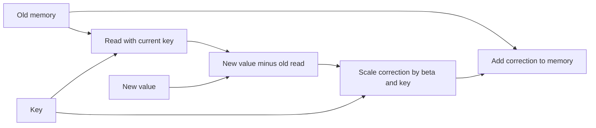

# Delta memory: correct what a key currently reads

A scalar forget gate weakens the whole memory. A delta update changes memory along the current key's direction. This is an established update rule, not a new proposal.

## Read, compare, correct

Let S be an m-by-d_v memory matrix. Keys have unit L2 length. beta controls write strength:

\[
v_{old}=S^Tk,\qquad e=v-v_{old},\qquad
S_{new}=S+\beta k e^T,\qquad y=S_{new}^Tq.
\]

The readout has no softmax or accumulated denominator. Keys and queries here are supplied vectors, not the positive features used in our previous gated-memory audit.

## When is replacement exact?

For a unit key:

\[
S_{new}^Tk=(1-\beta)v_{old}+\beta v.
\]

| Old value2, new value8 | New read |
|---|---:|
| beta0 | 2 |
| beta0.5 | 5 |
| beta1 | 8 |

With unit keys and a nonzero correction, exact replacement needs beta1. More generally it needs beta*||k||^2=1. In our random tests beta=sigmoid(a); exact0/1 are separately supplied boundary fixtures.

## What happens to another key?

For any query q, the change is

\[
\Delta y=\beta(q^Tk)(v-v_{old}).
\]

An orthogonal key has q^Tk=0, so its read is preserved. An overlapping key generally changes. For overlap0.6 and correction6 at beta1, the other read shifts by3.6. Key-directed does not mean interference-free.

## Why key length matters

Without unit normalization, the corrected key's read changes by beta*||k||^2*e. Large keys can overshoot. The state transition is I-beta*k*k^T: its factor along k is1-beta*||k||^2, and perpendicular directions retain factor1. This describes local state sensitivity, not full-network training stability.

This update also equals one gradient step of size beta on the local squared read error, 0.5*||S^T k-v||^2, holding k and v fixed. That algebra does not mean we trained a model in this study.

Sources: [Schlag et al. (2021), section4.2, equations20-25](https://proceedings.mlr.press/v139/schlag21a/schlag21a.pdf) gives the correction rule; its feature normalization differs from our explicit L2-unit keys. [Gated Delta Networks v3 (2025), section2.2](https://arxiv.org/html/2412.06464v3) states the equivalent matrix transition. We audit plain delta arithmetic, not either complete architecture. See [results](delta-memory-results.md).
