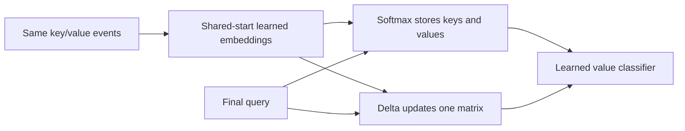

# Can compact memory retrieve the latest value?

Example: `A:1, B:4, A:3`. Asking A requires 3; asking B requires 4. Always returning the first match or the final event cannot solve both query groups.

Both readers receive the same structured key/value events and query. They learn key/value embeddings and a classifier. The task supplies pair boundaries, not the answer or an ideal memory slot. This is a compact retrieval comparison, not a complete Transformer.

## Two ways to retain the context

| Reader | Stored information | Answer construction |
|---|---|---|
| Softmax | Each event's projected key and value | Weight stored values using key similarity and a learned recency bias |
| Delta | One matrix updated after every event | Read the matrix with the learned query vector |

With unit keys, delta uses:

\[
v_{old}=S^Tk,\quad S_{new}=S+\beta k(v-v_{old})^T,\quad r=S_{final}^Tq.
\]

The update corrects what the current key reads. It does not erase every previous event. For that key, the new read is `(1-beta)*old + beta*new`. Other reads can change when their keys overlap. Here beta is learned through its sigmoid parameter; no orthogonal geometry or beta=1 is imposed.

Softmax uses `p_t = softmax(scale*q·k_t + recency*(t-(n-1)))`, then `r = sum(p_t*v_t)`. Its positive scale and recency slope are learned. Recency is needed because the requested value is the latest assignment. This bias is part of the comparison, not a claim about every attention design.

## What memory reduction means

For batch B, n events, 16 key dimensions and 8 value dimensions, FP32 persistent tensor payload is `4*B*n*24` bytes for softmax and `4*B*16*8` for delta.

| Events, batch 1 | Softmax payload | Delta payload |
|---|---:|---:|
| 8 | 768 bytes | 512 bytes |
| 32 | 3,072 bytes | 512 bytes |
| 128 | 12,288 bytes | 512 bytes |

These are mathematical tensor counts. They exclude model weights, input records and temporary buffers. CUDA allocation includes rounding; training must also retain information for gradients. Smaller persistent state therefore does not establish smaller training memory or faster execution.

## Why check learning before benchmarking?

A cheap reader that cannot retrieve the answer is not an accuracy-preserving replacement. Development must first reach 99% in every short training group and seed. Fresh confirmation then checks held-out reliability and paired accuracy loss. Memory and timing are measured only after those gates pass. No passing mean may hide a failing group.

The earlier [ELU+1 comparison](linear-retrieval-results.md) had incomplete training fit. The [delta/gated reader study](learned-memory-control-results.md) fitted different structured reset templates but did not include softmax. Neither answers this new paired question.

[Frozen design](../../protocols/delta-retrieval.md). Established update: [Yang et al. 2024, section 2.2](https://arxiv.org/html/2406.06484v2). Their parallel algorithm and large language experiments differ from this eager, single-memory reader. [Gated DeltaNet 2025](https://arxiv.org/html/2412.06464v3) adds retention and other model components; those are not included here. [Preconditioned DeltaNet 2026](https://proceedings.mlr.press/v306/tumma26a.html) was screened for newer context, not reproduced. Foundational equations take priority over recency when they define the tested rule.

Observed: both readers fit training; delta remains 100% through 32 events, while the compact softmax reader loses long-input reliability. The frozen gate skips resource benchmarking, so the byte table above remains theoretical. [Results, controls and interpretation](delta-retrieval-results.md).
