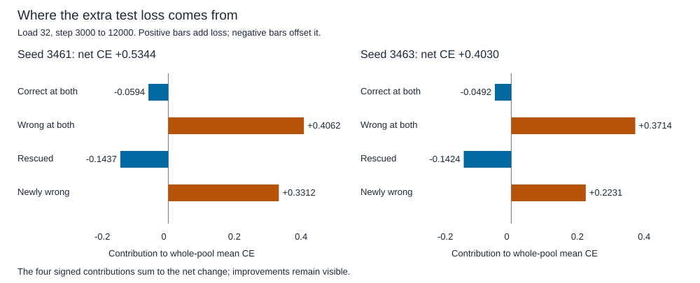

# Where continued training raises held-out loss

Persistent errors contribute the largest positive part of the load-32 loss increase in both validation and test seeds. Newly wrong answers add substantial loss too. Rescues and consistently correct answers offset part of it. On test data, the fixed persistent-error cohorts have higher mean wrong-winner confidence and lower mean true-class probability. This locates deterioration in the outputs; it does not identify a parameter cause.

## Method

Compare the existing exhaustive-policy predictions at steps 3000 and 12000 for seeds 3461/3463. Same full train/validation/test histories, keys, labels and repeat masks, at loads 2/8/16/32. CPU float64, one thread, zero training updates. Twenty-four paired pools contain 155904 paired answers, or 311808 endpoint score vectors. All/unique/repeat scopes overlap; they are not independent runs. Earlier source forward audits are reused through their immutable score/report hashes. [Protocol](../../protocols/feedback-loss-decomposition.md) | [Short learning guide](feedback-loss-decomposition-guide.md).

Each answer falls into exactly one correctness transition. Contribution = sum of its group CE changes divided by the whole relevant pool count. All four contributions reconcile with the earlier reported CE change. A conditional group mean is a different quantity. Data and seeds were already opened; this is exploratory diagnosis, not fresh confirmation or length transfer.

## What adds and removes test loss at load 32

| Seed | Transition | Answers | Mean CE at 3000 / 12000 | Contribution to whole-pool CE change |
|---|---|---|---|---|
| 3461 | Correct at both | 9735 | 0.0880 / 0.0130 | -0.059365 |
| 3461 | Wrong at both | 848 | 2.9950 / 8.8812 | +0.406212 |
| 3461 | Rescued | 887 | 2.0443 / 0.0533 | -0.143715 |
| 3461 | Newly wrong | 818 | 0.2803 / 5.2562 | +0.331240 |
| 3463 | Correct at both | 9806 | 0.0744 / 0.0127 | -0.049185 |
| 3463 | Wrong at both | 924 | 3.3472 / 8.2863 | +0.371394 |
| 3463 | Rescued | 882 | 2.0507 / 0.0673 | -0.142360 |
| 3463 | Newly wrong | 676 | 0.3256 / 4.3819 | +0.223148 |

Seed 3461 has 887 rescues versus 818 new harms: net 69 correct answers. Seed 3463 has 882 versus 676: net 206. These explain the +0.56/+1.68-point accuracy gains. Their total CE increases remain +0.534372/+0.402996. The positive terms exceed the net because negative terms offset them.

## Persistent errors: confidence is not true-class probability

These are fixed wrong-at-both cohorts. Probabilities below are cohort means. Some answers switch to a different wrong class.

| Seed | Pool at load 32 | Answers | True-class probability at 3000 / 12000 | Winner confidence at 3000 / 12000 | Answers with increased winner confidence |
|---|---|---|---|---|---|
| 3461 | train | 86 | 19.01% / 23.52% | 55.49% / 61.06% | 53 / 86 |
| 3461 | validation | 353 | 14.21% / 3.67% | 66.71% / 89.88% | 319 / 353 |
| 3461 | test | 848 | 12.61% / 4.58% | 66.68% / 89.16% | 754 / 848 |
| 3463 | train | 128 | 16.95% / 29.22% | 60.60% / 62.83% | 71 / 128 |
| 3463 | validation | 436 | 11.82% / 5.66% | 69.95% / 89.31% | 387 / 436 |
| 3463 | test | 924 | 12.16% / 5.15% | 68.42% / 88.30% | 766 / 924 |

On test data, CE increases for 738/848 and 713/924 persistent errors. Winning confidence increases for 754/848 and 766/924; it decreases or remains unresolved for the others. The wrong winning class changes for 344 answers in each seed. These are not uniformly unchanged wrong predictions.

Training persistent-error CE instead falls in both seeds, while both mean true probability and winner confidence rise. The remaining probability mass can move away from other classes toward both. Hence higher wrong-winner confidence alone does not prove higher CE. Mean CE also differs from -log(mean true probability). No calibration curve or ECE is measured.

## All seeds and loads

Cells below are CE change / accuracy change in percentage points. Full four-transition and absent-group records for every pool are in the CSV. Loads 2/8/16 are repeated-key groups; load 32 is unique-key.

| Seed | Load | Training | Validation | Test |
|---|---|---|---|---|
| 3461 | 2 | -1.04148e-10 / +0.00 | -1.46766e-10 / +0.00 | -1.04726e-10 / +0.00 |
| 3461 | 8 | +2.38207e-05 / +0.00 | -0.00844398 / +0.78 | +0.00837089 / -0.39 |
| 3461 | 16 | -0.0107227 / +0.03 | +0.0403953 / +0.98 | +0.0262958 / +1.35 |
| 3461 | 32 | -0.151916 / +4.55 | +0.482137 / +0.94 | +0.534372 / +0.56 |
| 3463 | 2 | -3.98686e-12 / +0.00 | -3.29488e-12 / +0.00 | -3.42905e-12 / +0.00 |
| 3463 | 8 | -0.00013082 / +0.00 | -0.0122039 / +0.39 | +0.000799556 / +0.00 |
| 3463 | 16 | -0.00836429 / +0.01 | +0.0573603 / +0.10 | +0.148132 / +0.16 |
| 3463 | 32 | -0.12643 / +3.64 | +0.461065 / -0.34 | +0.402996 / +1.68 |

At load 16, held-out CE also rises in both seeds despite better accuracy. Seed 3461 test-8 loses accuracy; seed 3463 validation-32 loses accuracy. The deterioration is not confined to one aggregate test mean. Tiny load-2 changes are recorded without assigning them a mechanism.

## Traceable examples and verification

| Seed | Test-32 history index | Key | True label | Old / new prediction | Old / new CE |
|---|---|---|---|---|---|
| 3461 | 182 | 4 | 5 | 3 / 2 | 8.1179 / 38.7948 |
| 3463 | 197 | 12 | 4 | 0 / 5 | 9.7444 / 47.9581 |

These are the largest positive CE-change examples for each test seed, not representative samples. History/key indices are zero-based and refer to the preserved original test-data order. The JSON retains up to five positive examples per pool, with indices and exact changes.

Independent scalar audit passes all 24 cells/155904 paired answers: labels, probabilities, margins, transition counts, signed sums, source-report bindings and example identities. Maximum native/scalar difference 2.842e-14; 137 locked files remain unchanged. Three preflight methods pass, including supplied transitions, missing groups, ties, shift invariance, initialized evaluator/matrix-audit reload and deliberate corruptions. No model forward pass, gradient or training update is added to the formal diagnosis; prior forward audits remain bound by hash.

- [Full partition metrics](../../../results/feedback_loss_decomposition/metrics.csv), [report and examples](../../../results/feedback_loss_decomposition/report.json), [independent audit](../../../results/feedback_loss_decomposition/audit.json), [preflight](../../../results/feedback_loss_decomposition_preflight.json).

## Interpretation and next question

Continuing training improves the number of correct answers while making many surviving held-out errors more costly. Both ranking changes and probability changes occur. This rules out a pure positive uniform rescaling of the old logits as the complete account, because such scaling preserves every class winner. It does not rule out amplification as one contributor, identify beta/readout/geometry causality or establish that memory content is irrecoverably lost. Endpoint data do not establish a monotonic trajectory.

Next proposed discriminator: how much of the extra CE can a declared rank-preserving readout-scale control remove while the final memory and predictions stay fixed? Match the final class-centered readout scale to the earlier scale using weights, without label-based tuning. Such a control can test an amplification contribution; it cannot repair incorrect retrieval or reconstruct the training cause. Freeze it separately. No control, calibration fit or new training has started. RL remains parked.

Sources inspected: [PyTorch 2.11 CrossEntropyLoss](https://docs.pytorch.org/docs/2.11/generated/torch.nn.CrossEntropyLoss.html), class-index NLL/mean reduction; [Guo et al. 2017, section 2](https://proceedings.mlr.press/v70/guo17a/guo17a.pdf), confidence versus calibration and NLL. The four-way contribution identity is local algebra; measured counts/probabilities are local results. The paper does not predict these scores or establish calibration failure in this toy reader.
