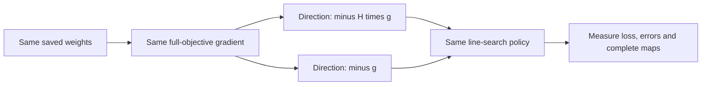

# Why the optimizer's direction matters

The [experiment](fitting-direction-results.md) asks why the same memory reader can fit better under a different procedure. It changes the update direction while retaining full training feedback and the same line-search policy. Architecture, labels and starting weights stay fixed.

## Gradient, direction and step length

Let $F(\theta)$ be our equal-load training CE and $g=\nabla F(\theta)$. An update is

$$\theta_{next}=\theta+t d.$$

| Quantity | Meaning |
|---|---|
| $g$ | Local sensitivity of loss to each parameter |
| $d$ | The direction in which the optimizer proposes to move |
| $t$ | How far the line search moves along that direction |

The negative-gradient branch uses $d=-g$. Locally, $g^Td=-\|g\|^2$, so sufficiently small positive steps decrease a differentiable objective when $g\ne0$. This local derivative does not guarantee useful progress at any particular finite step.

L-BFGS uses $d=-H g$. Here $H$ approximates inverse curvature; it is not an explicitly calculated neural Hessian. Recent parameter differences $s=\theta_{next}-\theta$ and gradient differences $y=g_{next}-g$ update the approximation. The tested implementation keeps at most 20 pairs and accepts a pair only when $y^Ts>10^{-10}$.

Curvature can change both the relative movement of parameters and the direction's overall size. An angle alone misses size changes. Our intervention tests the complete direction rule, including its scaling; it does not separate rotation from scaling.

## What the line search controls

Both branches call the same native strong-Wolfe search. For $\phi(t)=F(\theta+t d)$ it seeks

$$\phi(t)\le\phi(0)+c_1t\phi'(0),\qquad |\phi'(t)|\le c_2|\phi'(0)|,$$

with $c_1=10^{-4}$ and $c_2=0.9$ for a descent direction. The first inequality requires sufficient decrease. The second checks the remaining directional slope. A bounded implementation can exhaust its search; our audit measures whether accepted steps actually satisfy both.

Same policy does not mean identical accepted lengths, trials or update counts. Those can change because the direction changed. We count every full-gradient trial against the same 128-evaluation cap, including rejected trials.

## What this can establish

Better fitting would identify a contribution from the direction rule under this objective and search policy. It would not establish a universally superior optimizer, explain the entire Adam comparison, prove convergence, or explain why the learned memory transfers poorly. We reuse opened pools for diagnosis; this is not a new held-out confirmation.

Inspected sources: [PyTorch 2.11 L-BFGS documentation](https://docs.pytorch.org/docs/2.11/generated/torch.optim.LBFGS.html) and [source](https://github.com/pytorch/pytorch/blob/v2.11.0/torch/optim/lbfgs.py) supply the tested algorithm, thresholds and search. [Liu and Nocedal (1989), author abstract](https://users.iems.northwestern.edu/~nocedal/Abstracts/limited-memory.html) describes limited-memory curvature methods; its convex convergence claim does not apply automatically here. The derivative argument and experimental interpretation above are local reasoning, not predictions of our scores.
