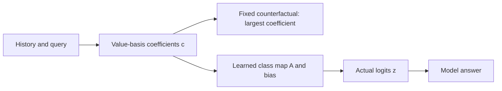

# Learning can repair answers while weakening other margins

The [saved-trajectory diagnostic](fitting-trajectory-results.md) follows the same examples during fitting. It measures both the memory mixture and the model's final decision. No weights are retrained.

## What is a coefficient?

Our reader can be written exactly as

\[
S_T=C_TV,\qquad c=C_T^Tq,\qquad z=(WV^T)c+b.
\]

Each entry c_j measures the mixture's coefficient for value ID j. A coefficient can be negative. It is not an attention probability or a direct amount of stored information.

Choosing the largest coefficient bypasses the learned decoder. Comparing this answer with the real answer tests a specific counterfactual. It is not an optimal decoder. Our synthetic control makes the coefficient rule wrong while a learned class map gives the right answer; the reverse also occurs.

## What is a margin?

For six scores x and correct class y,

\[
m(x,y)=x_y-\max_{j\ne y}x_j,\qquad
u(x,y)=\frac{m(x,y)}{\|x-\operatorname{mean}(x)\|_2}.
\]

Positive raw margin means the correct class strictly wins. Zero can be a tie; negative means it loses. An exactly constant vector has unit margin zero. The denominator removes overall positive scale, so larger weights alone cannot improve this measure.

An average margin can fall while accuracy rises. For example, margins [0.8, -0.01] have 50% accuracy; [0.2, 0.01] have 100% accuracy and a smaller mean. Fixing a few boundary cases need not strengthen every already correct answer. This example illustrates arithmetic, not our learned mechanism.

## What the trajectories tell us

L-BFGS improves training accuracy and the initially wrong training cohort. It also improves average margins in the initially wrong test cohort, but loses many initially correct test answers. Gains are not confined to training, and they do not establish a net transfer repair.

At the final checkpoint, most test errors are also errors under coefficient ranking. Yet the learned decoder corrects many training coefficient errors. That narrows the observed failure, without proving that another decoder could not recover it or explaining how the representations were learned.

Sources inspected: [Yang et al. (2024), section 2.2](https://arxiv.org/html/2406.06484v2#S2.SS2), delta writes/reads; [Guo et al. (2017), section 4.2](https://proceedings.mlr.press/v70/guo17a/guo17a.pdf), positive scaling and unchanged decisions. The factorization, unit margin and example above are local derivations. Our small scalar-beta reader differs from full DeltaNet; this is not a calibration study.
