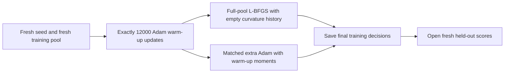

# Does successful finite-pool fitting repeat?

Executed and independently audited, 2026-10-05. **Both procedures confirm the exact 99% fitting gate in all three fresh seeds. Perfect fitting repeats in two L-BFGS seeds, while the third retains six errors.** Fresh held-out map reliability remains weak. The earlier [development witnesses](full-pool-fitting-results.md) remain valid.

## Method and learning point

The [locked protocol](../../protocols/full-pool-fitting-confirmation.md) keeps the architecture, objective, optimizer settings and exposure rule fixed. Seeds 3473/3479/3481 use one new shared dataset, with families excluded from the earlier studies. Training/validation/test contain 768/192/384 histories per load, including six related value shifts per base history. Each key keeps its value within a history; this does not test changing-value overwrite.

A fresh seed checks a different initialization and sampling stream. A fresh pool checks previously unseen history families. Three seeds sharing one pool do not give three independent dataset replications. Confirmation can establish repeatability under this recipe; it cannot identify which optimizer, batching or history change caused the difference.

All fitting decisions use final training checkpoints. Primary: >=99% accuracy in every nonempty training group in every seed, separately by procedure. Secondary: every training answer and complete map correct. Accuracy, cross-entropy and complete maps are reported together. Same-length held-out performance is distinct from longer-input transfer and universal task capacity.

## Fitting results

Warm-up load-32 accuracy is 99.2798% / 98.9990% / 99.0641% in seed order. The middle value fails the exact gate. Warm-up load 16 has four errors in seed 3479; other lower-load warm-up groups are perfect. No seed was skipped or selected.

Final load-32 fitting; each seed has 24,576 answers and 768 histories:

| Seed | Procedure | Accuracy | CE | Errors | Complete training maps |
|---|---|---:|---:|---:|---:|
| 3473 | L-BFGS | 100.0000% | 0.0016391 | 0 | 768/768 |
| 3473 | Adam | 99.9268% | 0.014564 | 18 | 750/768 |
| 3479 | L-BFGS | 100.0000% | 0.0079882 | 0 | 768/768 |
| 3479 | Adam | 99.5280% | 0.023577 | 116 | 672/768 |
| 3481 | L-BFGS | 99.9756% | 0.013711 | 6 | 762/768 |
| 3481 | Adam | 99.5199% | 0.0279 | 118 | 667/768 |

Every final lower-load training group and map is correct. L-BFGS improves load-32 accuracy and CE versus matched Adam in every seed. Seeds 3473/3479 are additional normal-write finite-pool witnesses, with minimum saved-logit margins 1.9496/0.5210 across all training loads. Seed 3481 is not a perfect witness. Its six errors span the six value shifts of one base-history family, not six independent cases; this [post-primary saved-score check](../../../results/full_pool_fitting_confirmation/study/supplementary_verification.json) adds no model evaluation or selection. The primary fitting criterion passes; the stronger all-seed perfection criterion fails for both procedures.

## Fresh held-out results

Cells show accuracy / mean CE. Complete maps count histories with every queried answer correct.

| Seed | Procedure | Load | Validation | Test | Complete test maps |
|---|---|---:|---:|---:|---:|
| 3473 | L-BFGS | 16 | 97.2656% / 0.98788 | 97.6562% / 0.72657 | 270/384 |
| 3473 | Adam | 16 | 97.4609% / 0.43617 | 97.2493% / 0.33701 | 269/384 |
| 3473 | L-BFGS | 32 | 86.6536% / 4.068 | 87.4023% / 4.2212 | 0/384 |
| 3473 | Adam | 32 | 87.3047% / 1.6358 | 87.9232% / 1.6223 | 6/384 |
| 3479 | L-BFGS | 16 | 97.6562% / 0.39914 | 97.5423% / 0.60538 | 269/384 |
| 3479 | Adam | 16 | 97.8516% / 0.23021 | 97.7051% / 0.32736 | 279/384 |
| 3479 | L-BFGS | 32 | 87.0280% / 2.9364 | 88.6637% / 2.6227 | 12/384 |
| 3479 | Adam | 32 | 87.4023% / 1.5951 | 88.4603% / 1.3844 | 24/384 |
| 3481 | L-BFGS | 16 | 96.6797% / 0.80363 | 97.7539% / 0.33701 | 270/384 |
| 3481 | Adam | 16 | 97.4609% / 0.36419 | 97.3145% / 0.33301 | 264/384 |
| 3481 | L-BFGS | 32 | 86.2305% / 2.3911 | 87.5895% / 2.2299 | 6/384 |
| 3481 | Adam | 32 | 86.6374% / 1.4506 | 87.0687% / 1.4103 | 0/384 |

Load 2 is perfect in all validation/test groups, with CE zero at float64 precision. At load 8, both seed-3473 validation accuracies are 99.6094%, with CE 0.044627/0.014242 for L-BFGS/Adam; both seed-3479 test accuracies are 99.8047%/99.6094%, with CE 0.085219/0.013927. Other load-8 held-out accuracies are 100%; their losses and all absent groups remain in the [576-row CSV](../../../results/full_pool_fitting_confirmation/study/evaluation.csv).

L-BFGS validation-32 accuracy is worse than Adam's in all three seeds. Test-32 accuracy effects are mixed; held-out CE is higher at loads 16/32 in every seed. Better training fitting has not produced a reliable held-out winner or explained the gap. Zero/tiny CE does not establish probability exactly one or convergence.

## Actual computation

| Stage | Optimizer calls | Gradient evaluations | History exposures | Answer targets |
|---|---:|---:|---:|---:|
| Three warm-ups | 36,000 | 36,000 | 2,304,000 | 33,408,000 |
| Six fitting branches | 18,525 | 18,718 | 2,347,008 | 34,031,616 |
| Combined | 54,525 | 54,718 | 4,651,008 | 67,439,616 |

Combined input events: 148,832,256. L-BFGS uses 127/128/127 closures and 63 optimizer calls per seed; paired Adam uses 6,096/6,144/6,096 updates. Exposure matches separately per load, including rejected trials. Warm-up is counted once per seed. The reused warm-up helper's stop-reason text names exposure matching, but its actual warm-up limit is the fixed 12,000 updates, with zero L-BFGS closures in that stage.

Training wall time is 716.55 seconds with three workers. Per-seed warm-up times are 385.26/385.72/386.14 seconds; L-BFGS 110.87/111.87/111.29; extra Adam 198.77/201.73/200.16. Times include recording and training snapshots; final held-out evaluation, setup and independent audit are outside this wall-time field. Concurrent times are not a speed comparison or independent timing experiments.

## Decision

Adequate finite-pool fitting repeats in all three fresh seeds, for both procedures. Perfect normal-write fitting repeats in two seeds, not all three. Keep the six remaining errors and poor unseen-map reliability visible. Optimizer, batching and optimizer history still differ together; their individual learning effects remain unresolved. This confirmation stops at its budget. A later causal comparison needs one predeclared distinguishing prediction, rather than further recipe search. RL remains parked.

## Verification and sources

The [formal audit](../../../results/full_pool_fitting_confirmation/study/audit.json) passes all 54,718 recorded gradients, 54,525 optimizer calls and 192 evaluation cells / 1,804,032 repeatedly evaluated answers. It checks all 896 base-history families, labels, initial/warm-start lineage, streams, matrix gradients, scalar Adam updates/moments, L-BFGS directions/displacements and counts. Maximum gradient/logit discrepancies are approximately 6.70e-15 / 4.55e-13. All 45 protected files are unchanged. L-BFGS trial replay shares the installed optimizer engine; gradients and direction algebra are checked separately. Verification replays are excluded from formal training counts. The [raw report](../../../results/full_pool_fitting_confirmation/study/report.json), score tensors, checkpoints and trajectories are preserved.

Two runtime preflight methods pass with three concurrent initialized fixture seeds, real saved evaluator/audit paths and deliberate label/logit/gradient/lineage/count/decision/missing-cell/load/family-leakage faults. The fixture producer makes 51 optimizer calls and 57 gradients; audit replays are separate. Serial preparation sources and the sandbox-blocked parallel preflight log are preserved. Native Windows pipe permission resolved that infrastructure failure without changing the recipe. Three CPU workers use float64 and one thread each; GPU is unused and CPU peak memory is unmeasured.

[PyTorch 2.11 L-BFGS](https://docs.pytorch.org/docs/2.11/generated/torch.optim.LBFGS.html) was reopened for closures/history/tolerances, and [Yang et al. (2024), section 2.2](https://arxiv.org/html/2406.06484v2#S2.SS2) for delta writes/reads. The [existing educational guide](full-pool-fitting-guide.md) explains the mathematics. Family separation, warm-start construction and confirmation criteria are local design choices. No paper predicts local scores.
