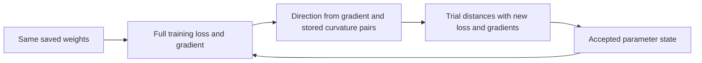

# Learning with the whole training objective

The question is whether another training procedure can produce a successful reference using the same reader. The memory still writes and reads normally; all parameters remain shared across histories. See the [results](full-pool-fitting-results.md) and [frozen protocol](../../protocols/full-pool-fitting.md).

## What changes

| Original Adam procedure | Full-pool L-BFGS procedure |
|---|---|
| Samples 64 histories from one load per update | Evaluates every training history and present-key query across four loads |
| Uses stored first/second gradient moments from earlier training | Starts with empty curvature history and collects parameter/gradient differences |
| Takes one declared Adam update | Chooses a direction and evaluates trial step lengths before accepting a state |

Both begin from identical saved weights in each seed. Their batching, optimizer and optimizer history differ together. This comparison can establish an effect of the overall procedure; individual causes remain separate.

## The objective and the direction

Each load gets equal weight, matching the original training objective in expectation:

$$L(\theta)=\frac14\sum_{m\in\{2,8,16,32\}}\frac{1}{768m}\sum_{h=1}^{768}\sum_{q\in h}CE(z_\theta(h,q),y_{h,q}).$$

A single mean over all concatenated answers would overweight larger loads. We instead accumulate each load's appropriately weighted gradient. Complete histories are still needed for each read; exhaustive queries share their history's memory computation.

L-BFGS uses changes in parameters and gradients,

$$s_t=\theta_{t+1}-\theta_t,\qquad y_t=g_{t+1}-g_t,\qquad d_t=-H_tg_t,$$

to approximate an inverse curvature matrix H. PyTorch stores recent s/y pairs and obtains the direction through a two-loop computation, without constructing a full Hessian. The measured gradient is still the derivative of CE through the normal memory writes.

A line search tries distances along that direction. Each trial evaluates the entire loss and gradient again. Those trials consume training computation even when rejected. A bounded line search and small gradient do not prove a global optimum.

## Why the budget counts evaluations

One complete objective evaluation processes 3,072 histories and 44,544 answers. Forty-eight original Adam updates process the same history/answer counts across a complete load cycle. We match those counts, including L-BFGS trial evaluations. Updates, gradient variance, repeated examples and execution cost still differ.

Final >=99% accuracy in every nonempty training group is the declared fitting gate. A 100% full-training-pool result is a stronger finite-pool witness. A fitting gain could still accompany worse held-out loss or incomplete maps. Fresh confirmation is a later requirement.

## Sources and scope

[Liu and Nocedal (1989), author abstract](https://users.iems.northwestern.edu/~nocedal/Abstracts/limited-memory.html) was inspected for limited-memory quasi-Newton context and the uniformly convex convergence scope. That guarantee does not apply automatically to this neural objective. [PyTorch 2.11 L-BFGS](https://docs.pytorch.org/docs/2.11/generated/torch.optim.LBFGS.html) and installed step/strong-Wolfe source were inspected for closures, curvature history, tolerances and evaluation counts. The gradient-weighting and exposure equality above are local derivations. No source predicts our scores or recommends this procedure for larger models.
