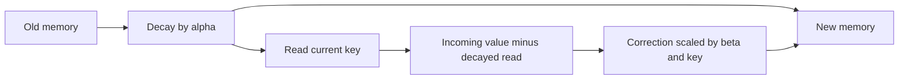

# Gated delta memory: forget, then correct

Two controls do different jobs. alpha retains a fraction of old memory. beta controls the correction toward the incoming value.

\[
P=\alpha S,\quad e=v-P^Tk,\quad
S_{new}=P+\beta k e^T,\quad y=S_{new}^Tq.
\]

The correction must use the **decayed** read P^T k. Subtracting the original read S^T k gives a different update. Keys have unit L2 length in this audit; there is no accumulated normalization denominator.

## What the controls buy

Start with independent orthogonal associations A:2 and B:5. Write A:8.

| alpha | beta | New A | New B | Meaning |
|---:|---:|---:|---:|---|
| 1 | 1 | 8 | 5 | Replace A, preserve B |
| 0.5 | 1 | 8 | 2.5 | Replace A, weaken B |
| 0 | 1 | 8 | 0 | Reset history and write A |
| 0.5 | 0.5 | 4.5 | 2.5 | Partially correct the decayed A |
| 0 | 0 | 0 | 0 | Clear everything |

Zero after reset means the old association is lost. The model has not learned that zero is its correct value. Exact0/1 are boundary fixtures; random gates use finite sigmoid logits.

For unit k, its new read is alpha*(1-beta)*old_read+beta*v. An orthogonal read is multiplied by alpha. Thus even unrelated associations decay unless alpha=1.

For a general query:

\[
\Delta y=(\alpha-1)S^Tq+\beta(q^Tk)(v-\alpha S^Tk).
\]

The first term is forgetting. The second is correction interference. Combining the mechanisms does not remove this tradeoff or teach the gates when to act.

The recurrence is the transpose-convention form of [Yang et al., Gated Delta Networks v3, section3.1 equation10](https://arxiv.org/html/2412.06464v3). We audit supplied vectors and gates, not its full architecture or learned performance. [Results](gated-delta-memory-results.md) | [Four-rule assessment](../../assessments/memory-update-assessment.md).
