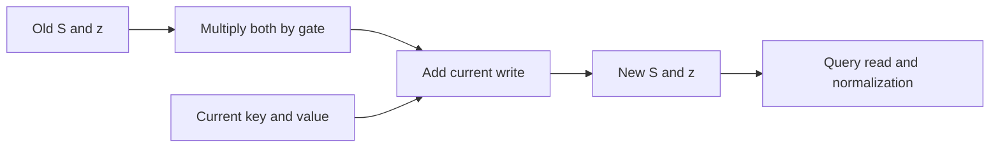

# Gated memory: forgetting is not selective updating

A forget gate multiplies the old memory before adding new information. We audit one scalar gate per head and token. It affects every entry of that head's memory.

## The update

With positive features phi=ELU+1 and gate g_t=sigmoid(a_t):

\[
S_t=g_tS_{t-1}+\phi(k_t)v_t^T,\qquad
z_t=g_tz_{t-1}+\phi(k_t),\qquad
y_t=\frac{\phi(q_t)^TS_t}{\phi(q_t)^Tz_t}.
\]

S stores key/value associations. z supplies the normalization. Both must decay. There is no separate write gate here.

| Gate | Effect |
|---|---|
| 1 | Keep old memory fully |
| 0.5 | Halve old state before the current write |
| 0 | Erase all old state |

Exact0/1 are explicit boundary tests. A finite real sigmoid logit produces a gate strictly between them.

## How much of an old write survives?

Write j receives the multiplier

\[
D_{tj}=\prod_{l=j+1}^{t}g_l.
\]

Its own gate is excluded: that gate acts before its write arrives. Expanded attention weights are proportional to D_tj*phi(q_t)^Tphi(k_j). This provides a separate calculation to check the recurrence.

Holding gates and keys fixed, the derivative of S_t with respect to an earlier S_j is D_tj times the identity. The normalized output gradient also depends on the denominator. It is not simply that product.

## A two-write example

Use identical scalar key/query features and values2 then8. The final output is (2g+8)/(g+1).

| Gate on second write | Output | Derivative with respect to old value |
|---|---:|---:|
| 1 | 5 | 0.5 |
| 0.5 | 6 | 1/3 |
| 0 | 8 | 0 |

Forgetting reduces the old value's influence. It does not make an average into exact replacement unless the old contribution is removed.

## The limit

For ideal separate feature directions A and B, consider A:2, B:5, A:8. With gates1/.5/.5, A reads6.8 and B still reads5. Resetting the whole memory on the final write makes A exactly8 but removes B. This witness uses supplied orthogonal features, not finite ELU+1 inputs, which are strictly positive.

Scalar forgetting therefore does not implement key-specific deletion. This does not rule out richer gates or learned representations.

[Yang et al., GLA (2024)](https://arxiv.org/html/2312.06635v6), sections2.1/4.1, describes gated matrix memory and a richer feature-wise gate. Our normalized scalar construction is an educational audit, not the paper's full model or a new architecture proposal. See [results](gated-memory-results.md).
