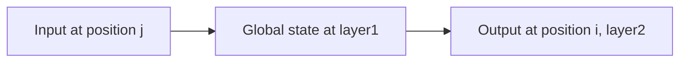
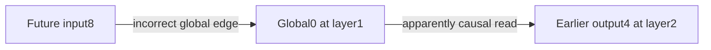

# Global tokens: shorter paths, careful causality

[Results](global-attention-results.md) | [Protocol](../../protocols/global-attention.md)

## What is global?

A designated position receives extra attention connections. Other positions can read it, and it can read other positions, subject to the causal policy. We designate existing positions; we do not append tokens or add parameters.

For query position i, key position j, local radius r and global-position set G:

`visible(i,j) = (abs(i-j)<=r OR i in G OR j in G)`

For causal attention, apply `AND j<=i` to the entire expression. Then use ordinary scaled dot-product softmax over visible keys. Global connections still compete with local keys in the softmax denominator.

## A shared route takes layers

In bidirectional attention, one global position can read all input positions in layer1. Other positions can read that global state in layer2. Thus two layers provide an all-pairs path. They do not guarantee that a fixed-width global state retains every useful detail.

Every layer reads the previous layer. An ordinary query cannot use the global token's newly computed state within the same layer.

## Causal global positions behave differently

With causal masking, a global position g can gather only positions j<=g. A later position i>=g can read that summary. A two-layer global route therefore requires `j<=g<=i`.

| Global placement | Consequence |
|---|---|
| First position | Cannot gather later inputs; being globally readable does not make it an up-to-date summary |
| Middle position | Can summarize its prefix and relay that information to later positions |
| Last position | Can directly gather the whole prefix, but earlier outputs cannot read it |

The table describes these routes, not every possible local path. Fixed-position embeddings, tokenwise FFNs, normalization and residuals do not add cross-position edges.

## How a future token leaks

Use zero-based positions0..8, radius1, global position0. Suppose global0 is incorrectly allowed to read future inputs, while ordinary queries remain causal.

Output4 cannot read input8 directly. Nevertheless, it can read a global state already contaminated by input8. Masking only ordinary-query edges is insufficient. In our controlled example the incorrect two-layer path changes output4 by1/3; the correctly masked change and derivative are exactly zero.

Bidirectional global attention is appropriate when the whole input is legitimately available. The error is using future-reading states in a computation that claims autoregressive causality.

## Cost and source boundary

Local connections plus g global positions require at most local-pair-count +2ng entries, with overlaps reducing that bound. At fixed radius and fixed g this is linear in sequence length. Growing g with sequence length can restore quadratic scaling. A dense masked implementation still computes dense scores.

[Longformer v2, section3.1](https://arxiv.org/html/2004.05150v2) describes bidirectional local/global connections and separate projections for global attention. Our audit shares supplied Q/K/V and additionally defines a causal variant. It verifies connectivity and arithmetic, not the full Longformer model, trained quality or GPU efficiency.
