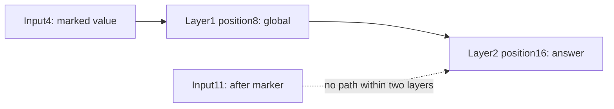

# Learning a causal global relay

[Results](global-retrieval-results.md) | [Protocol](../../protocols/global-retrieval.md) | [Global-token mathematics](global-attention-guide.md)

## The question

A route can exist without being learned. This experiment asks whether one middle global position helps a small Transformer retrieve distant information, and whether removing its extra connections removes that behavior.

All models see a marked value, distractors, a middle marker and a final query. The correct answer is the marked value. Full, local and local-plus-global models share the same initial weights and inputs. Only the attention mask differs.

## Which values can reach the answer?

Two local layers with radius2 can carry information at most four positions. With a causal global position g, a distant source j can use `j -> g -> i` only when `j<=g<=i`.

| Distance to query | Location relative to middle marker | Local | Local plus global |
|---|---|---|---|
|1,4 |After |Reachable |Reachable through local paths |
|5 |After |Unreachable |Unreachable |
|12,16 |Before |Unreachable |Reachable through global connections |

For length17, using zero-based positions, the marker is8 and the query16. A value at4 can reach the query through the marker:

The global position cannot read input11 because it is in its future. The query's local two-layer range starts at12, so input11 cannot reach it either. Global visibility does not remove causal constraints.

## Why one sixth is expected

Every distractor family contains all six possible answers. If the changed value has no path to the query, its final representation must be unchanged. A deterministic prediction can match at most one of the six labels. Accuracy is therefore at most16.67%, and may be lower if the model chooses another vocabulary class.

This creates different aggregate ceilings: local accuracy is at most50%; local-plus-global at most83.33%; full attention can in principle reach100%. These assume perfect performance on reachable groups. Compare distance groups, not just the aggregate.

With equal group weights, unreachable groups also impose cross-entropy lower bounds: local `(3/5)ln(6)=1.075056`, global `(1/5)ln(6)=0.358352`. These bounds explain unavoidable loss; they do not establish convergence.

## What removing the connections tests

After training, the global model is evaluated again with its extra global query/key edges removed in both layers. Its weights and inputs stay fixed. A loss of distant accuracy establishes dependence on those connections for this intervention. It does not identify a unique internal code, separate the query edges from key edges, or show that a global summary retains arbitrary amounts of information.

Train length17; test lengths17 and21. The longer input moves the middle marker from8 to10 and keeps the same source-to-query distances. Both distant sources remain before the marker. This is bounded context/position transfer, not unlimited-distance retrieval.

The [Longformer reference](https://arxiv.org/html/2004.05150v2) motivates local/global connectivity. Our causal shared-projection model and synthetic task differ from its full implementation and benchmarks. Dense masked execution gives no sparse-kernel speed result.

## Observed outcome

All seeds learn the eligible short task. Global distant accuracy on length21 is100%/100%/83.33% across seeds, so the frozen reliability rule fails. Removing global edges drops distant accuracy to1/6 in every test cell. A route can be used successfully and still generalize unreliably. The study is closed.
