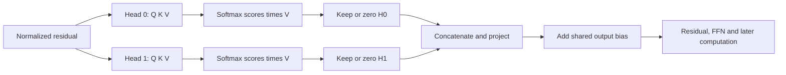

# What do separate attention heads contribute?

**Head dependence varies across seeds. Removing both heads is strongly damaging in either block.** These are frozen-model interventions, not evidence that a newly trained one-head model must fail.

## What is new?

The [earlier head study](head-token-results.md) restored donor Q/K in shifted block-2 inputs. This study removes ordinary head outputs in both blocks. Five pre-norm constant-rate models at 6,000 updates; 400 previously opened mappings, all 7,200 variants, offset 0. No training. [Protocol](../../head-ablation-protocol.md).

## Learn the operation

For head h, `A_h = softmax(Q_h K_h^T / sqrt(8) + causal_mask)` and `H_h = A_h V_h`. Each head has width 8. Its learned projections can produce different routing and content from the same input.

In row-vector notation, attention output is `O = concat(H_0,H_1) W_O^T + b_O = C_0 + C_1 + b_O`. Here `C_h = H_h W_O[:,8h:8h+8]^T`. This is an exact decomposition before the residual and downstream nonlinear operations. It is not an additive decomposition of final accuracy or loss.

Zeroing a head removes its contribution at **every query position**. The shared output bias remains, including when both heads are zero. Surviving heads are not rescaled. Downstream activations are recomputed.

## Results

Means across five seeds. The baseline gets every example right, so each changed prediction is a harmed prediction; there are no rescues. Loss is cross-entropy in nats.

| Removed | Accuracy | Loss | Mean harmed / 7,200 |
|---|---:|---:|---:|
| None | 100% | .000136 | 0 |
| Block 1, head 0 | 73.403% | 1.993127 | 1,915 |
| Block 1, head 1 | 73.472% | 2.025419 | 1,910 |
| Block 1, both | 27.814% | 5.681345 | 5,197.4 |
| Block 2, head 0 | 84.161% | .836366 | 1,140.4 |
| Block 2, head 1 | 66.536% | 1.755467 | 2,409.4 |
| Block 2, both | 18.347% | 5.096487 | 5,879 |

Similar means can hide different head roles. Accuracy after removal:

| Seed | B1 H0 | B1 H1 | B1 both | B2 H0 | B2 H1 | B2 both |
|---|---:|---:|---:|---:|---:|---:|
| 601 | 44.07% | 99.90% | 23.85% | 81.68% | 76.57% | 17.57% |
| 631 | 94.24% | 82.76% | 29.13% | 93.17% | 60.76% | 19.58% |
| 659 | 99.90% | 29.60% | 26.68% | 74.31% | 86.22% | 18.53% |
| 683 | 28.88% | 99.99% | 27.64% | 72.06% | 52.50% | 18.29% |
| 719 | 99.93% | 55.11% | 31.78% | 99.60% | 56.63% | 17.76% |

No single-head removal preserves perfect accuracy in any seed. Small losses of accuracy still do not establish safe pruning. Failures occur at every queried pair rank; per-rank accuracy and full-mapping correctness are in the raw report.

## Attention inspection: what can we learn?

Positions are `[k1,v1,k2,v2,k3,v3,marker,query]`. A value row can attend to its preceding key. In block 1, the head with higher mean attention mass on that key is also the more damaging head to remove in all five seeds. This is a descriptive association, not proof of the information it transmits.

| Seed | B1 preceding-key mass H0 / H1 | More damaging removal |
|---|---:|---|
| 601 | 87.21% / 48.87% | H0 |
| 631 | 71.19% / 80.48% | H1 |
| 659 | 24.36% / 82.46% | H1 |
| 683 | 92.84% / 18.05% | H0 |
| 719 | 37.14% / 84.93% | H1 |

Why inspect more than the final query? Seed 683's important B1 H0 sends 95.77% of its final-query attention to the marker, while its value rows send 92.84% to preceding keys. A final-query picture alone misses those other rows. All-row removal does not establish which row caused the damage.

In block 2, mean final-query attention on the target value ranges from 62.58% to 94.58% across the ten heads. Their projected final-query contribution norms range from 2.55 to 5.38. Neither is an importance score: values, projection directions, residual state and later normalization also matter. Full eight-position distributions and per-head norms are saved.

A concrete counterexample: seed 683's B2 H0 has more target attention than H1 (81.73% versus 74.64%). Yet removing H1 damages accuracy more (52.50% remaining versus 72.06%). Ranking heads by target attention alone gives the wrong removal-impact ordering here.

The loss interaction `L(both)-L(H0)-L(H1)+L(base)` is positive in every seed: .023 to 4.023 nats in block 1 and 1.348 to 4.196 in block 2. Joint removal costs more loss than the sum of separate removals here. This descriptive non-additivity does not uniquely identify redundancy or cooperation.

## Papers and limits

[Michel et al., NeurIPS 2019](https://proceedings.neurips.cc/paper/2019/hash/2c601ad9d2ff9bc8b282670cdd54f69f-Abstract.html) report that many heads can be removed at inference in their models. [Voita et al., ACL 2019](https://aclanthology.org/P19-1580/) study specialized translation heads and learned pruning. Publication abstracts were checked. Our tiny two-head recall models and direct zeroing differ; this is neither a replication nor a refutation.

Head indices are not aligned semantic roles across seeds. Zeroing creates unusual internal states. Results establish dependence under this intervention, not the minimum heads needed after retraining, general language-model behavior, or a complete retrieval mechanism. No architecture change follows from this diagnostic alone.

## Verification and next boundary

All 35 conditions were run. Explicit head-output zeroing agrees with a separate library implementation that zeros matching output-projection columns: maximum logit discrepancy 7.91e-14. Head contributions sum to ordinary output within 3.56e-15. Saved prediction summaries reproduce exactly; library attention inspection agrees within 2.23e-16. Checkpoint hashes remain unchanged. Both implementations use PyTorch, not independent frameworks.

[Code](../../../experiments/head_ablation.py), [raw results](../../../results/head_ablation.json), [saved logits](../../../results/head_ablation_scores.pt), [audit code](../../../experiments/audit_head_ablation.py), [audit results](../../../results/head_ablation_audit.json).

Follow-up completed: [value-row versus final-query removal](head-row-results.md). Block-1 damage concentrates at value rows; block-2 final-query dependence matches the architecture. This localizes effects without establishing what information was carried.
