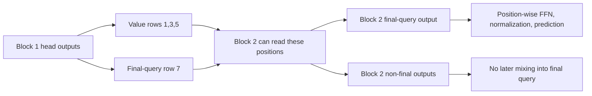

# Where do head-output removals cause damage?

**Block 1's value-token rows carry the strongest measured dependency.** Removing both heads at those rows leaves 24.60% mean accuracy. Final-query-only removal leaves 99.75%. This localizes an effect; it does not prove what information the heads carry.

## Rows are destinations, not sources

The sequence is `[k1,v1,k2,v2,k3,v3,marker,query]`. A head output at row i is `H_h[i] = sum_j A_h[i,j] V_h[j]`. Row i receives information; column j supplies it.

We remove output contributions at destination rows 1/3/5 (values), 7 (final query), or 0/2/4/6 (remaining). We do not delete those tokens or their source columns from attention.

For selected heads S and rows R, `O'[i] = O[i] - 1(i in R) sum_(h in S) C_h[i]`. The [previous head decomposition](head-ablation-results.md) defines C. Output bias and residual remain. Later attention, FFN and normalization recompute normally.

## Method and results

Same five frozen pre-norm models at 6,000 updates; same opened 400 mappings and 7,200 variants. Each head and both heads, in each block, across four row groups: 120 conditions. No training or head selection. [Protocol](../../head-row-protocol.md).

Mean accuracy; ordinary baseline is 100%. All-row controls reproduce the previous study.

| Block / heads removed | Value rows | Final query | Remaining rows | All rows |
|---|---:|---:|---:|---:|
| B1 H0 | 69.819% | 99.925% | 99.950% | 73.403% |
| B1 H1 | 69.675% | 99.925% | 100% | 73.472% |
| B1 both | 24.597% | 99.753% | 99.872% | 27.814% |
| B2 H0 | 100% | 84.161% | 100% | 84.161% |
| B2 H1 | 100% | 66.536% | 100% | 66.536% |
| B2 both | 100% | 18.347% | 100% | 18.347% |

Mean cross-entropy in nats exposes effects hidden by high accuracy. Ordinary loss is .000136.

| Block / heads removed | Value rows | Final query | Remaining rows | All rows |
|---|---:|---:|---:|---:|
| B1 H0 | 2.341083 | .002787 | .001553 | 1.993127 |
| B1 H1 | 2.263101 | .002048 | .000163 | 2.025419 |
| B1 both | 5.999904 | .008782 | .005136 | 5.681345 |
| B2 H0 | .000136 | .836366 | .000136 | .836366 |
| B2 H1 | .000136 | 1.755467 | .000136 | 1.755467 |
| B2 both | .000136 | 5.096487 | .000136 | 5.096487 |

The main block-1 contrast holds across every seed, not just the mean. Accuracy after removing both heads:

| Seed | Value rows | Final query | Remaining rows | All rows |
|---|---:|---:|---:|---:|
| 601 | 23.472% | 99.958% | 99.681% | 23.847% |
| 631 | 27.528% | 99.708% | 99.722% | 29.125% |
| 659 | 24.264% | 99.903% | 100% | 26.681% |
| 683 | 19.875% | 99.292% | 99.958% | 27.639% |
| 719 | 27.847% | 99.903% | 100% | 31.778% |

## Why is removing more sometimes less harmful?

The model after one removal is a different internal state. Further removal can change or partly counteract its errors. Nonlinear downstream operations do not require monotonic damage.

For seed 683, removing both B1 heads at value rows causes 5,769 errors. All-row removal causes 5,210. They share 4,561 errors; 1,208 occur only under value removal and 649 only under all-row removal. Thus value-only removal is not an exact reproduction of all-row failure. The counts establish non-monotonicity, not its internal explanation.

## Structural control versus learned behavior

Block 2 is the last token-mixing operation. Its output rows are followed only by position-wise operations. Non-final-row removals therefore cannot reach the final prediction. Final-query-only removal equals all-row removal. Both predictions were verified within 1e-10; this is expected from the architecture.

Block 1 is different: its outputs can affect block 2's Q/K/V. The value-row effects are consistent with preparing information for later retrieval. They do not establish preceding-key copying, identify a specific encoded feature, or separate block-2 routing from content effects.

## Verification, sources and boundary

Two implementations agree: cached explicit contribution subtraction and library attention with zeroed projection columns mixed into selected rows. Maximum logit error is 1.74e-13. Prior all-row predictions reproduce within 1.28e-13; structural controls within 7.38e-14. All 120 saved summaries and error overlaps pass audit; checkpoint hashes are unchanged. Both implementations share PyTorch.

The first audit mistakenly required bitwise equality for non-final B2 removals. Measured discrepancy was 1.64e-14. The check was corrected to the predeclared 1e-10 tolerance; experiment artifacts were unchanged.

[Runner](../../../experiments/head_rows.py), [results](../../../results/head_rows.json), [predictions](../../../results/head_rows_scores.pt), [audit code](../../../experiments/audit_head_rows.py), [audit](../../../results/head_rows_audit.json). Per-head/per-seed, rank, mapping and paired-error details are preserved there.

The [previous paper comparison](head-ablation-results.md#papers-and-limits) still applies: published head-pruning findings concern different models and tasks. This is an exploratory localization on reused examples, not a pruning benchmark or proof that fewer heads cannot learn.

Stop this row-localization study. Establishing what information is carried would require content-specific interventions, not another attention picture or stronger zeroing.
