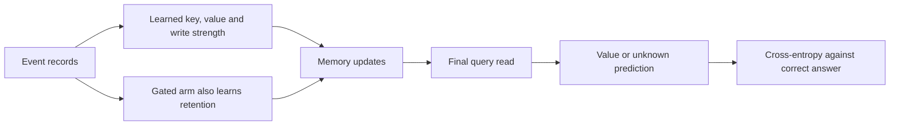

# Learning memory control

The earlier math audits supplied keys and gates. This experiment asks whether training can learn useful representations and updates from correct final answers.

## Four questions for the same reader

| Group | Example | Required answer |
|---|---|---|
| Retain | A:2, B:1, B:3; ask A | 2 |
| Overwrite | A:2, B:1, A:3; ask A | 3 |
| Reset, present | A:2, RESET, A:3; ask A | 3 |
| Reset, missing | A:2, RESET, B:1; ask A | Unknown |

These illustrate the labels; actual sequences have6/8 training events and6/8/12 test events. Relevant positions vary. Reset means earlier assignments no longer count. The program never manually clears the model's state on a reset record.

## What the model learns

Each event is a structured key/value record or reset marker. Learned projections create the key k, value v and correction strength beta. A learned query embedding reads the final memory; a linear classifier predicts one of four values or unknown.

Plain delta uses:

\[
S_{new}=S+\beta k(v-S^Tk)^T.
\]

Gated delta also learns retention alpha:

\[
P=\alpha S,\qquad S_{new}=P+\beta k(v-P^Tk)^T.
\]

Both use unit-length keys. Shared weights start identically. The gated reader has nine additional parameters. It also starts with retention sigmoid(2), approximately0.881, whereas plain delta retains with alpha1. This tests the full declared change, not parameter count or initialization in isolation.

Training adjusts the projection and classifier weights through gradients. The sequence memory starts at zero for each example. The word "learned" refers to those trained parameters; the experiment does not directly supervise intermediate states or gate values.

## How to judge the result

- Check training fit first. Low training accuracy means this recipe did not master the task within budget.
- Check all four groups. Always answering unknown solves only reset-missing examples.
- Check each seed. A good mean can hide unreliable runs.
- Longer-input failure is transfer-specific only after adequate short fitting.
- Accurate answers do not prove a particular internal reset mechanism. A classifier may use representations in ways our toy examples do not reveal.

The data are fresh but share symbols and construction templates across splits. This is not arbitrary program execution or a real-world benchmark. No comparison with softmax, language model or larger budget is included.

[Frozen protocol](../../protocols/learned-memory-control.md) | [Memory-rule assessment](../../assessments/memory-update-assessment.md).

**Observed result:** both readers scored100% in every evaluated group and seed. The added gate had no accuracy benefit here. See [results and limits](learned-memory-control-results.md); correct answers do not identify the internal reset mechanism.

Checkpoint follow-up: [reset diagnostic](memory-reset-diagnostic-results.md) found that history-dependent states can still produce correct reset-aware answers. Forgetting-gate removal changed losses but no original test predictions.
