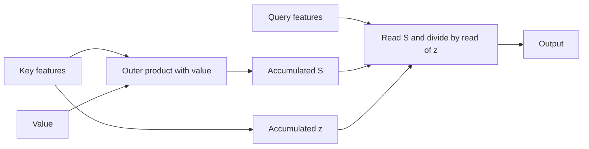

# Linear attention: read an accumulated memory

Ordinary softmax attention compares a query with stored keys. This variant accumulates transformed keys and values into a fixed-size state. It uses a different similarity function.

## The math

Let phi(x)=x+1 when x>=0, otherwise exp(x), elementwise. For valid causal keys:

\[
y_i=\frac{\sum_{j\le i}\phi(q_i)^T\phi(k_j)v_j}
{\sum_{j\le i}\phi(q_i)^T\phi(k_j)}.
\]

Each key writes an outer product into a matrix. Each query reads that matrix:

\[
S_i=S_{i-1}+\phi(k_i)v_i^T,\quad z_i=z_{i-1}+\phi(k_i),
\qquad y_i=\frac{\phi(q_i)^TS_i}{\phi(q_i)^Tz_i}.
\]

Invalid keys update neither S nor z. The denominator makes the weights sum to one. Our implementation rejects zero or nonfinite denominators; it does not silently add epsilon.

## What changes?

| Property | Meaning |
|---|---|
| Exact reassociation | Pairwise and recurrent forms above compute the same function |
| Different attention rule | They do not generally equal softmax(QK^T/sqrt(d))V |
| Fixed forward state | S and z contain m*d_v+m scalars per head |
| Compressed history | Different histories can produce the same state and become indistinguishable to later reads |
| Training caveat | Autograd can retain every intermediate state; fixed inference state does not imply constant training memory |

At fixed feature/value widths, attention accumulation and reads cost O(n*m*d_v). Increasing feature width increases cost. Actual GPU speed requires measurement.

Example: q=0, keys=(0,1), values=(0,1). Softmax gives equal weights and output1/2. This feature map gives weights(1/3,2/3), hence output2/3. Reassociation is exact for the new kernel, not a shortcut through softmax.

[Katharopoulos et al. (2020)](https://proceedings.mlr.press/v119/katharopoulos20a.html), sections3.2-3.4, derives positive-kernel reassociation and causal recurrence. We checked those equations locally; we did not reproduce its trained quality or performance benchmarks. See [our results](linear-attention-results.md).
