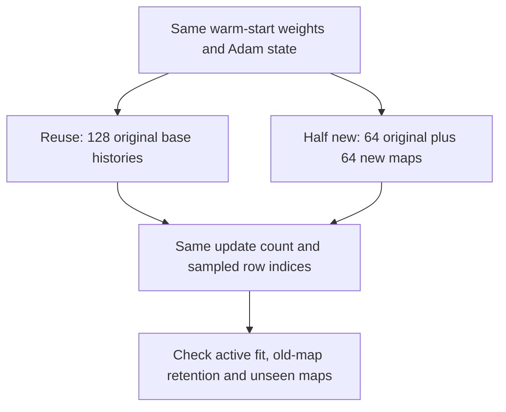

# Reusing maps versus seeing new maps

A map is a set of key-value associations. For example, `A:2, B:5` and `A:4, B:1` use the same keys but different answers. Changing their order alone does not create new associations.

The previous [trajectory diagnostic](fitting-trajectory-results.md) found that further fitting rescued some unseen answers and harmed others. It did not identify why. Here we change the training data while holding the model and optimizer fixed. See the [frozen protocol](../../protocols/map-exposure.md) and [audited results](map-exposure-results.md).

Every history has 32 key-value events. Load counts distinct keys: load 32 has one event per key; lower loads repeat keys. Values stay constant within each key's history. This tests new associations at a fixed length.

Each base has six cyclic value shifts. Both active high-load pools have 768 histories. New maps preserve the old key order and query at each replaced row; values change. Lower loads stay identical. Removing half the old examples also removes their continued feedback, so this is not a pure diversity-only contrast.

Original maps were present during warm-up; replacement maps were not. This tests adapting an existing learner to new associations. It does not compare two equally exposed datasets trained from scratch.

For a history h with M keys, training averages all its answers:

\[
L(\theta)=\frac1B\sum_{i=1}^{B}\frac1M\sum_{q\in h_i}
-\log p_\theta(y_{iq}\mid h_i,q).
\]

The equation is unchanged. The examples inside it change. Adam receives different gradients, starting with the same stored moments. Matching updates and answer counts prevents extra compute from explaining a paired difference.

Three checks answer different questions:

| Check | What it tells us |
|---|---|
| Active training fit | Did the model learn the pool it continued on? |
| Original training retention | Did learning new maps damage previously learned ones? |
| Fresh unseen-map scores | Did the changed exposure help beyond the active pool? |

A better test score with poor training fit is still a measured improvement. It does not settle whether the model learned a reliable retrieval rule. High training fit with weak test performance establishes a remaining transfer gap. Neither outcome proves a Transformer limitation: this is a small structured delta-memory reader.

Cross-entropy rewards probability assigned to the correct class. Accuracy checks which class ranks first. Loss can therefore fall without more answers becoming correct.

Here, forgetting means losing accuracy on previously solved contexts. It does not prove that the weights stored their literal key-value maps. The answer is still supplied by the current input context.

Sources inspected: [DeltaNet, section 2.2](https://arxiv.org/html/2406.06484v2#S2.SS2) defines delta memory updates; [Scaling Data-Constrained Language Models, JMLR (2025), abstract](https://www.jmlr.org/papers/v26/24-1000.html) distinguishes unique data from repeated exposure. Those papers do not predict this experiment's result. The loss average and matched intervention above describe our local setup.
