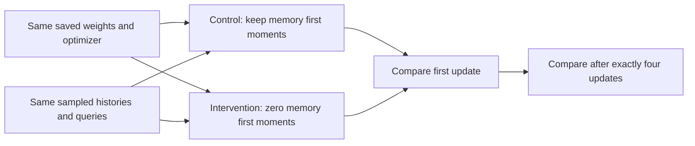

# What resetting an Adam first moment actually tests

Adam's first moment carries a smoothed history of gradients. A saved update showed that its stored memory term could outweigh a helpful current term. We tested that history directly, rather than assuming a reset would help.

## Change one thing

Both arms begin with identical weights, optimizer state and data streams, immediately before step 11004. The control keeps everything. The intervention sets only memory exp_avg to zero: keys, values and the write logit. Classifier moments, second moments and step counters stay intact.

For the first shared gradient,

$$m_{control}=\beta_1m_{old}+(1-\beta_1)g,\qquad
m_{reset}=(1-\beta_1)g.$$

Both use the same updated second moment and bias-correction counters. Therefore their first memory-step difference isolates the stored first-moment numerator under these conditions. The first classifier update is identical. The independent audit checks these identities on the actual updates.

These equations follow the inspected [Kingma and Ba Algorithm 1](https://arxiv.org/pdf/1412.6980) and [PyTorch Adam](https://docs.pytorch.org/docs/2.11/generated/torch.optim.Adam.html). The intervention and comparison are local work. Sources do not predict a benefit.

This is **not a fresh optimizer**. Historical second moments and counters remain. It is also not continued gradient surgery or a repeated reset. After the first update, weights, gradients and second moments may diverge between arms.

## What happened

For seed 3463, the control increased CE on the starting errors. The reset reduced it. That establishes a local effect of stored memory first moments. Seed 3461's control already improved those errors; resetting made the immediate improvement slightly smaller.

After four matched updates, both seeds had lower error CE and equal-load training CE under reset. Training accuracy rose by 12 correct answers in seed 3461 but fell by three in seed 3463. Both final test-32 accuracies also fell slightly. See [the tables](memory-first-moment-reset-results.md).

Loss and accuracy ask different questions. Loss responds to every score change. Accuracy changes only when the winning class changes. Lower loss on old errors can coexist with newly wrong answers.

## What is settled

Stored first moments can cause a particular unfavorable update. Removing them is not an established reliable repair. Neither immediate nor four-update benefit passes across both seeds. This targeted, short experiment does not explain all learning, establish convergence or justify another reset automatically.
