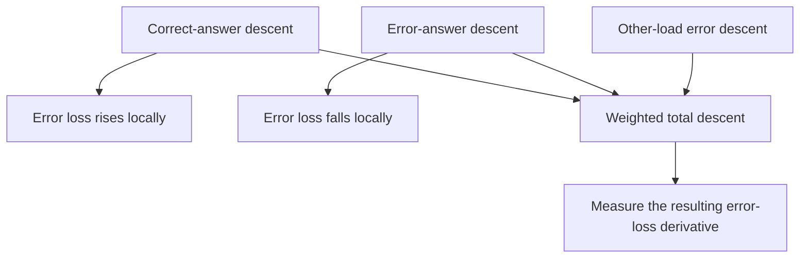

# When correct answers oppose repairing errors

The model can [decode clean associations](target-only-history-results.md), yet some mixed-history answers remain wrong. We ask whether training on correct answers pushes memory parameters against repairing those errors.

A gradient points toward increasing a loss. Plain gradient descent moves in the opposite direction. Different groups can prefer different movements in the same parameters.

## Preserve the objective

The recipe averages four loads equally. If load m has N_m answers, its contribution is

$$L_m=\frac{1}{4N_m}\sum_i\ell_i.$$

At each saved checkpoint, split answers into correct and wrong using their original predictions. Keep that membership fixed during differentiation and numerical checks. Sum correct contributions across all loads into gradient g_C. Keep load-32 error gradient g_E and other-load errors g_O separate:

$$g_{total}=g_C+g_E+g_O.$$

These are **weighted contributions**, not equally weighted correct/error means. Rebalancing them would change the objective. An empty group contributes zero.

## Opposition versus net harm

The gradient cosine is

$$\cos(C,E)=\frac{g_C^Tg_E}{\|g_C\|\|g_E\|}.$$

A negative value means the groups locally oppose one another. [Yu et al. (2020), section 2.2](https://arxiv.org/html/2001.06782v3#S2.SS2) defines this conflict and explains why conflict alone is insufficient to establish detrimental learning. Their study concerns multiple tasks; our correct/error split is a local construction within one task. We do not test their PCGrad method or curvature claims.

Let h_E be the gradient of the **conditional mean loss** on remaining load-32 errors. For a small movement delta,

$$\Delta L_E\approx h_E^T\delta.$$

Therefore correct-only descent has derivative $-h_E^Tg_C$, while total descent has derivative $-h_E^Tg_{total}$. Positive means error loss rises locally; negative means it falls. These formulas are local first-order derivations.

The diagram separates contributions; the [measured joint total](memory-gradient-competition-results.md) favors lower error loss at all four checkpoints. Opposing vectors can still sum to a helpful direction.

## What was measured

Keys, values and alpha are separate blocks; their concatenation is joint memory. Alpha is the learned write logit, with beta=sigmoid(alpha). The classifier is fixed. Norms and combined angles depend on these raw parameter coordinates, so beta gradients are not interchangeable with alpha gradients.

Actual saved-model gradients agree with an independent matrix formulation. Tiny probes in both directions, at two spacings, verify the predicted error-loss slopes and restore parameters exactly. CE and its reductions follow the inspected [PyTorch 2.11 definition](https://docs.pytorch.org/docs/2.11/generated/torch.nn.CrossEntropyLoss.html).

These are local CE directions, not measured accuracy improvements, convergence or the next Adam update. Adam uses sampled gradients and stored moments. Establishing opposition does not identify why the full training history left errors.
