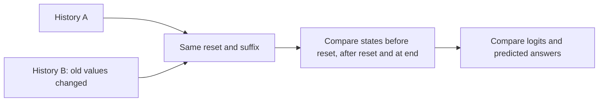

# Reset-aware answers without complete history erasure

Executed2026-10-03 and closed. Saved checkpoints only, no training. [Frozen protocol](../../protocols/memory-reset-diagnostic.md) | [Learning guide](learned-memory-control-guide.md).

**Different histories remain distinguishable in state, while every tested answer stays correct. Disabling the forgetting gate changes no test predictions.** This narrows the mechanism question without claiming a complete explanation.

## What we changed

For each reset-present/missing test example, rotate every pre-reset value by1 modulo4. Keep its keys, reset marker, suffix and query identical. The correct answer must remain the same. These are derived diagnostic inputs, not fresh confirmation data.

Across six checkpoints and lengths6/8/12, this gives3,456 paired comparisons. Every pair has a nonzero state difference before reset, immediately after reset and at the end, using1e-10 as the equality tolerance. Nevertheless, both histories score100% and their predicted classes agree in every group and seed. Logits need not agree: the largest paired difference is19.1672.

## How much state difference survives reset?

The ratio is ||difference after reset||_F / ||difference before reset||_F, averaged equally across the576 pairs per checkpoint. It measures retention of these perturbations, not a percentage of recoverable information.

| Seed | Plain delta ratio | Gated delta ratio | Learned reset alpha | Learned reset beta, gated |
|---|---:|---:|---:|---:|
| 2711 | 0.8392 | 0.6876 | 0.8202 | 0.8884 |
| 2719 | 0.8315 | 0.6679 | 0.8023 | 0.8194 |
| 2729 | 0.8316 | 0.6551 | 0.7852 | 0.8797 |

For identical reset inputs, the old-state difference obeys

\[
\Delta S_{after}=\alpha(I-\beta kk^T)\Delta S_{before}.
\]

All pairs match this equation within8.89e-16. A learned reset marker is a constant input record here, so its projected gate values are constant within each checkpoint. Gate values alone do not establish their necessity.

## Is the forgetting gate necessary for these answers?

At fixed gated checkpoints, set alpha=1, leaving all other parameters unchanged. Evaluate every original test group and length.

| Gated checkpoint condition | Accuracy, every seed/group/length | Changed predictions | Mean CE loss |
|---|---:|---:|---:|
| Native | 100% | 0 | 0.00004959 |
| alpha1 at every event | 100% | 0 | 0.00006237 |
| alpha1 only at reset | 100% | 0 | 0.00011448 |

Loss means equally weight three seeds, three lengths and four groups. Predictions are unchanged, but losses change. Gate removal is not numerically equivalent to the native reader. The [full table](../../../results/memory_reset_diagnostic_metrics.csv) preserves all144 seed/arm/length/mode/group cells, including the plain-delta control.

This establishes lack of dependence of tested class accuracy on the scalar gate under these interventions. It does not show that removing it during training has no effect, or that it is unnecessary on other inputs.

## What this teaches

| Statement | Evidence status |
|---|---|
| Reset makes the full state independent of these old histories | Rejected: every paired state still differs |
| Correct reset-aware answers require literal state clearing | Rejected for these evaluated readers and probes |
| Scalar forgetting is required for the original test answers | Not supported: both interventions preserve all predictions |
| Old information is absent, unrecoverable or exactly in a readout nullspace | Not established; logits change and no recovery probe was run |
| We identified the full learned reset algorithm | No; task templates and a single family of history perturbations limit the conclusion |

State equality, logit equality and class agreement are different questions. The reader can preserve history dependence while keeping the correct class on top.

## Verification and stopping point

Independent explicit matrix transitions verify every diagnostic output and intermediate state. The36 original-pool conditions contain13,824 predictions;18 paired-history batches contain6,912 predictions, totaling20,736 checked evaluations of examples. These are not independent training seeds. Maximum output discrepancy7.994e-15; paired-state discrepancy1.78e-15; zero independent argmax changes. Native logits also match saved scores. A deliberately zeroed final-state read changes outputs in every checked batch, so the output check detects that error.

Original checkpoint hashes and all275 prior JSON artifacts remain unchanged. Protocol, sources and raw aggregates are preserved. No retraining, harder task or further probe is selected.

Evidence: [diagnostic source](../../../experiments/memory_reset_diagnostic.py), [raw report](../../../results/memory_reset_diagnostic.json), [original learning results](learned-memory-control-results.md).
