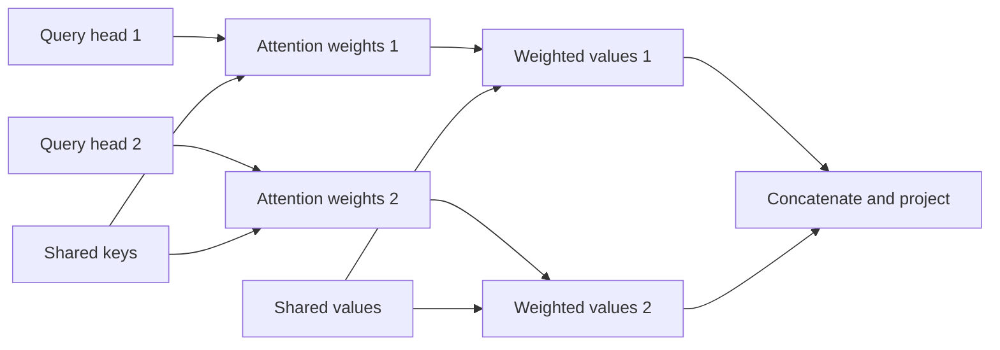

# Learning with shared K/V

Both models have two query heads. MHA learns two sets of keys and values. MQA learns one set that both heads read. A shared set can be useful, but the heads lose independent K/V features.

`A_h = softmax(Q_h K_shared^T / sqrt(8) + mask)`.

`Y_h = A_h V_shared`. Separate Q means the two heads can gather different information. Shared K/V does not force identical outputs.

During training, gradients from both uses accumulate into the shared parameters. Locally, `dL/dK_shared = sum_h dL/dK_used_by_h`, with the corresponding sum for V. The shared features therefore adapt to both query heads. This differs from merging a trained model and immediately testing it.

## What this comparison can answer

Each paired seed starts from the same untrained template. Embeddings, norms, FFNs, Q and output projections match exactly. MQA starts with the first template K/V head. Its weights then learn freely; no existing trained checkpoint is converted.

Both arms receive identical questions, answers and token budgets. This tests the complete sharing/initialization recipe. It does not isolate every optimization effect or hold parameter count/FLOPs equal.

Fewer K/V projections reduce parameters from 5,088 to 4,544. Compact cache payload halves. Both query heads still compute attention over the full visible prefix. Temporary broadcasting and kernel costs can limit actual speed; speed is outside this comparison.

Report repeated and unique queries separately. Four-pair results test the training length; six-pair results test longer sequences. Reused three-pair results are diagnostic. Mean gains cannot erase a losing seed.

The [protocol](../../mqa-training-protocol.md) fixes ten runs, quality floors and tolerated losses. The [earlier probes](../../shared-kv-results.md) establish mathematical restrictions; they do not predict this training outcome. [GQA's original paper](https://arxiv.org/html/2305.13245v3) instead adapts pretrained checkpoints. These are different experimental conditions.

Completed: [trained findings and audit](../../mqa-training-results.md). MQA passes the resource/quality rule while losing 0.674pp mean six-pair unique accuracy. Acceptance does not mean identical quality.
