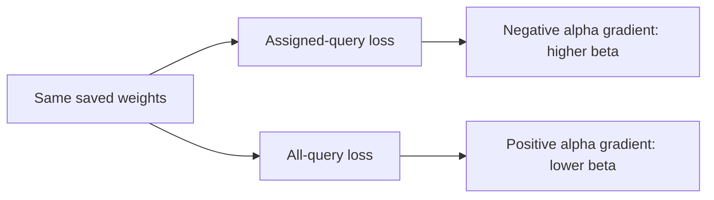

# What does the training loss ask beta to do?

The [diagnostic](objective-beta-pressure-results.md) compares two losses at the same saved weights. Assigned loss grades one fixed query per history. All-query loss grades every present key, averaging within each history. The second is the expected loss under uniform query resampling. Both use the original equal weighting of four loads.

## From loss to write strength

Beta controls the correction written into memory. The model learns alpha, with beta = sigmoid(alpha):

$$\frac{\partial L}{\partial\alpha}=\frac{\partial L}{\partial\beta}\beta(1-\beta).$$

Under plain gradient descent, alpha changes by $-\eta\,\partial L/\partial\alpha$. A positive derivative pushes beta down; a negative derivative pushes it up. This describes an infinitesimal local change with other weights fixed. It does not promise better accuracy after a finite step.

Measured across the equally weighted loads, all four checkpoints show:

That is local objective tension. A model can answer every assigned training query correctly while its loss still rewards increasing confidence. Other answers can suffer. Perfect accuracy does not imply zero loss or zero gradient.

## Conflict can extend beyond beta

For gradient vectors $g_a$ and $g_b$, cosine measures their alignment. Negative cosine means opposite components dominate their dot product. For a small plain-gradient step on assigned loss,

$$\Delta L_{all}\approx-\eta\,g_{all}^{\mathsf T}g_{assigned}.$$

The fixed models have negative whole-model cosine: about -0.70/-0.74. The formula therefore predicts a local increase in all-query loss along that assigned-loss direction. This is a first-order derivation, not an executed training step. Resampled models have positive whole-model cosine despite beta conflict; one parameter's disagreement does not describe the whole vector.

## How the derivative was checked

With our state orientation, $S_t=S_{t-1}+\beta k_t(v_t-S_{t-1}^{\mathsf T}k_t)^{\mathsf T}$. Holding keys/values fixed and writing $D_t=\partial S_t/\partial\beta$,

$$D_t=(I-\beta k_tk_t^{\mathsf T})D_{t-1}+k_t(v_t-S_{t-1}^{\mathsf T}k_t)^{\mathsf T},\qquad D_0=0.$$

The auditor propagates this tangent through reads and CE, then applies the sigmoid factor. It agrees with autograd and two fixed central-difference spacings. This checks the measured derivative, not a historical training explanation.

[Yang et al. 2024, section 2.2](https://arxiv.org/html/2406.06484v2) was inspected for correction/read and input-dependent beta. Our reader has one scalar. Objective averaging, tangent and cosine interpretations above are local derivations. [PyTorch 2.11 Adam equations](https://docs.pytorch.org/docs/2.11/generated/torch.optim.Adam.html) were inspected: Adam uses moments, so these loss gradients are not its next actual updates.

Remaining question: did this tension precede and shape the beta divergence during training? Endpoint derivatives cannot answer that. An instrumented reproduction of the original budget is the next proposed step; no continuation or training repair has run.
