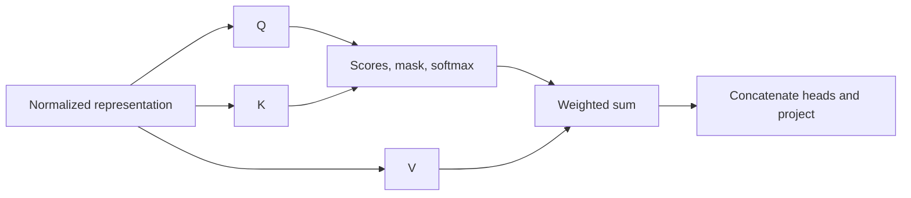

# Q/K routing versus V content

**Matched Q/K replacement largely rescues the shifted model while keeping its shifted V. V replacement alone does not.** This is a conditional finding for block 2, these models and these crops.

## Learn the operation

Each token enters attention as a vector z. Three learned projections produce three different vectors:

| Symbol | Role | Useful question |
|---|---|---|
| Q, query | Scores candidate keys | What information should this position read? |
| K, key | Compared with each query | How compatible is this source position? |
| V, value | Information combined using attention weights | What information is available to carry forward? |

These are learned numbers, not literal questions or dictionary entries. K in attention is not the same thing as the symbolic key token in our recall task. Q/K also contain content. Calling them routing describes how the equation uses them.

For this implementation, z=LN1(x), Q=zW_Q^T+b_Q, with analogous formulas for K and V. Each of two heads has width 8:

\[
A=\operatorname{softmax}(QK^T/\sqrt{8}+M),\qquad H=AV.
\]

The causal mask M is zero for allowed positions and minus infinity for future positions. Softmax operates over source positions. Each row of A sums to one. Heads are concatenated and passed through the unchanged output projection. These definitions follow [Vaswani et al., sections 3.2.1-3.2.2](https://arxiv.org/html/1706.03762v7#S3.SS2), checked for this explanation. Our small pre-norm causal model differs from their translation model; this is not a benchmark reproduction.

Illustration only: if a row of A is [0.1,0.8,0.1], its output is 0.1*v1+0.8*v2+0.1*v3. Changing Q/K changes the weights. Changing V changes the vectors being mixed. A correct vector can exist in V yet contribute too little under the current weights. This illustration is not a measured attention row.

## What we changed

Use five frozen models and all 5,120 inspected six-derived crops per model. Every crop has three pairs. The recipient uses global position shift +4. Compact donor vectors come from the same example, or the exact unrelated donors used in the [previous controls](../retrieval/donor-controls-results.md). No training or donor reselection.

Replace Q, K, Q+K, V, or all three in block 2. Both heads and all token positions are included. Keep remaining vectors, mask, output projection, residual stream and downstream model fixed to the recipient computation. For example, matched QK computes softmax(Q_compact K_compact^T/sqrt(8)+M)V_shifted. Follow the [predeclared protocol](../../qkv-protocol.md).

## Matched-example results

Baseline shifted accuracy is 60.60%; compact reference is 99.996%. Means across five seeds:

| Compact vectors supplied | Recipient accuracy | Cross-entropy, nats | Every seed >=90% |
|---|---:|---:|---|
| Q only | 63.57% | 2.0033 | No |
| K only | 92.74% | 0.3243 | No |
| Q and K | 99.15% | 0.0330 | Yes |
| V only | 61.13% | 2.1463 | No |
| Q, K and V | 99.984% | 0.0015 | Yes |

| Seed | K only | QK | V only |
|---|---:|---:|---:|
| 137 | 95.45% | 100% | 66.37% |
| 163 | 99.12% | 99.45% | 58.79% |
| 191 | 91.17% | 99.36% | 60.78% |
| 223 | 85.88% | 99.73% | 57.62% |
| 257 | 92.07% | 97.19% | 62.09% |

The predeclared QK sufficiency criterion passed. The V criterion failed. K alone helps greatly, but one seed fails 90%. Do not summarize this as “only K matters.”

## Unrelated-donor controls

Same-answer and different-answer donors have different parent episodes, query keys and mappings. Their token slots do not necessarily refer to the same keys as the recipient. Matching only the answer does not align those slots.

| Vectors supplied | Same-answer recipient accuracy | Different-answer recipient accuracy | Different-answer donor agreement |
|---|---:|---:|---:|
| Q | 40.82% | 41.21% | 18.76% |
| K | 46.43% | 46.68% | 16.63% |
| QK | 49.92% | 48.68% | 18.65% |
| V | 49.34% | 18.85% | 45.77% |
| QKV | 99.36% | 0.18% | 99.34% |

Only full unrelated QKV transfer passed the every-seed 90% donor-agreement criterion. Full QKV reconstructs the donor's complete attention output, reproducing the previous whole-output test. Mixing unrelated routing with recipient values does not reproduce that effect. Unrelated V alone also does not reliably transfer the donor answer.

## Interpretation in short sentences

The shifted values still support almost-correct predictions when read with matched compact routing. Values alone are therefore not sufficient to explain the failure. Replacing only values leaves the shifted routing and barely helps.

This is more specific than copying a completed attention output. The matched QK intervention leaves V in the shifted state. But it still supplies information from a successful compact run. It is not a deployable fix.

Q/K and V must work together. An unrelated example can use different source positions. Its routing may read the wrong recipient slots. These controls support that interpretation but do not prove exact key-to-value alignment or a complete binding circuit.

We have not proved where the Q/K difference originates. Both depend on block 1 and normalization. We have not identified the responsible head or token. Hybrid vectors can be unnatural, repeated crops are dependent, and data were already inspected. Results do not establish a universal transformer limitation, novelty or additive causal shares.

## Verification and next step

[Script](../../../experiments/qkv_paths.py) and [raw results](../../../results/qkv_paths.json) preserve all 15 interventions per seed, losses, paired rescue/harm counts and hashes. Explicit attention matched library output within 5.56e-15. Shifted reconstruction matched logits within 2.58e-14. Causal zero weights and row sums passed. Baselines reproduced within 1e-12; full donor replacements reproduced previous metrics within 1e-10. Finite outputs, labels, unchanged checkpoints, source hashes and paired-count arithmetic passed.

Follow-up completed: [head and token localization](head-token-results.md). Final Q plus value-slot K in both heads reaches 98.66%; neither head alone meets the all-seed criterion. Source competition and upstream construction remain unresolved.
