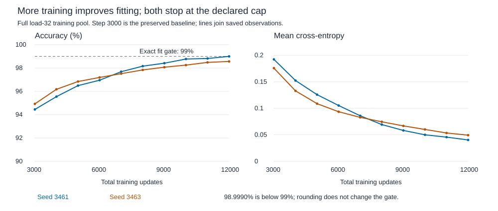

# Exhaustive-feedback training continuation

More training gives substantial fitting gains with unchanged architecture and optimizer settings. Both seeds stop at step 12000 below the exact 99% rule. At load 32, test accuracy rises modestly, but validation/test CE worsens in both seeds. Better fitting has not established reliable held-out quality.

## Method and stopping

Resume exhaustive runs 3461/3463 from step 3000, restoring every weight, Adam moment and step. Reconstruct both RNG streams and verify all prefix hashes. Same 615-parameter reader, CPU float64, one thread, batch 64 histories, 32 events, cyclic loads 2/8/16/32, every present key queried, mean CE, Adam .003. Full training checks every 1000 updates; stop at first all-load/group accuracy >=99% or total step 12000. Both hit the cap. [Protocol](../../protocols/query-feedback-continuation.md) | [Educational guide](query-feedback-continuation-guide.md).

Each seed adds 9000 updates, 576000 history draws, 18432000 events and 8352000 answers. Combined: 18000 added updates, 1152000 histories, 36864000 events, 16704000 targets. The full learning path has 24000 updates across the two seeds, including their preserved initial 3000 each. This is extra time and exposure together, not an isolated update-count effect. Only exhaustive feedback continues; no continued sampled-policy control or architecture ranking.

All original training pools (768 histories/load) are evaluated at ten saved checkpoints. Full validation (192/load) and previously opened test (384/load) are measured only after both stopping decisions are saved. No held-out selection, new seed or new test pool. Same 32-event length, not length transfer.

## Fitting and exact failed criterion

| Seed | Training-32 at 3000 | At 12000 | Gain | Training CE at 3000 / 12000 | Remaining errors / targets | Fit rule |
|---|---|---|---|---|---|---|
| 3461 | 94.4499% | 98.9990% | +4.55 pp | 0.192271 / 0.040355 | 246 / 24576 | Fail |
| 3463 | 94.9259% | 98.5636% | +3.64 pp | 0.175781 / 0.049351 | 353 / 24576 | Fail |

With 24576 answers, the exact rule allows at most 245 errors. Seed 3461 has 246; rounding its score to 99.00% would hide the failure. Seed 3463 has 353. Lower-load training is now 100% in both seeds. The near miss does not erase the measured improvement.

## Every final load

Each cell is accuracy / mean CE, using every present-key query. Loads 2/8/16 are repeated-key groups; load 32 is unique-key. Full absent-group fields and every intermediate result remain in the CSV.

| Seed | Load | Training | Validation | Opened test |
|---|---|---|---|---|
| 3461 | 2 | 100.0000% / 0 | 100.0000% / 0 | 100.0000% / 0 |
| 3461 | 8 | 100.0000% / 0.0002426 | 100.0000% / 2.308e-07 | 99.6094% / 0.009747 |
| 3461 | 16 | 100.0000% / 0.001477 | 99.2188% / 0.1068 | 98.7956% / 0.1061 |
| 3461 | 32 | 98.9990% / 0.04035 | 87.8906% / 0.8698 | 86.4421% / 0.977 |
| 3463 | 2 | 100.0000% / 0 | 100.0000% / 0 | 100.0000% / 0 |
| 3463 | 8 | 100.0000% / 5.053e-05 | 100.0000% / 7.436e-06 | 100.0000% / 0.001073 |
| 3463 | 16 | 100.0000% / 0.001608 | 98.4375% / 0.1167 | 97.1680% / 0.2485 |
| 3463 | 32 | 98.5636% / 0.04935 | 86.7350% / 0.8901 | 86.9792% / 0.8791 |

## Held-out loss and complete maps

| Seed | Test-32 accuracy gain | Validation-32 CE at 3000 / 12000 | Test-32 CE at 3000 / 12000 |
|---|---|---|---|
| 3461 | +0.56 pp | 0.387669 / 0.869806 | 0.442601 / 0.976972 |
| 3463 | +1.68 pp | 0.428989 / 0.890054 | 0.476152 / 0.879149 |

More correct predictions coexist with worse CE. CE penalizes the probability of the correct class, so unchanged wrong predictions can become more costly. We have not yet decomposed individual loss changes or established miscalibration as their cause. Seed 3463 also loses 0.34 points of validation-32 accuracy; seed 3461 loses 0.39 points of test-8 accuracy. Keep those harms visible.

| Seed | Training-32 complete maps at 3000 / 12000 | Final validation-32 maps | Final test-32 maps | Beta at 3000 / 12000 |
|---|---|---|---|---|
| 3461 | 149 / 561 (of 768) | 18 / 192 | 18 / 384 | 0.322128 / 0.166042 |
| 3463 | 181 / 510 (of 768) | 0 / 192 | 6 / 384 | 0.297427 / 0.150458 |

Beta decreases while fitting improves, but geometry, value representations and readout also change. This is not a beta-only explanation. Complete held-out maps remain rare. Loss falls over the last measured training interval in both seeds; convergence and a hard capacity ceiling remain unestablished.

## Verification and resources

Independent audit passes all 96 cells/957696 scored targets, reconstructed exposures/streams/RNG states and every snapshot. Scalar Adam checks cover 18000 new updates and 24000 including parent steps. Maximum logit difference 1.137e-13; identical argmax. All 127 locked prior files/sources remain unchanged. Separate matrix equations and scalar reductions share data, weights and PyTorch, so this is not a second-framework reproduction.

Preflight passes three test methods, including tensor-exact resumed versus uninterrupted model/optimizer states, initialized/intermediate evaluator/audit reloads, gradients, first-fit/cap stops, missing groups and deliberate moment/RNG/score/label errors. Before freezing, the direct test import path and a synthetic initialized-accuracy assumption were corrected; failed setup/preflight records are preserved. Neither changed formal data, recipe or thresholds.

The two continuations took 272.21 seconds including full training snapshots, excluding setup/profiles, final held-out evaluation and independent audit. Restored highest-load complete-step profiling on native CUDA peaks at 72330752 bytes allocated / 73400320 reserved (about 69/70 MiB), including optimizer states. Formal training is CPU; CPU tensor-memory peaks are unmeasured. Single profiles and elapsed execution are not speed benchmarks.

- [All snapshot/load/group metrics](../../../results/query_feedback_continuation/metrics.csv), [formal report](../../../results/query_feedback_continuation/report.json), [training-only stopping record](../../../results/query_feedback_continuation/training_decision.json), [independent audit](../../../results/query_feedback_continuation/audit.json), [complete-step profiles](../../../results/query_feedback_continuation_profiles.json).

## What this narrows and what comes next

The original 3000-update fitting deficit is not evidence that this reader cannot approach 99%: unchanged continued training closes much of it. The exact all-seed fit gate still fails, and the larger budget does not solve held-out retention. It does not isolate the remaining cause or establish that still more updates would help. Stop here; no further continuation, LR search or architecture change.

Next proposed question: which answers account for worsening held-out CE, and do remaining errors become more confident as training progresses? Inspect saved scores/checkpoints before spending more training budget. Separate prediction transitions, correct-class probabilities and readout scale from changed memory behavior. No such diagnostic has started. RL remains parked.

Sources inspected: [Yang et al. 2024, section 2.2](https://arxiv.org/html/2406.06484v2), delta correction/read; [PyTorch 2.11 Adam](https://docs.pytorch.org/docs/2.11/generated/torch.optim.Adam.html), moment/bias-correction equations; [official checkpoint tutorial](https://docs.pytorch.org/tutorials/beginner/saving_loading_models.html#saving-loading-a-general-checkpoint-for-inference-and-or-resuming-training), model/optimizer restoration. The budget, gate and measured results are local; no source predicts them. A globally shared beta and standalone 615-parameter reader differ from full DeltaNet.
