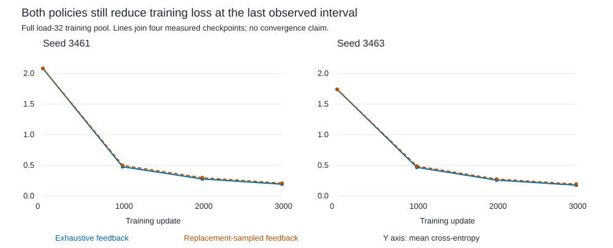

# Matched query-feedback training

Exhaustive feedback gives small fitting gains in both seeds, but misses the frozen benefit and 99% fit rules. Every training history/key pair receives supervision in all four runs, yet errors remain. Removing within-history query sampling is insufficient to solve this task under the tested recipe.

## Method

Two paired development seeds 3461/3463, exhaustive versus m replacement-sampled queries per history. Same initialization, original histories and history/potential-query draws, 615-parameter reader, 64 histories per update, 32 events each, cyclic loads 2/8/16/32. Adam .003, CPU float64, one thread, 3000 updates per run. Both average CE across 64*m answers; expected objective and tensor shapes match.

Each run uses 192000 histories, 6144000 input events and 2784000 answer targets. Four runs total 12000 updates and 11136000 targets. Both receive 14.5 times the historical one-query answer count. These historical scores are references; shared improvement cannot isolate why that recipe failed.

Full training evaluation at steps 0/1000/2000/3000, full validation and reserved test evaluation at 3000. Original train/validation sizes 768/192 histories per load. Test has 384 histories per load, frozen before training and disjoint from original train/validation families modulo global value shift. It was opened only after all training/validation results and decisions were saved. Same 32-event length throughout; this is not length transfer. Test data are reserved, but seeds and development histories are reused, so this is not fresh-seed architecture confirmation. [Protocol](../../protocols/query-feedback-training.md) | [Short learning guide](query-feedback-training-guide.md).

## Paired effect and failed criteria

| Seed | Training-32 accuracy gain | Training-32 CE reduction | Validation-32 gain | Test-32 gain | Frozen benefit |
|---|---|---|---|---|---|
| 3461 | +0.61 pp | 7.88% | +1.12 pp | +0.30 pp | Fail |
| 3463 | +0.86 pp | 9.33% | +0.15 pp | -0.88 pp | Fail |

Both training CE reductions exceed 5%, and lower-load training accuracy is preserved. Both accuracy gains miss the predeclared one-point margin. Neither arm passes all-seed/all-load training accuracy >=99%. These are threshold failures alongside measured gains, not evidence of no effect.

Seed 3463 test-32 also has worse CE under exhaustive feedback. The positive training/validation effect therefore does not support a reliable held-out winner. The replacement control already averages m queries, reducing conditional query variance by m; this comparison cannot establish that noise in the original one-query recipe was unimportant.

## Every final load

Accuracy percentages below use every present-key answer, not just the originally assigned query. Loads 2/8/16 contain repeated keys; load 32 has unique keys. All loss and missing-group metrics are retained in the CSV.

| Seed | Policy | Load | Training | Validation | Reserved test |
|---|---|---|---|---|---|
| 3461 | exhaustive | 2 | 100.00% | 100.00% | 100.00% |
| 3461 | exhaustive | 8 | 100.00% | 99.22% | 100.00% |
| 3461 | exhaustive | 16 | 99.97% | 98.24% | 97.44% |
| 3461 | exhaustive | 32 | 94.45% | 86.95% | 85.88% |
| 3461 | sampled_m | 2 | 100.00% | 100.00% | 100.00% |
| 3461 | sampled_m | 8 | 100.00% | 99.22% | 100.00% |
| 3461 | sampled_m | 16 | 99.80% | 98.11% | 97.14% |
| 3461 | sampled_m | 32 | 93.84% | 85.82% | 85.58% |
| 3463 | exhaustive | 2 | 100.00% | 100.00% | 100.00% |
| 3463 | exhaustive | 8 | 100.00% | 99.61% | 100.00% |
| 3463 | exhaustive | 16 | 99.99% | 98.34% | 97.01% |
| 3463 | exhaustive | 32 | 94.93% | 87.08% | 85.30% |
| 3463 | sampled_m | 2 | 100.00% | 100.00% | 100.00% |
| 3463 | sampled_m | 8 | 100.00% | 99.61% | 100.00% |
| 3463 | sampled_m | 16 | 99.90% | 98.24% | 97.12% |
| 3463 | sampled_m | 32 | 94.06% | 86.93% | 86.18% |

## Complete maps and remaining training errors

| Seed | Policy | Beta | Training-32 complete maps | Validation-32 complete maps | Test-32 complete maps | Min training targets per history/key at load 32 |
|---|---|---|---|---|---|---|
| 3461 | exhaustive | 0.322128 | 149 / 768 | 6 / 192 | 6 / 384 | 42 |
| 3461 | sampled_m | 0.320185 | 96 / 768 | 6 / 192 | 0 / 384 | 24 |
| 3463 | exhaustive | 0.297427 | 181 / 768 | 0 / 192 | 0 / 384 | 42 |
| 3463 | sampled_m | 0.297576 | 105 / 768 | 0 / 192 | 6 / 384 | 25 |

Exposure audit reconstructs every target draw. All history/key pairs at every training load are covered in both policies. Missing supervision pairs cannot explain the remaining errors in these new runs. Complete-map reliability remains poor even when individual-answer accuracy improves.

Final betas are close within each matched pair, while fitting and held-out outcomes differ. That does not prove beta irrelevant: trajectories and jointly learned geometry/value/readout parameters can still differ. No beta-only attribution is established.

## Learning continues at the budget boundary

| Seed | Policy | CE at 1000 | CE at 2000 | CE at 3000 |
|---|---|---|---|---|
| 3461 | exhaustive | 0.476373 | 0.277469 | 0.192271 |
| 3461 | sampled_m | 0.499542 | 0.298714 | 0.208714 |
| 3463 | exhaustive | 0.466851 | 0.258818 | 0.175781 |
| 3463 | sampled_m | 0.487949 | 0.276168 | 0.193875 |

Every load-32 full-pool CE falls over both final measured intervals. Convergence and a hard representational ceiling are unestablished. Low training fit also blocks interpreting the held-out deficit as purely generalization. The declared 3000-update runs stop here; no extra step, LR change or replacement seed was used.

## Verification and resources

Preflight passes three methods: full-parameter gradients under both query policies against independent repeated-history matrix equations, duplicate/omission and normalization checks, initialized/intermediate saved evaluator/audit reload, two short actual training loops, supplied logits, missing groups and deliberate score/map/label/exposure errors.

Formal audit passes all 96 cells/846336 scored targets, 12000 scalar Adam steps, independently rebuilt label maps/exposures/streams and every checkpoint hash/step. Maximum logit error is 1.421e-14; no argmax differences. All 93 locked dependencies/artifacts remain unchanged. Auditor shares data, weights and PyTorch while using separate equations and scalar reductions; this is not a second-framework reproduction.

Highest-load profiles include forward, backward and an optimizer step with moment states allocated: 64 histories, 2048 answers. Native CUDA peaks are about 69 MiB allocated and 70 MiB reserved for either arm. Formal training used CPU; CPU tensor-memory peaks were not measured and CUDA training peaks are not applicable. Profiles are single resource checks, not speed comparisons.

Four formal runs took 289.52 seconds in total, including their training/validation evaluations, excluding preflight, profiling, reserved test and final audit. This is elapsed execution time, not a benchmark.

- [Every load/group/snapshot metric](../../../results/query_feedback_training/metrics.csv). Complete-map fields describe the whole history pool, not separate subgroups.
- [Formal report and frozen decisions](../../../results/query_feedback_training/report.json), [pretest snapshot](../../../results/query_feedback_training/pretest_report.json), [independent audit](../../../results/query_feedback_training/audit.json), [complete-step profiles](../../../results/query_feedback_training_profiles.json).

## What remains and the next discriminator

This intervention establishes a small matched fitting effect and rules out never-queried training pairs as the sole explanation of its remaining errors. It does not establish that sampling noise alone caused the original failure, explain the remaining fitting gap or justify a new architecture. Optimization time, joint representation/decoder learning and capacity remain candidates.

The next useful question is whether unchanged exhaustive training reaches the full training-fit requirement under one separately bounded training-only continuation. Falling full-pool loss motivates that check before an architecture change. Freeze its budget and fit stopping rule, preserve this fixed-budget failure and keep opened validation/test out of selection. It would test budget adequacy, not automatically prove convergence or a unique learning mechanism. No continuation has started. RL remains parked.

Sources inspected: [McCandlish et al. 2018, section 2.2](https://arxiv.org/html/1812.06162v1#S2.SS2), expected stochastic gradients and iid covariance; [Yang et al. 2024, section 2.2](https://arxiv.org/html/2406.06484v2), delta correction/read and input-dependent beta. Expected-objective equivalence and the within-history variance/m comparison are local derivations. This is a shared-scalar 615-parameter reader, not full DeltaNet or a general Transformer ranking. Neither source predicts these scores.
