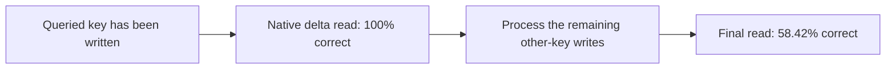

# A correct write can become a wrong answer later

The query is the key whose value we want. The **queried write** is the event assigning that key a value. These are distinct: this reader answers after processing the history.

Our 32-key histories assign each key once. Other keys written afterward cannot change the correct answer. They can change delta's shared matrix.

## The mathematics

With state S, unit write key k, value v and write strength beta:

\[
S'=S+\beta k(v-S^{\mathsf T}k)^{\mathsf T}.
\]

For a fixed query q, its read changes by:

\[
\Delta r=\beta(q^{\mathsf T}k)(v-S^{\mathsf T}k).
\]

The classifier has logits `z=W*r+b`, so `delta_z=W*delta_r`. Another key's correction can move the requested answer across a class boundary. Orthogonal query/write keys give zero cross-change; a zero correction residual also gives zero change.

This is a local derivation from the [DeltaNet correction rule](https://arxiv.org/html/2406.06484v2), section 2.2. Our reader uses one learned scalar beta; the paper also describes input-dependent strength. The equations do not guarantee every write is harmful.

## What the trace shows

All 479 native final errors had a correct prediction immediately after their queried write. This establishes subsequent-write damage to classification in these examples. It does not prove that the association was erased from every possible readout.

Moving the queried write last restores 100% here. The reordering uses the known query, bypasses later interference, and does not demonstrate simultaneous retention for every possible query in one unchanged final state.

The no-recency softmax reader keeps all event K/V. Reordering fixed pairs leaves its normalized sums unchanged, following [attention's weighted-sum definition](https://arxiv.org/html/1706.03762v7), section 3.2.1. This control applies to this reader, not every contextual Transformer.

[Results and methods](query-write-order-results.md).
