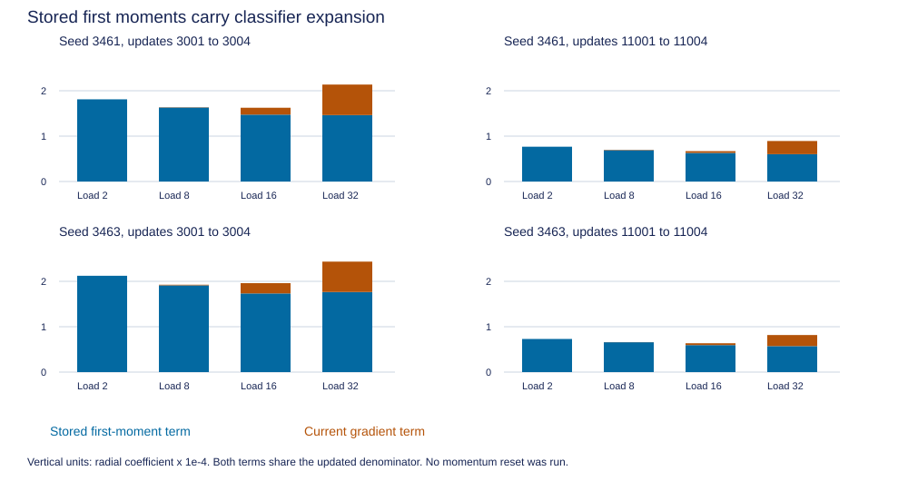

# Readout movement under Adam

Question: does local scale pressure translate into classifier expansion during the original optimizer calculations? [Frozen protocol](../../protocols/readout-adam-transport.md), [short educational guide](readout-adam-transport-guide.md).

## Finding

All 16 reconstructed steps have a positive radial component and increase the centered head norm. The stored first-moment term supplies the larger radial contribution in every step. At loads 8/16/32, the current raw gradient favors expansion in all twelve sampled steps; no resolved opposition appears in these selected cycles. This does not imply universal alignment between Adam and current gradients.

At late load 2, current pressure is numerically unresolved, yet the head norm rises 0.00767%/0.00730% in that step. The stored term accounts for approximately all of the radial movement. Signals from earlier batches can therefore move the head during a nearly fitted easy batch. We have not traced which earlier loads contributed what to the stored moment.

## Every reconstructed step

Radial coefficients below use units of 1e-4. Stored and current columns sum to Adam within the frozen tolerance. Norm change is the exact measured relative change, not the radial coefficient. Raw g is the native head-gradient projection.

| Seed | Update | Load | Raw g | Adam radial | Stored radial | Current radial | Norm change % |
|---|---:|---:|---:|---:|---:|---:|---:|
| 3461 | 3001 | 2 | -2.421e-09 | 1.811204 | 1.811204 | 0.000000 | 0.018113 |
| 3461 | 3002 | 8 | -1.067e-03 | 1.636929 | 1.630758 | 0.006171 | 0.016370 |
| 3461 | 3003 | 16 | -2.626e-02 | 1.625456 | 1.473848 | 0.151608 | 0.016255 |
| 3461 | 3004 | 32 | -1.034e-01 | 2.136463 | 1.463411 | 0.673053 | 0.021365 |
| 3461 | 11001 | 2 | -9.859e-56 | 0.766775 | 0.766775 | 0.000000 | 0.007670 |
| 3461 | 11002 | 8 | -5.143e-04 | 0.699215 | 0.690824 | 0.008391 | 0.006994 |
| 3461 | 11003 | 16 | -3.208e-03 | 0.669237 | 0.629895 | 0.039342 | 0.006694 |
| 3461 | 11004 | 32 | -2.613e-02 | 0.892758 | 0.602300 | 0.290458 | 0.008930 |
| 3463 | 3001 | 2 | -1.134e-10 | 2.122610 | 2.122610 | 0.000000 | 0.021228 |
| 3463 | 3002 | 8 | -1.298e-03 | 1.925038 | 1.911376 | 0.013662 | 0.019252 |
| 3463 | 3003 | 16 | -2.187e-02 | 1.960274 | 1.733426 | 0.226848 | 0.019604 |
| 3463 | 3004 | 32 | -8.536e-02 | 2.434535 | 1.764780 | 0.669755 | 0.024347 |
| 3463 | 11001 | 2 | -1.122e-54 | 0.730048 | 0.730048 | 0.000000 | 0.007303 |
| 3463 | 11002 | 8 | -3.719e-04 | 0.660553 | 0.657725 | 0.002827 | 0.006607 |
| 3463 | 11003 | 16 | -4.743e-03 | 0.635823 | 0.595011 | 0.040812 | 0.006360 |
| 3463 | 11004 | 32 | -2.931e-02 | 0.816922 | 0.572790 | 0.244132 | 0.008172 |

Very small current terms round to zero in this table; all raw values and scalar-SGD reference coefficients remain in the report/CSV. Late load-2 radial gradients are below the frozen 1e-10 interpretation threshold. Saturated native autograd and the stable score-gap formula agree within absolute tolerance; relative precision of these tiny derivatives is not established.

## Load 32 still contains opposing errors

| Seed | Update | Correct / errors | Correct contribution to g | Error contribution to g | Net g | Stored radial share % |
|---|---:|---:|---:|---:|---:|---:|
| 3461 | 3004 | 1948 / 100 | -0.148460 | +0.045024 | -0.103435 | 68.50 |
| 3461 | 11004 | 2031 / 17 | -0.037347 | +0.011215 | -0.026131 | 67.47 |
| 3463 | 3004 | 1954 / 94 | -0.128857 | +0.043492 | -0.085365 | 72.49 |
| 3463 | 11004 | 2022 / 26 | -0.038435 | +0.009121 | -0.029314 | 70.12 |

Correct-answer pressure outweighs error pressure in these four minibatches too. Stored radial shares are algebraic portions of the measured step using a common updated denominator, not causal percentages of historical training. The current term also uses accumulated second moments. No momentum reset was tested.

The head changes direction as well as amplitude. Perpendicular step norms relative to head norm range 9.707e-05 to 2.200e-04; in some late steps this component is larger than the radial one. Expansion alone does not describe the complete head, memory update or answer change.

## Fidelity and scope

Starts: saved steps 3000 and 11000, both seeds. Replayed the next four original updates from each start: 16 optimizer calls, 1024 sampled histories, 32768 input events and 14848 answer targets. All model parameters update on private copies to preserve the original sequence. No run is extended and no new training-budget update is added. CPU float64, batch 64 histories, exhaustive m queries per history. Full minibatch CE/accuracy and all/unique/repeat correct/error derivatives are retained in the report; these are not new full-pool fit evaluations or held-out comparisons.

Restored model, optimizer and both archived RNG states; consumed even the unused query draws. Original beta gradients, alpha/beta values and moments match all 16 historical log entries tensor-exactly. The historical log did not record individual head steps. Their fidelity is supported by saved full states/streams, the executed original source, native replay and independent reconstruction, rather than a direct archived head-step measurement.

Independent audit rebuilds streams from seed origins, verifies labels/query order and cross-step continuity, and checks every parameter gradient using matrix recurrence with manual log-partition loss. Scalar Adam equations verify 9840 parameter coordinates and both moments. Maximum gradient error 2.867e-15; logit error 5.684e-14; Adam/state error 1.776e-15. All 160 locked files remain unchanged. Three preflight methods pass, including initialized saved paths, warmed resume matched exactly to an uninterrupted cycle, supplied missing groups, synthetic moment agreement/opposition, and deliberate wrong RNG, moments, updates, labels, signs and beta logs.

- [Every step, minibatch metrics and projections](../../../results/readout_adam_transport/report.json), [16-row projection CSV](../../../results/readout_adam_transport/metrics.csv), [independent audit](../../../results/readout_adam_transport/audit.json), [preflight](../../../results/readout_adam_transport_preflight.json). Tensor traces stay local alongside these small artifacts.

Sources inspected: [Kingma and Ba, Algorithm 1](https://arxiv.org/pdf/1412.6980) and [PyTorch 2.11 Adam](https://docs.pytorch.org/docs/2.11/generated/torch.optim.Adam.html), moment equations, bias correction and update options. Installed torch 2.11.0+cu128 single-tensor source was checked for lerp, denominator and addcdiv. Projection, norm identity and numerator splitting are local derivations; these measurements are not paper predictions.

## What is now explained, and what remains

| Evidence | Supported conclusion | Remaining boundary |
|---|---|---|
| Full-pool scale gradients at ten snapshots | The training objective locally favors sharper correct answers | Not every wrong answer opposes expansion |
| These 16 native Adam reconstructions | Stored first moments carry expansion through the selected cycles | Not a full historical attribution or a moment-reset repair |
| Earlier fixed-memory scale control | Softer final scores substantially reduce high-load held-out CE | Every wrong answer remains wrong |

These results provide a bounded account of objective pressure, optimizer transport and the final confidence effect. We can stop extending the amplification branch. Remaining accuracy failures require a different question: can the unchanged classifier decode the queried key's own writes when competing-key writes are removed? A separately frozen target-only-history diagnostic can check whether a clean read is usable. It changes the input distribution and uses task knowledge, so recovery would establish sufficiency under that intervention, not a learned repair or a unique training cause. No automatic continuation, momentum reset, architecture change or temperature sweep; RL stays parked.
