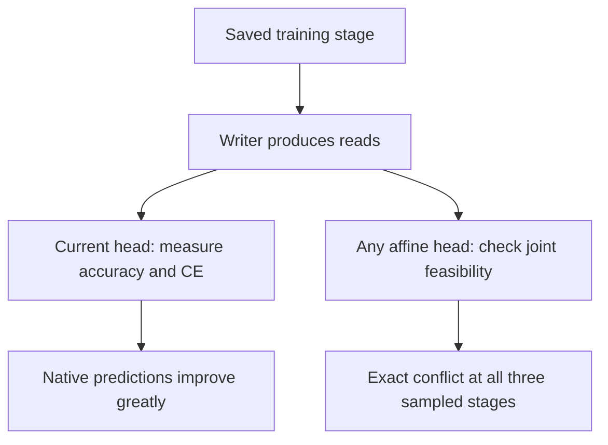

# Better predictions can coexist with a decoding conflict

The joint affine conflict is **already present before training** in both tested initializations. Training makes the native answers much better, but does not remove that conflict at steps 3000 or 12000.

[Measured stages](readout-conflict-stages-results.md) | [Frozen protocol](../../protocols/readout-conflict-training-stages.md) | [Certificate explanation](shared-readout-recovery-guide.md)

## Two different measurements

| Measurement | What it asks |
|---|---|
| Native accuracy | How many answers does the current model get right? |
| Affine feasibility | Could any one affine head answer every training read correctly with this writer fixed? |

The current head uses $z=Wr+b$. Feasibility varies W and b while holding every read r fixed. One conflicting set of comparisons can rule out perfection even when the native head answers almost everything correctly. Infeasibility therefore does not measure how many errors must remain.

Training changes keys, value vectors, beta and the head together. It can improve many reads and decision boundaries without making every required comparison compatible. The measurements establish that this happened; they do not isolate which parameter caused each improvement.

## What the chronology changes

The existence of conflict was not first created by optimization in these runs. The next learning question is why optimization fails to eliminate it completely. We have not shown that the same conflicting queries persist: certificates are not unique, and each stage can have different geometry.

Only three stages were inspected. Feasibility could differ between them. Nor do the certificates establish lost information, a nonlinear-head benefit, a load-32-only limit or an architectural impossibility. The labels remain independently checked against the events; the certified conflict concerns the learned read vectors.

Sources inspected: [Yang et al. section 2.2](https://arxiv.org/html/2406.06484v2#S2.SS2), write/read equations; [Boyd and Vandenberghe slides 5.33-5.35](https://stanford.edu/~boyd/cvxbook/bv_cvxslides.pdf), exact alternatives. The chronology and interpretation are local findings, not predictions from those sources.
