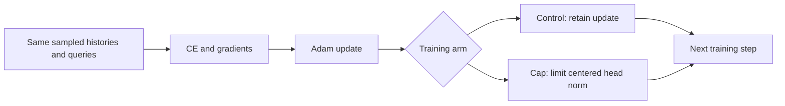

# Classifier confidence versus learning better reads

The memory produces a read vector r. The classifier gives six scores, z=Wr+b. Accuracy asks which score wins. Cross-entropy (CE) asks how much probability the correct class receives. Increasing score differences can lower CE for correct answers without changing their winners.

Earlier diagnostics measured classifier growth and a local incentive to expand it. That does not prove expansion causes retrieval errors. This [matched training test](readout-norm-cap-training-results.md) asks whether preventing further growth changes how the model learns.

## The constraint

Combine weights and bias into A=[W,b]. Subtract the mean class row to obtain C. The removed row contributes the same scalar to every score and cannot affect softmax or the winning class. Fix R to the starting norm of C. After each ordinary Adam update:

$$C=A-\operatorname{mean}_{class}(A),\quad s=\min(1,R/\|C\|_F),\quad A'=\operatorname{mean}_{class}(A)+sC.$$

When the norm exceeds R, scale the centered part back to R. Contraction is allowed. The classifier's direction and common component can change. Keys, values and beta still learn. Adam moments stay untouched by projection.

## Why this can affect learning

At that instant, projection gives z'=mean(z)+s*(z-mean(z)). Positive s preserves the winner, but changes softmax probabilities p. The CE derivative with respect to a read is

$$\nabla_r CE=W^T(p-e_y),$$

where e_y is the true-class indicator. Scaling changes both W and p. The next memory gradient can change, and later answers can diverge. This is a training intervention, not a frozen-model confidence adjustment. There is no guarantee that memory feedback becomes better or larger.

## What it can distinguish

A fitting benefit would support an effect of limiting head growth within this particular training window. Lower held-out CE without better training accuracy would support a narrower confidence-loss benefit. Harm would show a cost of the constraint. None alone identifies a unique full-history cause.

The norm depends on read coordinates. Growing value embeddings can compensate for a capped classifier, so we also measure value norm, beta and centered-logit RMS. Fresh seeds, reliable complete maps and longer-input transfer remain separate requirements for adopting a repair.

Both arms start from the same saved model, Adam states and streams. The control must exactly reproduce the historical endpoint. The radius comes from starting weights, with no sweep or held-out fitting. See [protocol](../../protocols/readout-norm-cap-training.md) for the frozen budget and gates.

Sources inspected: [Guo et al. (2017), section 4.2/equation 9](https://proceedings.mlr.press/v70/guo17a/guo17a.pdf) for positive scaling and invariant argmax; [PyTorch 2.11 Adam](https://docs.pytorch.org/docs/2.11/generated/torch.optim.Adam.html) for moment updates; [Yang et al. (2024), section 2.2](https://arxiv.org/html/2406.06484v2) for the reader's delta rule. Projection, centering and the gradient interpretation are local derivations. The constraint is not their post-hoc temperature calibration or a full DeltaNet experiment.
