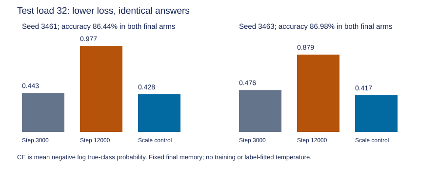

# Fixed-memory readout-scale results

Question: can the earlier classifier scale remove continued-training CE deterioration without changing final memory or answers? This is an intervention on two reused development seeds and opened pools, not fresh confirmation. Zero training updates. See the [short guide](readout-scale-control-guide.md) and [frozen protocol](../../protocols/readout-scale-control.md).

## Scale and scope

| Seed | Earlier centered head norm | Final norm | Scale s | Temperature 1/s |
|---|---:|---:|---:|---:|
| 3461 | 7.9432 | 23.6138 | 0.3364 | 2.9729 |
| 3463 | 9.2939 | 25.4748 | 0.3648 | 2.7410 |

Only the centered classifier weights and bias changed. Final keys, values and beta remain tensor-exact. Scale values were saved before controlled evaluation and use no labels. Both scales soften probabilities. All 24 full train/validation/test pools at loads 2/8/16/32 were evaluated: 155904 answers. Loads vary association count within the existing task; this is not a new beyond-training-length test. Every predicted class, accuracy and complete-map count is unchanged.

## Every pool

| Seed | Pool | Accuracy % | CE at 3000 | CE at 12000 | Controlled CE |
|---|---|---:|---:|---:|---:|
| 3461 | train_2 | 100.0000 | 0.000000 | 0.000000 | 0.000000 |
| 3461 | train_8 | 100.0000 | 0.000219 | 0.000243 | 0.001870 |
| 3461 | train_16 | 100.0000 | 0.012200 | 0.001477 | 0.012270 |
| 3461 | train_32 | 98.9990 | 0.192271 | 0.040355 | 0.105339 |
| 3461 | validation_2 | 100.0000 | 0.000000 | 0.000000 | 0.000000 |
| 3461 | validation_8 | 100.0000 | 0.008444 | 0.000000 | 0.000352 |
| 3461 | validation_16 | 99.2188 | 0.066393 | 0.106788 | 0.046678 |
| 3461 | validation_32 | 87.8906 | 0.387669 | 0.869806 | 0.394008 |
| 3461 | test_2 | 100.0000 | 0.000000 | 0.000000 | 0.000000 |
| 3461 | test_8 | 99.6094 | 0.001377 | 0.009747 | 0.004784 |
| 3461 | test_16 | 98.7956 | 0.079755 | 0.106051 | 0.047700 |
| 3461 | test_32 | 86.4421 | 0.442601 | 0.976972 | 0.428350 |
| 3463 | train_2 | 100.0000 | 0.000000 | 0.000000 | 0.000000 |
| 3463 | train_8 | 100.0000 | 0.000181 | 0.000051 | 0.000889 |
| 3463 | train_16 | 100.0000 | 0.009972 | 0.001608 | 0.012142 |
| 3463 | train_32 | 98.5636 | 0.175781 | 0.049351 | 0.108911 |
| 3463 | validation_2 | 100.0000 | 0.000000 | 0.000000 | 0.000000 |
| 3463 | validation_8 | 100.0000 | 0.012211 | 0.000007 | 0.000393 |
| 3463 | validation_16 | 98.4375 | 0.059291 | 0.116651 | 0.053818 |
| 3463 | validation_32 | 86.7350 | 0.428989 | 0.890054 | 0.421086 |
| 3463 | test_2 | 100.0000 | 0.000000 | 0.000000 | 0.000000 |
| 3463 | test_8 | 100.0000 | 0.000273 | 0.001073 | 0.001390 |
| 3463 | test_16 | 97.1680 | 0.100343 | 0.248475 | 0.106943 |
| 3463 | test_32 | 86.9792 | 0.476152 | 0.879149 | 0.417074 |

CE below 0.0000005 rounds to 0.000000 in this table. Full precision and all/unique/repeat groups remain in the JSON and CSV. Earlier scores are a historical reference; the controlled comparison uses final representations throughout.

At test load 32, the control removes 102.67%/114.66% of the old-to-final CE excess. Above 100% means controlled CE is slightly below the earlier CE, not that more than all of a causal effect was explained. Validation-32 recovery is 98.69%/101.71%. These ratios use the earlier positive loss excess as their denominator and are unstable for tiny excesses.

## Where the loss reduction occurs

The historical cohorts stay fixed. Positive contribution means lower CE under the control; negative means a cost. Contributions divide by the full test-32 answer count, not the cohort count.

| Seed | Historical cohort | Answers | Final CE | Control CE | Whole-pool CE reduction |
|---|---|---:|---:|---:|---:|
| 3461 | correct_both | 9735 | 0.0130 | 0.0525 | -0.031266 |
| 3461 | wrong_both | 848 | 8.8812 | 3.3271 | +0.383292 |
| 3461 | rescued | 887 | 0.0533 | 0.1870 | -0.009651 |
| 3461 | newly_wrong | 818 | 5.2562 | 2.1579 | +0.206248 |
| 3463 | correct_both | 9806 | 0.0127 | 0.0508 | -0.030343 |
| 3463 | wrong_both | 924 | 8.2863 | 3.3517 | +0.371054 |
| 3463 | rescued | 882 | 0.0673 | 0.2051 | -0.009891 |
| 3463 | newly_wrong | 676 | 4.3819 | 1.9960 | +0.131255 |

Persistent-error winning confidence falls from 89.16%/88.30% to 70.87%/70.89%; true-class probability rises from 4.58%/5.15% to 11.67%/11.89%. They remain wrong. Correct-at-both test answers incur higher CE. Even some wrong answers worsen: 12/848 and 16/924 persistent test errors, plus 27/818 and 22/676 newly wrong answers.

Costs remain visible: train-32 CE rises 0.040355 -> 0.105339 and 0.049351 -> 0.108911. Both train-8/16 and validation-8 pools worsen too; seed 3463 test-8 worsens. This is not a universal loss improvement or an accuracy repair.

## Methods and verification

Actual controlled-model forwards and independent matrix-equation reloads cover all 24 pools. Original endpoint forward audits are reused by bound hashes. Labels and repeat groups are independently rebuilt. The auditor checks head norms, unchanged non-head tensors, every winner/map, scalar CE/probability reductions and cohort sums. Maximum matrix-logit error 3.553e-14; maximum scalar metric error 8.527e-13, within 1e-9. All 141 locked files remain unchanged. Three preflight methods pass; they exercise initialized saved models, supplied logits, missing groups, ties and deliberate wrong labels/scales/heads/memory/metrics. No gradients are measured.

The first audit failed on one near-zero loss-increase count. Float64 subtraction crossed the frozen 1e-12 boundary; 60-digit arithmetic, checked against 90 digits, placed it below. Raw seed 3463 test-8 correct_both loss-increased count 2244 becomes 2243 in both all/repeat summaries. Raw scores/report/CSV/sources remain preserved. The separately tested [recovery protocol](../../protocols/readout-scale-threshold-recovery.md), [correction overlay](../../../results/readout_scale_control/threshold-corrections.json) and audit document the effective counts. No scale, CE mean, prediction, threshold or scientific criterion changed.

- [Raw report](../../../results/readout_scale_control/report.json), [all cohort metrics](../../../results/readout_scale_control/metrics.csv), [scales saved before evaluation](../../../results/readout_scale_control/scales.json), [recovered independent audit](../../../results/readout_scale_control/audit.json), [original preflight](../../../results/readout_scale_control_preflight.json), [recovery preflight](../../../results/readout_scale_control/recovery_preflight.json).

## What this establishes

At fixed final memory and readout direction, reducing the declared head scale substantially reduces held-out high-load loss. This is direct intervention evidence about final prediction sharpness. It does not prove that head growth historically caused all deterioration, explain rank changes between checkpoints, demonstrate calibration, restore retrieval or remove the failed training-fit gates. Scaling depends on the chosen parameter coordinates; two seeds do not establish a general architecture finding.

Next proposed discriminator: measure whether correct training answers drive head-scale expansion while incorrect answers oppose it, using signed radial CE derivatives at saved weights. Raw objective pressure must remain separate from Adam momentum and historical update causality. No further intervention or training follows automatically; RL stays parked.

Source inspected: [Guo et al. 2017, section 4.2, equation 9](https://proceedings.mlr.press/v70/guo17a/guo17a.pdf), positive-temperature softmax and unchanged argmax. The paper fits validation temperature; this study uses one weight-derived scale. Centering, norm matching, cohort accounting and all scores are local, not published predictions.
