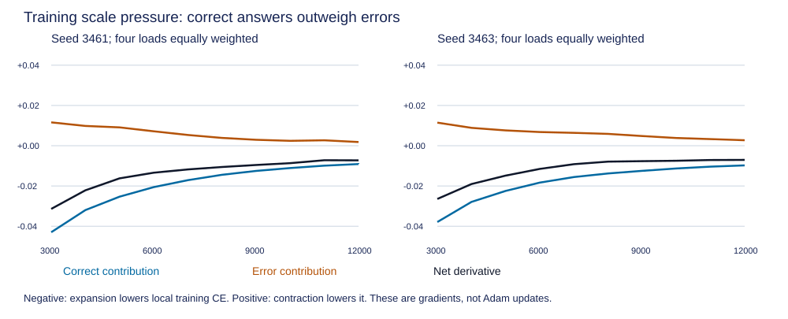

# Training pressure on readout scale

Question: do correct training answers favor classifier expansion strongly enough to outweigh errors, along the saved continuation? [Frozen protocol](../../protocols/readout-scale-pressure.md), [educational guide](readout-scale-pressure-guide.md). This is a training-objective diagnostic on two reused seeds, with zero optimizer updates.

## Finding

All 20 equal-load objective means favor expansion. At load 32, correct-answer contributions outweigh positive error contributions at all ten snapshots in both seeds. The centered head norm increases at every saved snapshot. This identifies a local objective incentive consistent with observed growth; it does not establish what caused each Adam update or why memory learned the remaining errors.

Negative derivative means increasing log scale locally lowers CE. Positive means reducing it locally lowers CE. Contributions use the original answer frequencies; the four loads receive equal weight, matching the cycling recipe.

| Seed | Step | Head norm | Correct contribution | Error contribution | Net derivative |
|---|---:|---:|---:|---:|---:|
| 3461 | 3000 | 7.9432 | -0.042981 | +0.011597 | -0.031384 |
| 3461 | 4000 | 9.4413 | -0.031980 | +0.009826 | -0.022154 |
| 3461 | 5000 | 10.9313 | -0.025320 | +0.009107 | -0.016212 |
| 3461 | 6000 | 12.5180 | -0.020573 | +0.007166 | -0.013407 |
| 3461 | 7000 | 14.2743 | -0.017119 | +0.005339 | -0.011779 |
| 3461 | 8000 | 16.2217 | -0.014447 | +0.003875 | -0.010571 |
| 3461 | 9000 | 18.1644 | -0.012518 | +0.002947 | -0.009571 |
| 3461 | 10000 | 20.0740 | -0.011092 | +0.002431 | -0.008660 |
| 3461 | 11000 | 21.8914 | -0.009902 | +0.002693 | -0.007209 |
| 3461 | 12000 | 23.6138 | -0.009104 | +0.001834 | -0.007270 |
| 3463 | 3000 | 9.2939 | -0.037901 | +0.011459 | -0.026442 |
| 3463 | 4000 | 11.2077 | -0.027911 | +0.008873 | -0.019038 |
| 3463 | 5000 | 13.1321 | -0.022450 | +0.007607 | -0.014843 |
| 3463 | 6000 | 15.0712 | -0.018320 | +0.006802 | -0.011518 |
| 3463 | 7000 | 16.9577 | -0.015562 | +0.006393 | -0.009170 |
| 3463 | 8000 | 18.7334 | -0.013777 | +0.005877 | -0.007901 |
| 3463 | 9000 | 20.4883 | -0.012480 | +0.004809 | -0.007671 |
| 3463 | 10000 | 22.2366 | -0.011301 | +0.003827 | -0.007475 |
| 3463 | 11000 | 23.9156 | -0.010393 | +0.003288 | -0.007106 |
| 3463 | 12000 | 25.4748 | -0.009767 | +0.002722 | -0.007045 |

These are local derivatives at changing weights, not gradients integrated along a fixed trajectory. Net pressure weakens overall but is not strictly monotonic. Head norms use the centered augmented weights/bias definition from the earlier control.

## Fewer errors can lose the gradient balance

Load-32 endpoint rows below separate a conditional mean from its contribution to the full 24576-answer training pool.

| Seed | Step | Correct / errors | Correct mean g | Error mean g | Correct contribution | Error contribution | Net g |
|---|---:|---:|---:|---:|---:|---:|---:|
| 3461 | 3000 | 23212 / 1364 | -0.151392 | +0.836922 | -0.142989 | +0.046450 | -0.096539 |
| 3461 | 12000 | 24330 / 246 | -0.032273 | +0.732719 | -0.031950 | +0.007334 | -0.024616 |
| 3463 | 3000 | 23329 / 1247 | -0.132634 | +0.903619 | -0.125904 | +0.045850 | -0.080054 |
| 3463 | 12000 | 24223 / 353 | -0.035222 | +0.757964 | -0.034717 | +0.010887 | -0.023829 |

At step 12000, errors favor contraction much more strongly per answer. They are only 246/24576 and 353/24576 answers, so their weighted contribution does not cancel the correct-answer expansion pressure. The earlier failed 99% fitting gates remain failed.

## Lower loads and exceptions

| Seed | Step | Load | Error answers | Error mean g | Net pool g |
|---|---:|---:|---:|---:|---:|
| 3461 | 3000 | 2 | 0 | absent | -2.550e-09 |
| 3461 | 3000 | 8 | 0 | absent | -1.046e-03 |
| 3461 | 3000 | 16 | 4 | -0.193331 | -2.795e-02 |
| 3461 | 12000 | 2 | 0 | absent | -1.199e-60 |
| 3461 | 12000 | 8 | 0 | absent | -6.358e-04 |
| 3461 | 12000 | 16 | 0 | absent | -3.830e-03 |
| 3463 | 3000 | 2 | 0 | absent | -1.092e-10 |
| 3463 | 3000 | 8 | 0 | absent | -9.211e-04 |
| 3463 | 3000 | 16 | 1 | -0.166130 | -2.479e-02 |
| 3463 | 12000 | 2 | 0 | absent | -1.232e-51 |
| 3463 | 12000 | 8 | 0 | absent | -2.079e-04 |
| 3463 | 12000 | 16 | 0 | absent | -4.144e-03 |

The four/one load-16 errors at step 3000 favor expansion too. This contradicts a universal claim that wrong answers push scale down. Load 8 is fully correct throughout all snapshots. Load 2 is also fully correct; its late derivatives are below the frozen 1e-10 interpretation threshold. Saved tiny values are preserved, not called zero gradients or convergence. Null absent groups are not measured zero-pressure partitions.

## Methods, sources and limits

Selected all ten saved steps 3000 through 12000, both seeds and full training loads 2/8/16/32: 80 cells and 890880 repeated training-answer evaluations. Stable probability-weighted score gaps give per-answer derivatives. Whole-pool scalar autograd and two central differences check the direction. Native saved-model forwards project W/b CE gradients onto the centered head, with all memory parameters frozen. Correct/error membership is fixed separately at each snapshot; cohorts are not the historical transition partitions from the loss-decomposition study.

Independent audit rebuilds labels/repeats, scalar CE/probabilities/derivatives, exact partitions and equal-load sums. Matrix recurrence plus manual log-partition loss verifies all 80 full-pool head-gradient projections. Maximum scalar/gradient disagreement 6.624e-15; matrix-logit disagreement 8.527e-14. All 151 locked files remain unchanged. Three preflight methods pass, including initialized saved reloads, absent groups/ties, both wrong-answer signs, offset invariance and deliberate sign/count/label/gradient/logit corruption. No near-zero derivative sign counts are used; the previous rounding-sensitive loss-count defect and its overlay remain preserved.

- [Full report: every seed, step, load and all/unique/repeat group](../../../results/readout_scale_pressure/report.json), [480 partition rows](../../../results/readout_scale_pressure/metrics.csv), [independent audit](../../../results/readout_scale_pressure/audit.json), [preflight](../../../results/readout_scale_pressure_preflight.json).

Source inspection: [PyTorch 2.11 CrossEntropyLoss](https://docs.pytorch.org/docs/2.11/generated/torch.nn.CrossEntropyLoss.html), class-index CE and mean reduction; [Guo et al. 2017, section 4.2, equation 9](https://proceedings.mlr.press/v70/guo17a/guo17a.pdf), positive scaling and invariant argmax. Our radial derivative and partition weighting are local algebra. No source predicts these measurements or a calibration score.

We now have evidence that the training objective locally rewards expansion at these saved weights, plus the earlier intervention showing that softening the final head helps held-out high-load loss. This still leaves actual optimizer transport, changed representations and accuracy failures unresolved. These snapshots do not measure Adam updates, prove historical causality, identify a unique repair or reopen training budgets.

Next proposed discriminator: replay the original four-load cycles at updates 3001 to 3004 and 11001 to 11004 for both seeds. Use archived streams and moments to compare raw head-gradient pressure with the reconstructed Adam step's radial component. These 16 original-budget updates need a separate frozen diagnostic; no post-budget update or repair follows automatically. RL remains parked.
