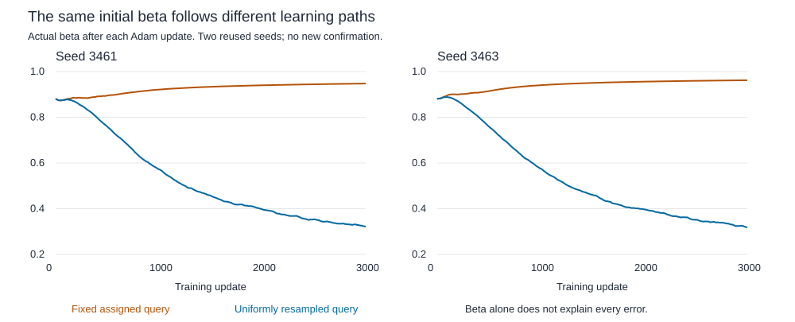

# Retention learning reproduction

The four original training runs were reproduced with passive measurements. Every final model tensor, Adam tensor, stream hash, exposure count, logged loss and full training/validation metric matches its historical counterpart exactly. This adds observations to the same two seeds; it is not fresh confirmation or a training repair.

## Method

Seeds 3461/3463, fixed/resampled queries, 615-parameter standalone delta reader, Adam .003, batch 64, 3000 updates per run. CPU float64, one thread. Total 12000 updates, 768000 sampled histories and 24576000 input events. CUDA was unused; GPU memory peaks are not applicable. No new data, test access, schedule, replacement seed or extra update.

Record beta, alpha's minibatch gradient and every Adam step. At seven fixed steps, inspect both full training objectives across four loads. Primary count: 224 cells and 1333248 target scores. Probe recomputation adds compute, not supervised training exposure. [Protocol](../../protocols/retention-learning-replay.md) | [Short learning guide](retention-learning-replay-guide.md).

## What appeared during learning

Both objectives agree on beta's direction at initialization in both seeds. Fixed-query conflict appears earlier than resampled conflict in every measured pair. A greater-than-.01 beta gap is first measured at step 300 in both seeds. Seed 3463 has fixed-objective conflict at the step-100 observation, before that gap threshold. Seed 3461 first shows both at step 300, so their ordering is unresolved on this grid. Smaller beta differences exist earlier; the threshold does not define the start of any divergence.

| Seed | Arm | Initial beta | Final beta | First measured pooled conflict | Adam steps against current gradient |
|---|---|---|---|---|---|
| 3461 | Fixed | 0.880797 | 0.947571 | 300 | 610 / 3000 |
| 3461 | Resampled | 0.880797 | 0.322355 | 2000 | 1690 / 3000 |
| 3463 | Fixed | 0.880797 | 0.962037 | 100 | 287 / 3000 |
| 3463 | Resampled | 0.880797 | 0.318702 | 3000 | 1667 / 3000 |

Conflict means opposite resolved pooled alpha gradients, using the predeclared 1e-7 cutoff. Both objectives favor lower beta at initialization. Later signs change as all parameters learn. Conflict is not an invariant property of these losses. A first measured occurrence is not necessarily the exact onset or the first transient occurrence.

Adam step counts use measured gradient and alpha change, excluding gradients <=1e-7 or changes <=1e-12 in magnitude. Their signs disagree with plain gradient descent when the product is positive. Counts are optimizer events, not independent experiments or failure rates.

| Seed | Arm | Load 2 | Load 8 | Load 16 | Load 32 |
|---|---|---|---|---|---|
| 3461 | Fixed | 30 | 80 | 449 | 51 |
| 3461 | Resampled | 547 | 647 | 399 | 97 |
| 3463 | Fixed | 25 | 12 | 212 | 38 |
| 3463 | Resampled | 534 | 645 | 414 | 74 |

Each load has 750 updates per run. Current-gradient disagreements concentrate at lower loads in the resampled runs. Adam carries its first moment between these alternating loads. That explains the immediate update sign mathematically; it does not isolate why training chose its eventual solution or establish that removing momentum would repair retention.

## Evidence and remaining failure

Full training/validation endpoint scores are unchanged from [query coverage](delta-query-coverage-results.md). Fixed training still fits its assigned queries, while many other reads fail. Resampled load-32 all-query training accuracy remains 89.75%/90.03%, below the original fit gate. Reproduction does not improve those results or reopen confirmation. No test pool was produced by that failed development study.

The earlier [beta swaps](beta-swap-results.md) establish inference effects under fixed weights. This trace adds learning chronology and actual optimizer arithmetic. Together, they support pursuing an objective-dependent write-strength explanation. They still do not isolate beta from jointly learned key geometry, values and output decoding, or explain every remaining error.

## Verification and records

Preflight passed two reusable methods, including both actual training loops, initialized/intermediate checkpoint reloads, 48 independent objective cells, supplied logits, missing groups and deliberately wrong labels, metrics, updates and optimizer state. Formal independent audit status and numerical bounds are recorded in [audit.json](../../../results/retention_learning_replay/audit.json). The auditor checks every recorded scalar Adam update, every saved objective cell and all 64 final training/validation cells. It uses independent matrix equations, beta tangents, two finite-difference spacings and scalar Adam reconstruction. Data, weights and PyTorch remain shared; this is implementation independence, not a second ML framework.

Audit passed. Maximum absolute errors: Adam reconstruction 4.45e-16, logits 1.43e-14, parameter gradients 1.81e-16, alpha finite differences 4.76e-10. All 41 frozen dependencies/artifacts remain unchanged. Four instrumented runs took 172.97 seconds in this single execution, excluding preflight and independent audit. This is elapsed execution time, not a performance benchmark.

- [Every probe and pooled objective](../../../results/retention_learning_replay/snapshots.csv).
- [All per-load/group probe metrics, including missing groups](../../../results/retention_learning_replay/group_metrics.csv).
- [Every optimizer update](../../../results/retention_learning_replay/step_trace.csv).
- [Load and 1000-update interval breakdown](../../../results/retention_learning_replay/load_interval_updates.csv).
- [Four-run report and exact endpoint checks](../../../results/retention_learning_replay/report.json).

The gradient column in the group-metric CSV belongs to the entire load/objective cell, not an independently computed subgroup derivative.

The bounded reproduction ends here. Next useful question: does random one-query feedback produce unstable gradient directions compared with the exhaustive expected objective, especially at load 32? The saved intermediate checkpoints now permit that diagnostic without further training. It would quantify a candidate learning difficulty, not by itself establish a causal training failure. No such follow-up or repair ran in this reproduction. RL remains parked.

Sources inspected: [Yang et al. 2024, section 2.2](https://arxiv.org/html/2406.06484v2), correction/read rule and input-dependent beta; [PyTorch 2.11 Adam equations](https://docs.pytorch.org/docs/2.11/generated/torch.optim.Adam.html), moment-based bias-corrected steps. Local objective pooling, cutoffs and chronology are our definitions. Neither source predicts these paths or validates a broad Transformer conclusion.
