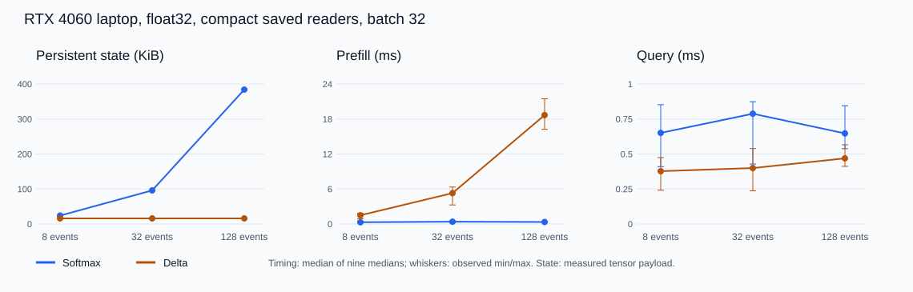

# Smaller state, faster reads, slower preparation

Executed 2026-10-04 on the RTX 4060 laptop. **Delta retains less state and reads queries faster in all 54 paired seed/process/shape cells. Its eager prefill is slower in all 54, and its complete training-step peak is higher.** These are resource measurements of compact readers. The parent quality/adoption gate remains false.

[Frozen protocol](../../protocols/retrieval-gpu-resources.md) | [Source](../../../experiments/retrieval_gpu_resources.py) | [Report](../../../results/retrieval_gpu_resources/report.json) | [Independent audit](../../../results/retrieval_gpu_resources/independent_audit.json) | [All seed/process timings](../../../results/retrieval_gpu_resources/timings.csv) | [All training profiles](../../../results/retrieval_gpu_resources/training_memory.csv).

## What each measurement means

**Prefill** processes the supplied event history. Softmax stores normalized K and embedded V. Delta updates a matrix once per event:

\[
S_t=S_{t-1}+\beta k_t(v_t-S_{t-1}^{\mathsf T}k_t)^{\mathsf T}.
\]

**Query** asks for one value after that work is finished. Softmax computes a weighted sum over the retained history. Delta reads `S^T q`. Query embedding and classifier are included; a new event write is not. This is not full language-model decoding.

**Persistent state** is what must survive between queries. Float32 uses four bytes per number. With key width 16 and value width 8:

\[
M_{softmax}=4Bn(16+8),\qquad M_{delta}=4B(16\times8).
\]

Delta's state is fixed for these widths; softmax's grows with events n. This implementation starts saving payload at n>=6. That threshold depends on the widths and excludes weights, input records and temporary buffers.

**Training peak** includes the forward computation, saved backward intermediates, gradients and first Adam-state creation. Keeping only the final matrix during inference does not make the autograd history disappear during training.

## Measured persistent storage

Bytes, identical across all seeds/processes.

| Events | Softmax, B=1 | Delta, B=1 | Softmax, B=32 | Delta, B=32 | Payload reduction |
|---|---:|---:|---:|---:|---:|
| 8 | 768 | 512 | 24,576 | 16,384 | 33.33% |
| 32 | 3,072 | 512 | 98,304 | 16,384 | 83.33% |
| 128 | 12,288 | 512 | 393,216 | 16,384 | 95.83% |

Measured retained CUDA allocations match these payloads except B=1,n=8 softmax: 1,024 allocated bytes for 768 payload bytes. Allocator rounding accounts for the distinction between logical storage and live allocation. Reserved allocator memory is a third quantity, not the state payload.

## Timings

Synchronized wall milliseconds. Each entry is the median of nine seed/process medians; each median uses ten repetitions. Per-case ranges and CUDA-event spans are retained in [summary data](../../../results/retrieval_gpu_resources/summary.json), with every sample in worker reports. These are descriptive results, not confidence intervals.

| Batch | Events | Softmax prefill | Delta prefill | Softmax query | Delta query |
|---|---:|---:|---:|---:|---:|
| 1 | 8 | 0.292 | 1.433 | 0.581 | 0.326 |
| 1 | 32 | 0.314 | 4.498 | 0.496 | 0.330 |
| 1 | 128 | 0.313 | 15.906 | 0.526 | 0.388 |
| 32 | 8 | 0.304 | 1.498 | 0.651 | 0.377 |
| 32 | 32 | 0.396 | 5.293 | 0.788 | 0.400 |
| 32 | 128 | 0.347 | 18.668 | 0.647 | 0.469 |

At B=32,n=128, the nine medians range from 0.268 to 0.450 ms for softmax prefill versus 16.232 to 21.466 ms for delta; query ranges are 0.538 to 0.845 versus 0.412 to 0.566 ms. Retain this variation when interpreting the headline values.

| Seed, B=32,n=128 | Softmax prefill | Delta prefill | Softmax query | Delta query |
|---|---:|---:|---:|---:|
| 3299 | 0.424 | 18.964 | 0.544 | 0.444 |
| 3301 | 0.294 | 18.668 | 0.647 | 0.466 |
| 3307 | 0.347 | 17.801 | 0.684 | 0.501 |

Seed rows are medians across the three processes. Delta prefill executes an eager Python recurrence; softmax prefill embeds events in parallel. The source therefore explains a concrete execution difference. These timings do not isolate kernel-launch cost or show that an optimized delta kernel would have the same ranking. Query is faster here, but one prefill plus one query is substantially slower for delta. A fixed matrix does not guarantee faster total inference.

## Complete-step memory

Batch 64, float32, one disposable update per profile. Absolute peaks are identical within each arm/length across all nine profiles. MiB = 2^20 bytes.

| Events | Softmax allocated peak, MiB | Delta allocated peak, MiB | Softmax reserved peak, MiB | Delta reserved peak, MiB |
|---|---:|---:|---:|---:|
| 8 | 65.208 | 65.520 | 66 | 66 |
| 32 | 65.806 | 66.803 | 66 | 68 |
| 128 | 68.197 | 72.194 | 70 | 74 |

The first training profile in each process adds 32 MiB more above its starting baseline than subsequent comparable profiles. Reversed arm order moves this effect to softmax in worker 1. Preserve it as initialization/order overhead; no allocator trace identifies its exact origin. Absolute peaks remain comparable here. Baselines include runtime allocations, so do not attribute the entire 65 to 72 MiB to model tensors.

Adam tensor-state payload is 1,880 bytes for softmax and 1,868 for delta, including scalar step counters; parameters are 928/924 bytes. The larger delta training peak is compatible with saved recurrence intermediates. We did not isolate each allocation or measure training throughput.

## Method, verification and limits

Six unchanged checkpoints, three fresh sequential processes on native Windows. PyTorch 2.11.0+cu128, CUDA 12.8, driver 617.14, float32, TF32 off, native allocator, deterministic operations. Shapes B=1/32,n=8/32/128. Three warmups and ten repetitions per prefill/query. Transfers, checkpoint loading and numerical checks are outside timings. CUDA-event spans include possible Python launch gaps. Three processes on one laptop/session are not three independent hardware experiments.

| Verification | Executed evidence |
|---|---|
| Actual GPU preflight | Three test methods; initialized output/parameter gradients, wrong equations/output/payload/alias controls, saved reload, timing and optimizer paths |
| Original pools across precisions | 20,736 predictions, zero argmax changes against original and float32-rounded independent float64 equations; maximum original-weight error 2.43e-5 |
| Resource fixtures | 108 cells, 1,782 predictions, independent matrix/exponential equations; zero argmax changes, maximum error 1.82e-5 |
| Resource accounting | 2,160 measured calls with wall/event samples; 54 complete-step profiles, optimizer counters and medians verified |
| Evidence preservation | All 126 targeted earlier files unchanged; original quality gate remains false |

The 54 profiling updates affect discarded copies. Preflight adds three disposable optimizer steps, not quality training. No saved weights change. The reference reuses parameters/data and PyTorch; it is independently written math, not an independent software stack.

Length 128 uses synthetic cost inputs beyond the quality-tested range. The original [quality study](delta-retrieval-results.md) finds reliable delta answers through 32 events, while compact softmax misses long reliability. This diagnostic does not restore comparability as an accuracy-preserving replacement. The [recency intervention](recency-ablation-results.md) remains a separate explanation, not a repaired reader.

The [DeltaNet paper, sections 2.2/3](https://arxiv.org/html/2406.06484v2) defines correction and develops chunkwise parallel execution. Our results support the local fixed-state distinction, but do not reproduce its optimized architecture or throughput. [PyTorch 2.11 CUDA semantics](https://docs.pytorch.org/docs/2.11/notes/cuda.html) supports the synchronization and allocated/reserved distinction.

Close this resource diagnostic. We now have measured storage, query, preparation and training-memory costs. Full models, optimized kernels, other precision/shape regimes and independent hardware sessions remain untested. No additional optimization or training is selected.
