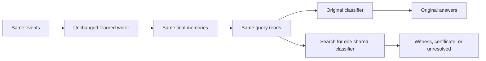

# Could a different classifier fix the same memories?

Keep the learned writer and its final memories fixed. Ask whether **one shared affine classifier per seed** could answer every existing training query correctly. Include loads 2/8/16/32 together, so correcting the largest load cannot sacrifice the smaller ones.

[Results](shared-readout-feasibility-results.md) | [Frozen protocol](../../protocols/shared-readout-feasibility.md)

## What changes?

| Diagnostic | Fixed | Allowed to change |
|---|---|---|
| Earlier [shared-state feasibility](shared-state-feasibility-results.md) | Queries and classifier | One supplied memory per history |
| This diagnostic | Queries, values, beta and actual final memories | One classifier shared across all histories and loads |

The earlier positive result does not answer this new question. Useful memories may exist even when the actual memories cannot all be decoded by one affine head.

## The mathematics

A read is $r=S^Tq$, with eight coordinates. Class $c$ receives score $z_c=w_c^Tr+b_c$. Set $\phi=[r,1]$ and $\theta_c=[w_c,b_c]$. Correct classification with positive margin requires

$$ (\theta_y-\theta_c)^T\phi\geq\gamma\quad\text{for every }c\ne y. $$

Maximize $\gamma$, capped at one. Subtracting the same affine score from every class leaves rankings unchanged, so fix $\theta_0=0$. That leaves 45 classifier coordinates plus the margin variable. Weights have no norm bound. This is a feasibility search, not CE training or a smallest-weight solution.

| Returned evidence | What it establishes |
|---|---|
| Independently verified positive gaps everywhere | A shared affine classifier exists for these stored reads. |
| Exact nonnegative certificate | The required score inequalities conflict. |
| Neither | The question remains numerically unresolved. |

For the certificate, write each score-gap coefficient as $a_i$. If nonnegative weights satisfy $\sum_i\lambda_i=1$ and $\sum_i\lambda_i a_i=0$, summing the required inequalities gives $0\geq\gamma$. This excludes a positive margin. Our additional tie check requires a supported comparison where the target has the larger class index; perfect first-index argmax would require that gap to be strictly positive too.

**A tiny residual is not an exact certificate.** With unrestricted classifier weights, a small coefficient error can be amplified. A solver's zero margin therefore does not prove impossibility. Likewise, an error status does not prove that no solution exists. Both occurred in this run.

The claim treats saved binary float64 reads as exact inputs. Even a positive witness would use training labels and would not establish generalization, a learned repair, or why the original joint training chose its parameters.

Sources inspected: [Boyd and Vandenberghe, slides 5.33-5.35](https://stanford.edu/~boyd/cvxbook/bv_cvxslides.pdf), feasibility alternatives and certificates; [SciPy HiGHS dual simplex documentation](https://docs.scipy.org/doc/scipy/reference/optimize.linprog-highs-ds.html), free bounds, marginal signs and solver statuses. The multiclass reduction above is our local derivation; these sources do not predict local scores.
