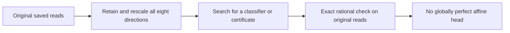

# Why changing the classifier cannot fix every saved read

The numerical recovery answers a narrow question: **with these reads fixed, no single affine head can correctly classify every existing training query across all four loads.** This holds for both saved seeds. It does not establish that every remaining error is unavoidable.

[Results and evidence](shared-readout-recovery-results.md) | [Frozen recovery protocol](../../protocols/shared-readout-numerical-recovery.md) | [Original classifier explanation](shared-readout-feasibility-guide.md)

## Why the solver needed help

Eight read coordinates do not necessarily carry eight independent directions. From zero memory, each delta write keeps every memory row within the span of the six value embeddings:

$$S_t=S_{t-1}+\beta k_t(v_t-S_{t-1}^Tk_t)^T.$$

Consequently, in exact arithmetic,

$$r_q=S_T^Tq=\sum_t a_{qt}v_t.$$

The coefficients depend on keys, beta and subsequent writes; they can have either sign. Six value vectors span at most six directions. Floating arithmetic leaves tiny departures from that span. Our measured reads have six strong directions and two near roundoff.

Simply deleting the tiny directions would change the original question. We instead retain all eight, rotate and rescale them, and calculate the transformation at high precision. This helps the search represent both large and tiny directions. It is numerical preprocessing, not extra information or a model improvement.

For row-vector reads, let $r'=(r-\mu)T$, where T is invertible. Then

$$r'u+b=r(Tu)+(b-\mu Tu).$$

Thus every affine head in the transformed coordinates has an affine counterpart in the original coordinates. Rounding can still affect the solver. We therefore accept proofs only on the original saved reads.

## What makes this a proof?

Each correct class must outrank every competitor. A certificate combines selected score-gap requirements with nonnegative weights. Its coefficients cancel **exactly**, so the combined gap is zero for every possible affine head. At least one supported requirement must be strictly positive for the correct target to beat a lower-index competitor. Those requirements cannot all hold.

This is stronger than a zero solver margin. The independent checker uses rational representations of the original binary floats and verifies every coefficient cancellation without a tolerance.

## What we learned, and what remains open

| Established | Still open |
|---|---|
| Changing only the affine head cannot make all four training pools perfect simultaneously. | How much accuracy another head could recover while preserving smaller-load successes. |
| The actual reads impose a joint classification conflict. | Whether nonlinear decoding helps, or whether information is lost. |
| Earlier supplied correct memories exist, but the actual reads fail this global-head test. | Why joint training chose these keys, values, beta and resulting memories. |

The certificate uses constraints from smaller loads too. It does not settle whether load 32 alone is separable. Nor does it give a minimum error count or prove that all 246/353 original errors must remain. The next learning question concerns how training produces these conflicting representations, not whether another affine boundary alone can make them all perfect.

Sources inspected: [Yang et al. section 2.2](https://arxiv.org/html/2406.06484v2#S2.SS2) for delta writes/reads; [NumPy SVD](https://numpy.org/doc/stable/reference/generated/numpy.linalg.svd.html) for coordinate decomposition; [Boyd and Vandenberghe slides 5.33-5.35](https://stanford.edu/~boyd/cvxbook/bv_cvxslides.pdf) for exact feasibility alternatives. The span argument, coordinate mapping and multiclass certificate are local derivations for our scalar-beta toy reader. These sources do not predict its measured behavior.
