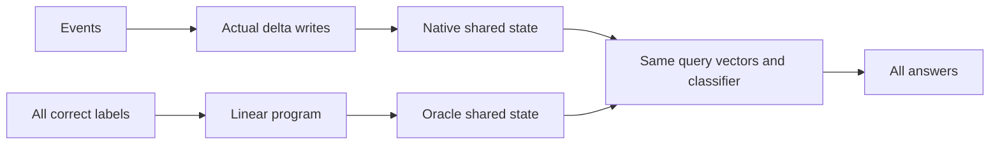

# Could one memory answer every key?

A clean association can be easy to read while a mixed history is hard to retain. Earlier filtering made a separate memory for each query. This diagnostic instead supplies **one shared memory per history**, with the saved keys and classifier unchanged.

[Measured results](shared-state-feasibility-results.md) | [Frozen protocol](../../protocols/shared-state-feasibility.md)

## Three different questions

| Question | Meaning |
|---|---|
| Is decoding possible? | Could some shared state give every correct answer at these weights? |
| Does writing succeed? | Does the actual delta recurrence produce a suitable state from the events? |
| Why did learning fail? | Why did joint training choose these keys, values, beta and classifier? |

The diagnostic answers the first question for the tested histories. A positive result narrows the second question. It does not settle the third.

Both states have 16-by-8 entries. The oracle knows every answer and bypasses writing. It is an explanatory bound, not a deployed model.

## What a margin means

The saved classifier reads $z=WS^Tq+b$. A correct class must score above every competitor:

$$z_y-z_c=(W_y-W_c)S^Tq+b_y-b_c\geq\gamma.$$

The margin is the score gap. For example, correct score 3 and competitor 2 give margin 1. Positive gaps make the correct class the unique winner. Zero permits ties; a negative gap means a competitor wins.

With queries and classifier fixed, the expression is linear in S. We search for a state meeting all 160 class inequalities together. The program maximizes a common margin, capped at 1. State entries are unrestricted in sign and size. A returned state with independently verified positive gaps is a witness, even without proving optimality.

| Outcome | Safe interpretation |
|---|---|
| Positive witness | A correct shared state exists at these fixed weights for that history. |
| Exact nonpositive dual certificate | Strict correctness is impossible there while those queries/classifier remain fixed. Ties remain a separate issue. |
| Neither | Numerically unresolved. A solver message is not proof. |

Because state entries are unbounded, tiny residuals in a dual identity are insufficient for an impossibility claim. The negative rule uses exact rational identities on stored binary floats. Positive states are checked with the actual Reader and separate high-precision scalar reads.

## What remains open

The state may be unreachable by the learned recurrence, require task labels, or be fragile. A solver-selected state is not necessarily the smallest state by norm. Its CE reflects artificial score gaps, so 100% oracle accuracy does not imply improved trained-model loss. A finite collection of feasible histories does not establish feasibility for every possible assignment.

Sources inspected: [Yang et al., section 2.2](https://arxiv.org/html/2406.06484v2#S2.SS2) for memory writes/reads; [Boyd and Vandenberghe, slides 5.33-5.35](https://stanford.edu/~boyd/cvxbook/bv_cvxslides.pdf) for certificates; [SciPy HiGHS](https://docs.scipy.org/doc/scipy/reference/optimize.linprog-highs.html) for free bounds and marginal signs. Our margin problem is a local derivation for this toy reader. The paper uses input-dependent write strength; ours has a shared scalar. None of these sources predicts our scores.
