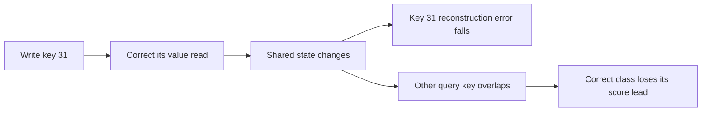

# A useful write can damage another answer

The previous diagnostic supplied one correct shared memory for every training history. This test asks whether the learned writer preserves those answers when the same history is replayed once.

[Measured results](shared-state-preservation-results.md) | [Frozen protocol](../../protocols/shared-state-preservation.md)

## What the writer improves

For the current key k and learned value v, define its reconstruction error:

$$E(S)=\tfrac12\|S^Tk-v\|^2,
\qquad \nabla_S E=k(S^Tk-v)^T.$$

The delta update is a gradient step on this local quantity:

$$S'=S-\beta\nabla_S E=S+\beta k(v-S^Tk)^T.$$

This is a local derivation. It does not mean model parameters were trained on squared error. Their outer objective is final-answer cross-entropy.

## Why another key changes

Every query reads the same state. Its change is

$$\Delta r(q)=\beta(q^Tk)(v-S^Tk),
\qquad \Delta z(q)=W\Delta r(q).$$

| Term | Meaning |
|---|---|
| $q^Tk$ | Coupling between the query and the written key. Orthogonal queries have zero change. |
| $v-S^Tk$ | Correction toward the written value vector. |
| W | Converts that correction into changes of class scores. |

The signs matter together. Overlap alone does not determine which answer is harmed. A correct class can lose its lead even while the written key's reconstruction error falls.

In the measured seed-3461 example, writing key 31 lowers its error from 110.22 to 76.66. Query key 0's true-versus-new-winner gap changes from +1.00 to -2.67. The unchanged classifier then gives the wrong answer.

## Why the written key was protected here

For the same normalized key as query, let $h=k^Tk$ and $r=S^Tk$. Then

$$r'=(1-\beta h)r+\beta h v.$$

When $0\leq\beta h\leq1$, this interpolates between the old read and the value. If both receive the correct class from a linear classifier, their mixture keeps that class. Both saved classifiers correctly label all six value embeddings. In the replay, zero correct-to-wrong transitions occur at the just-written key. All observed harms affect other keys.

## Preserve the distinction

Every supplied map becomes incomplete after the first write. Later writes restore many answers; final oracle accuracy is 99.67% / 99.44%, below the initial 100%. Those transient errors do not by themselves violate the original task, which grades the final memory.

Training supplies final-answer CE after the full prefill. Gradients still pass through every write; there is no explicit intermediate retention loss. This experiment measures state transitions, not those training gradients. It neither proves that an intermediate loss is needed nor that a different stable shared state is impossible.

Next: inspect error-correcting gradients through the actual cold-start write sequence, with a separate protocol. The question is whether repair signals weaken or cancel across event positions. No training objective changes yet.

Sources inspected: [Yang et al., section 2.2](https://arxiv.org/html/2406.06484v2#S2.SS2) for write/read equations; [Schlag et al. (2021)](https://proceedings.mlr.press/v139/schlag21a.html) for fast-weight delta-rule context. The squared-error and score-gap relations above are local derivations. [Our executed training source](../../../experiments/query_feedback_training.py) verifies final-state supervision. Our scalar-beta toy reader differs from the papers' complete models.
