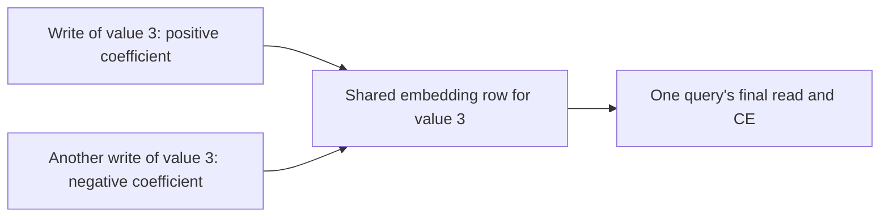

# Opposing writes for one answer

[Results](single-query-write-opposition-results.md) | [Frozen protocol](../../protocols/single-query-write-opposition.md)

Combining query losses can create disagreement. This check removes that ambiguity: inspect one query's feedback at a time.

## The effective read coefficient

With fixed keys and beta, the delta recurrence is linear in its value inputs. For our transposed-state convention,

$$r_q=\sum_t a_{q,t}v_t,\qquad
a_{q,t}=\beta q^TA_T\cdots A_{t+1}k_t,\quad A_t=I-\beta k_tk_t^T.$$

The last write has an empty matrix product. Earlier writes pass through all later update operators. The coefficient is their final influence on this query's read. It need not be positive or sum to one.

Let d_q be that query's CE gradient with respect to its read. Then

$$\frac{\partial L_q}{\partial v_t}=a_{q,t}d_q.$$

Two writes of the same value share one embedding row. If their coefficients have opposite signs, their gradients point in opposite directions even for this one query. Different value IDs occupy different rows and cannot cancel each other in that parameter block.

## A negative pair is not the whole sum

Define E as the sum of individual event-gradient squared norms. Define J as the squared norm after summing into shared value rows. W=J-E is the net temporal cross term. Negative W establishes net opposition. Having just one negative pair does not guarantee negative W.

Because each event gradient is a scalar times the same d_q,

$$W_q=\|d_q\|^2\left[
\sum_c\left(\sum_{t:\mathrm{value}(t)=c}a_{q,t}\right)^2-\sum_ta_{q,t}^2\right].$$

The bracket is routing geometry; the prefactor is loss-feedback scale. A confident correct answer can have opposing geometry and tiny weighted feedback. Tiny feedback is not proof of convergence.

## What is now resolved

Most wrong queries oppose individually. Mixing query losses partly offsets this opposition in every measured cohort. It does not create the negative aggregate here.

Opposite same-value coefficient signs also occur for every correct query. Thus signed routing is a measured mechanism, not a sufficient explanation of failure. Why training learns these coefficients, and whether changing them repairs fitting, remain open. Stop this decomposition chain here.

Source inspected: [Yang et al., sections 3.1/3.2](https://arxiv.org/html/2406.06484v2#S3.SS2), affine recurrence and unrolled contributions. The CE factorization and energy decomposition above are local derivations, checked against single-query autograd and an independent analytic audit. Our scalar-beta reader differs from the full paper architecture.
